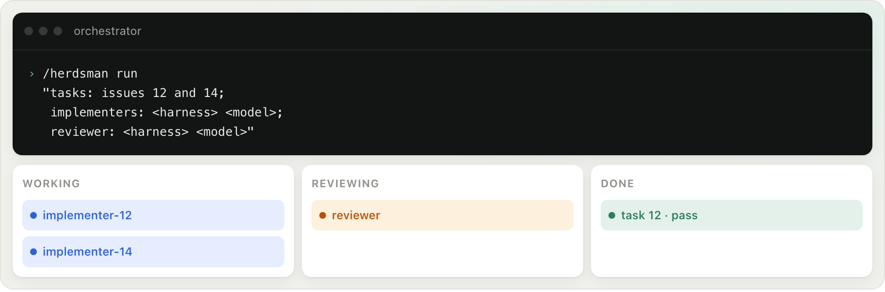
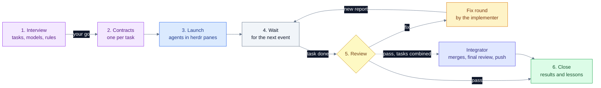

<h1 align="center">herdsman</h1>

<p align="center">
  <strong>Run a whole team of coding agents from one conversation.</strong>
</p>

<p align="center">
  <a href="https://github.com/arafathusayn/herdsman/actions/workflows/tests.yml"></a>
  <a href="LICENSE"></a>
</p>

<p align="center">
  <picture>
    <source media="(prefers-color-scheme: dark)" srcset=".github/assets/banner-dark.png">
    
  </picture>
</p>

herdsman is a skill for coding agents. You talk to one agent: the orchestrator, or an optional adjutant that relays your briefs and answers to the orchestrator through a private message channel. The orchestrator runs the rest of the team inside [herdr](https://github.com/herdrdev/herdr): implementers write the code, reviewers check it, and an integrator combines the work when it ships as one branch. Fixes and reviews go round until each task passes.

Read the docs at <https://herdsman.arafat.ai/docs/>, or at `/docs/` on any running `herdsman web`.

The reference lives in [`docs/`](docs/index.md): [commands](docs/commands/index.md), [configuration](docs/config.md), the [SDK](docs/sdk.md) and [plugins](docs/plugins.md).

---

## Contents

- [The team](#the-team)
- [How a route runs](#how-a-route-runs)
- [Features](#features)
- [Install](#install)
- [Usage](#usage)
- [The herdsman CLI](#the-herdsman-cli)
- [Web app](#web-app)
- [Requirements](#requirements)
- [Develop](#develop)
- [Design notes](#design-notes)
- [License](#license)

---

## The team

Every agent runs in its own herdr pane. Each one can use a different harness and a different model: any coding agent that herdr can start and recognize in a pane can take any role.

| Role | What it does |
| --- | --- |
| **Adjutant** | Optional, at most one. When a route has one, you talk to the adjutant instead of the orchestrator. It asks you every question of the route, gos included, relays full briefs and your answers to the orchestrator as herdsman messages (your answer there is your go), and runs only the pane administration you approve. It never writes code, runs tests, commits or pushes. See [`references/adjutant.md`](skills/herdsman/references/adjutant.md). |
| **Orchestrator** | Runs the route. You talk to it directly, or through the adjutant. It runs the interview, writes the contracts, launches and watches the other agents, forwards review findings and records the results. It never writes application code and never pushes. |
| **Implementer** | One per task. It writes the code and the tests for its task on its own branch. |
| **Integrator** | Used when several tasks ship as one branch or one pull request. It combines the accepted task branches, fixes what breaks between them, and is the only agent that pushes and answers review threads. |
| **Reviewer** | Reviews each task branch and, before a push, the combined result. It reports only P0 and P1 findings and changes nothing. |

## How a route runs



Purple is planning with you, blue is agents at work, grey is the orchestrator asleep until an event, yellow is the reviewer's verdict, amber is a task sent back for fixes, indigo is the integrator (only when tasks ship as one branch), and green is done.

1. **Interview.** The orchestrator (or the adjutant, when the route has one) asks once for the tasks, branches, harnesses, models, integration style, merge policy and test setup. It then shows a dispatch plan and waits for your go.
2. **Contracts.** It writes a route folder: shared rules, one contract per task, a reviewer contract, and an integrator contract when tasks are combined.
3. **Launch.** It opens the herdr tabs and panes, starts the agents, and sends each implementer a full brief: the goal, numbered steps with a check for each, a leave-alone list, time limits and the report format.
4. **Wait.** A background waiter exits on the first event. The orchestrator handles it, runs a health check, and starts the waiter again.
5. **Review.** Each finished task goes to a reviewer. A `fix` verdict sends it back to the implementer; a `pass` verdict closes it. When tasks are combined, the integrator merges the accepted branches in phases, and only a passing final review of the combined head lets it push.
6. **Close.** The orchestrator records the results and saves the lessons to memory. General lessons become rules in the skill's [reference files](skills/herdsman/references) or its tool notes.

## Features

**Work in parallel**

- **Parallel implementers.** One agent per task, each in its own pane, optionally in its own git worktree and branch.
- **One pull request or many.** Each implementer opens its own pull request, or an integrator combines the tasks into one branch.
- **No-commit routes.** When commits are not allowed, reviews use tree snapshots taken from a temporary git index.

**Keep quality high**

- **Strict review.** Reviewers, usually on a stronger model than the implementers, report only P0 and P1 findings. A task gets at most three fix rounds; after that, you decide.
- **Final review before any push.** When tasks are combined, the combined head is reviewed before it leaves the machine.

**Stay responsive and healthy**

- **An optional adjutant.** You talk to an adjutant while the orchestrator works. Messages go through a private file channel: an approved pair, a courier that checks every message, a watcher, and alerts when either stops ([`references/messages.md`](skills/herdsman/references/messages.md)).
- **A message channel daemon** *(next release)*. One `herdsman daemon` per user, installed as a LaunchAgent or a systemd user unit, can own a route's channel in place of that route's courier and watcher: it serves the message commands over a local socket, imports the route into a SQLite database with a journal and crash replay, and file-mode writers refuse an inbox it owns. `message status` and the web app read its liveness, even while it is down.
- **Event-driven waits.** The orchestrator wakes on a new report, a new review, a blocked agent or a stalled one, and sleeps otherwise.
- **Health checks.** Each wake shows every agent's state, model, background jobs and their ages, recent file writes, and the machine's load and free memory. Long-running jobs, idle trees and a loaded machine are flagged. Between wakes the waiter checks every ten minutes and wakes the orchestrator only for a new flag.
- **One heavy check at a time.** Type checks, lint, tests and builds go through `herdsman run-check`: a machine-wide lock with a load gate, at lower CPU priority, so checks queue instead of piling up.

**Work in worktrees and measure**

- **Worktree commands** *(next release)*. `new`, `go`, `ls`, `diff`, `commit`, `each` and `teardown` work on a task's worktree by name. `teardown` stops only what the task owns.
- **One-command start** *(next release)*. `herdsman up` starts a route and picks up where it stopped when you run it again.
- **Cost and traces** *(next release)*. `cost` reports the tokens that harnesses measured, and `trace` exports a route's spans as OpenTelemetry.

**Build on it**

- **Contracts, an SDK and MCP** *(next release)*. The commands and the daemon's services are defined as contracts, with Go and TypeScript clients, and `herdsman mcp` serves them to agents.

**Manage context**

- **Checkpointer.** A pane next to the orchestrator asks it to save its memory every 15 minutes, and to compact its context once it passes a token limit.
- **Context hygiene.** Each agent is compacted or cleared as soon as it finishes.

## Install

**1. Install herdr and your harnesses.** Get [herdr](https://github.com/herdrdev/herdr), plus the coding-agent harnesses you want for each role.

**2. Install the skill** for the orchestrator's harness with the [GitHub CLI](https://cli.github.com/manual/gh_skill_install):

**Claude Code** (then run it as `/herdsman`):

```sh
gh skill install arafathusayn/herdsman herdsman --agent claude-code --scope user
```

**Codex** (then run it as `$herdsman`):

```sh
gh skill install arafathusayn/herdsman herdsman --agent codex --scope user
```

**Another harness:**

```sh
gh skill install arafathusayn/herdsman herdsman --agent <agent> --scope user
```

`<agent>` is the harness's name as `gh skill install --help` lists it. Add `--pin <tag or commit>` to pin a version, and run `gh skill update` to update later.

<details>
<summary>Want to edit the skill while you use it? Link a clone instead.</summary>

```sh
git clone --recurse-submodules https://github.com/arafathusayn/herdsman.git
ln -s "$PWD/herdsman/skills/herdsman" <harness skills folder>/herdsman
```

A skill from `main` needs a `herdsman` built from the same clone (`make build`), because `main` can be ahead of the latest release.

</details>

**3. Start the orchestrator** inside a herdr pane. Outside herdr (`HERDR_ENV` is not `1`), the skill asks whether each role's agents run in herdr panes or as background subagents of the orchestrator's harness.

## Usage

In the orchestrator session, inside herdr:

```
/herdsman [subcommand] [options]
```

| Subcommand | What it does |
| --- | --- |
| *(none)* or `run <route request>` | Runs the full route. The request names the tasks, harnesses, models and rules. |
| `adjutant [--name <name>] [--orchestrator <pane>] [--inbox <root>] [--launch]` | Optional. Attaches this session as the adjutant, the user's side of the message channel ([`references/adjutant.md`](skills/herdsman/references/adjutant.md)). |
| `orchestrator [--adjutant <name> --name <own-name> --inbox <root>] [request]` | Orchestrates as `run` does; with the adjutant options, it enrolls in the message channel first. |
| `message [status\|wait\|read\|release\|ack\|send\|hold\|unhold]` | Herdsman messages between the adjutant and the orchestrator ([`references/messages.md`](skills/herdsman/references/messages.md)). The default action is `status`. |
| `checkpoint [start\|now\|probe\|status\|stop]` | Manages the checkpointer. The default action is `start`. |
| `status` | Shows the health of every agent in the current route. Changes nothing. |
| `help` | Shows the subcommands, options and examples. |

### Examples

```sh
# Two issues, one pull request each
/herdsman run "tasks: issues 12 and 14; implementers: <harness> <model>; reviewer: <harness> <model>"

# Four parts of one change, combined into one pull request
/herdsman run "tasks: four parts of one change, one pull request; implementers: <harness> <model>; integrator: the first implementer that is free; reviewers: two <harness> <model>"

# Check on the team, or manage the checkpointer
/herdsman status
/herdsman checkpoint start --every 10 --limit 300k
/herdsman checkpoint now
```

### Checkpointer options

| Option | Default | Meaning |
| --- | --- | --- |
| `--pane <id>` | this session's pane | The orchestrator pane to watch |
| `--every <minutes>` | `15` | Time between checkpoints (`start` only) |
| `--limit <tokens>` | `250k` | Compact at or over this context size |
| `--prompt "<text>"` | the script's default | The memory checkpoint prompt |
| `--compact "<command>"` | `/compact` | The harness's compact command |
| `--side right\|down` | `right` | Where the new pane goes (`start` only) |

## The herdsman CLI

The `herdsman` command holds the web app, the tools the skill runs and the worktree commands, in one Go binary. Each command reads strict settings, stops with exit code 2 and the setting's name when one is wrong, and prints its usage and exit codes with `--help`. Most print JSON with `--json`. `herdsman help` lists them all, `herdsman spec cli` prints them as JSON, and each has a [page](docs/commands/index.md).

| Command | What it does |
| --- | --- |
| `wait` | Waits for the next event of the loop (a report, a review, a blocked or stalled agent, a health flag), or prints `TICK` after the deadline. |
| `watch implementers\|reviewer\|prs` | Watches the implementers, the reviewer or pull requests; `prs` returns on the first pull request change, or with a `TICK`. |
| `status` | A health snapshot of every agent in `HERDSMAN_STATUS_SPECS` and of the machine. |
| `route check\|log` | `route check` prints an `ok` or `MISSING` line per item of a route folder at a stage (`plan`, `launch` or `close`); `route log` appends a dated run-state line. |
| `checkpointer` | The checkpointer loop (`TARGET=<pane>`), one checkpoint (`--once`) or a probe of the context size (`--probe`). `checkpointer guard <name> <pane>` checks, in adjutant mode, that the approved registry still names that pane as the orchestrator. |
| `message` | The adjutant message channel: `status`, `wait`, `read`, `release`, `ack`, `send`, `hold` and `unhold`, and its services `register`, `courier`, `card-watch`, `resume-goal`, `authority` and `leak-gate`. For a route the daemon owns (`--route`, or `HERDSMAN_ROUTE`), the same actions go through the daemon, plus `enroll` *(next release)*. |
| `daemon` *(next release)* | The per-user message channel daemon: `run`, `install`, `uninstall`, `start`, `stop`, `restart`, `status`, `route`, `setup`, `pair` and `credential` ([below](#the-daemon)). |
| `approval-gate consume\|complete` | Binds a relayed go to one effect before it runs (`consume`), and records its outcome (`complete`). |
| `transcript-audit claude\|codex` | Audits a Claude or Codex transcript for writes outside the allowed roots: `GAP`, `FLAG` and `AUDIT` lines. |
| `run-check` | Runs one heavy check at a time on this machine, under a shared lock, behind a load gate, at a lower priority. `--publish <hours>` writes the machine's load reading for the gate. |
| `doctor` | Checks that this machine can run a route: herdr, gh, the binary, the inbox, the sandbox, the load. Also lists anything deprecated that is in use, with its replacement. |
| `models [last\|save]` | Probes each installed harness for its version, models, efforts and default effort as it reports them; `last` and `save` keep your last pick for each role. |
| `afk` | How long you have been away: the machine's idle time or your newest message, whichever is newer. |
| `review start` | Prepares a clean, detached worktree at a commit for a reviewer, with its own build caches. |

**Tasks and worktrees**

| Command | What it does |
| --- | --- |
| `new` *(next release)* | Makes a task's branch and worktree from the fetched base, then runs its hooks and setup. |
| `go` *(next release)* | Enters a worktree by task, branch, path or pull request, making one for a pull request when needed. |
| `ls` *(next release)* | Lists the repository's worktrees, with a form for status lines. |
| `diff` *(next release)* | Shows a worktree's changes. |
| `commit` *(next release)* | Commits a worktree with a Conventional Commits message. |
| `each` *(next release)* | Runs a command in every worktree. |
| `hook` *(next release)* | Shows, approves or runs a worktree hook. |
| `resource` *(next release)* | Records a resource that a task created. |
| `teardown` *(next release)* | Stops what a task runs and keeps what it holds. |
| `down` *(next release)* | Stops a task, then frees what it holds. |
| `clean` *(next release)* | Frees what a task holds, after a verified snapshot. |
| `prune` *(next release)* | Frees integrated worktrees past a minimum age. |
| `undo` *(next release)* | Restores a snapshot. |

**Routes and measurement**

| Command | What it does |
| --- | --- |
| `up` *(next release)* | Starts a route in one command: workspace, private inbox, both coordinators, the pair and the first brief. |
| `runtime` *(next release)* | Shows which agent runtime a route uses and why, lists agent executions, and reads or sets the installation default. |
| `launch` *(next release)* | Run by herdr-core, not by a person: proves a reserved terminal is the agent's, runs its prelude and starts its harness. |
| `notice` *(next release)* | Run by a managed agent on herdr-core: `notice wait`, `notice read` and `notice ack` pull its instructions, which no automation types into its terminal. `runtime submit` is a person's typed line to one agent. |
| `pause` *(next release)* | Interrupts a route's agents and holds its channel; every pane stays open. |
| `resume` *(next release)* | Continues a paused route, or restarts a stopped one from its record. |
| `stop` *(next release)* | Ends a route's sessions and service panes; the work stays on disk. |
| `delete` *(next release)* | Removes a route, once a verified snapshot makes that undoable. |
| `cost` *(next release)* | Reports measured tokens and cost per task, project or route. |
| `trace` *(next release)* | Shows one route's spans, or exports them as OpenTelemetry. |
| `eval` *(next release)* | Reports a suite's runs with intervals and an A/A control. [Experimental](docs/experimental.md). |

**Setup and integration**

| Command | What it does |
| --- | --- |
| `web` | Serves the web app and prints its URL, a one-run token and a QR code. |
| `config` *(next release)* | Reads and changes the configuration, and installs the shell integration. See the [configuration reference](docs/config.md). |
| `project` *(next release)* | Works on a project's context repository: `project context init\|check\|note` and `project log`. |
| `export` *(next release)* | Copies the whole account to a new folder. |
| `import` *(next release)* | Rebuilds an account from an export. |
| `suggest` *(next release)* | Searches the catalog of tips and tools, ranked for this machine and project. |
| `recommend` *(next release)* | The same as `suggest`. |
| `spec` *(next release)* | Prints the contracts: `cli`, `proto` or `descriptor`. See the [SDK](docs/sdk.md). |
| `mcp` *(next release)* | Serves the daemon's services as MCP tools over stdio. |
| `plugin` *(next release)* | Manages [plugins](docs/plugins.md). Experimental. |
| `update` *(next release)* | Installs the latest signed release over this binary. |
| `version` | Prints the version, commit and platform. |
| `help` | Prints the commands. |

Commands marked *next release* are on `main`; build from source to use them now.

### The daemon

Without the daemon, each route with an adjutant runs its own courier and watcher as `herdsman message` services. `herdsman daemon` is one process per user that can own a route's channel instead. It is on `main` and comes with the next release; the skill's routes still start the file-mode services, so moving a route to the daemon is a step you run by hand.

```sh
herdsman daemon install          # write and start the LaunchAgent (macOS) or the systemd user unit (Linux)
herdsman daemon status           # the health of every route and herdr link
herdsman daemon route create --repo <repo> --route <route>
herdsman daemon route adopt --inbox <path> --route <route> --confirm <peers.approved sha256>
herdsman daemon setup <route> --rule <policy file>...
herdsman daemon pair approve <route> <sha256>
```

- **Private home.** Its files live where no sandboxed agent can reach: `--private-home`, else `HERDSMAN_PRIVATE_HOME`, else `~/.herdsman-private`. The route databases are SQLite files under `daemon/routes/` there, and its socket is `run/daemon.sock`.
- **Routes.** `route create` makes a new route; `route adopt` moves an existing inbox to the daemon as one resumable transaction: it takes the inbox's locks, imports the inbox into a staging database, records the adoption in `state/adopting.json`, moves file mode's setup proof, approval and credential records to `state/legacy/`, drains the file-mode processes, then publishes the route. A refusal before `state/adopting.json` exists (for example a bad inbox path, a held lock, a write in flight, a pair that does not match `--confirm`, or a failed import) releases the locks and leaves the route unadopted and the inbox's records unchanged. Once that file exists, an error such as `adopt_busy` means the adoption is pending: the inbox has changed, and after `adopt_busy` the locks stay held, so do not restart the file-mode services. Resolve the reported problem and run `route adopt` again with the same route and `--confirm`; the daemon also retries a pending adoption when it starts and on its scheduler. `route remove`, `route reset-events` and `route list` do the rest. Route names are unique across the daemon and compared without case.
- **Setup and pairing.** `setup` records a route's setup proof and `pair approve` approves a proposed pair; both need an attended terminal (`pair approve` takes `--interaction <ask reference>` instead), because only the human records them. `pair retire` and `credential revoke` take a party or a credential back.
- **Supervisor.** `start`, `stop` and `restart` go through the LaunchAgent or unit; a stopped daemon stays stopped until `start`. `uninstall` stops it and removes the unit. Only one daemon runs per account.
- **What changes for a route.** Once the daemon owns a route's inbox, `herdsman message` takes the daemon path for that route, file-mode writers refuse the inbox, and `message status` and the web app's Messages tab show the daemon's liveness instead of the courier and watcher heartbeats.
- **Exit codes.** `0` done; `1` the daemon is down or degraded (`status`), or no answer within 10 s (`start`, `stop`, `restart`, `uninstall`); `2` usage, a refusal, another daemon of this account running, or no attended terminal; `3` the human boundary; `75` retryable: busy, the route is unowned, herdr is unreachable, or the daemon is not answering.

## Web app

`herdsman web` serves a browser app that shows and steers the team: a board of every agent by role or status, each agent's live terminal with its keys and a prompt box, the route's checklist, run state, docs and code changes, the HTML pages agents wrote, and the adjutant's messages. It is one Go binary with the app inside; nothing else runs on your machine.

```sh
brew tap arafathusayn/tap
brew trust arafathusayn/tap
brew install --cask arafathusayn/tap/herdsman
herdsman web --open
```

Homebrew installs from a tap outside its own only after you trust it; `brew trust` does that once. Later, `brew upgrade --cask herdsman` gets new releases.

Or download the archive for macOS or Linux from [Releases](https://github.com/arafathusayn/herdsman/releases), or build from a clone with Go and Bun: `make build` writes `bin/herdsman`.

For a source build, initialize the pinned Reactre submodule with `git submodule update --init web/vendor/reactre`
(or clone with `--recurse-submodules`). The web build reads its TypeScript sources directly; no npm install,
`node_modules`, or Reactre JavaScript build is needed. The UI is authored in TSX and uses Reactre signals; see
[`web/README.md`](web/README.md).

It prints a URL with a one-run token. The browser that opens it must type a 6-digit pairing code that the same terminal prints, so a leaked link alone controls nothing. Each link allows 20 wrong codes in all; then it stops working, and the terminal prints a new one. A paired browser keeps a device secret for that host until the server stops.

**From a phone.** The terminal also shows a QR code. A phone can use the hosted app only when it reaches this server over HTTPS, so the QR code opens the hosted app when `--public-url` names that address, and this server's own app otherwise:

```sh
tailscale serve --bg 7878
herdsman web --public-url https://<machine>.<tailnet>.ts.net
```

| Option | Default | Meaning |
| --- | --- | --- |
| `--port <n>` | `7878` | Port to listen on; `0` picks a free one |
| `--host <ip>` | `127.0.0.1` | Listen on one other address, such as a LAN or Tailscale IP, to open it from a phone. A LAN address serves plain HTTP, and the server warns about it |
| `--allow-host <name>` | none | Also answer to this host name, such as the domain of a proxy or tunnel in front of the server (repeatable) |
| `--inbox <folder>` | `HERDSMAN_INBOX` | The adjutant's private message folder, for the Messages tab (read only) |
| `--client <url>` | `HERDSMAN_CLIENT`, else `https://herdsman.arafat.ai` | A hosted copy of the app; the server also prints a link that opens it with this host. `none` turns it off |
| `--public-url <https url>` | none | The HTTPS address in front of this server, such as `tailscale serve` or a tunnel. It is also an allowed host name, and the QR code then opens the hosted app |
| `--route <folder>` | found from the panes' folders | A route folder to show first (repeatable) |
| `--session <name>` | `HERDR_SESSION` | The herdr session |
| `--open`, `--no-qr` | off | Open the browser; skip the QR code |

**Hosts.** The app can also be served from its own site and reach any number of hosts across origins: this computer, a LAN or Tailscale address, or a public domain in front of a server. Open the Hosts dialog from the server button in the top bar, or paste a host's printed link into it. Each host pairs on its own. A page served over HTTPS can reach plain-HTTP hosts only on this computer; put others behind HTTPS (for example `tailscale serve`, or a proxy with `--allow-host`).

**Hosted app.** A copy of the app built from `main` is served at <https://herdsman.arafat.ai> (also `herdsman.arafat.dev`, and the short names `h.` and `herd.` on both domains). The server prints a link that opens the hosted app with this host filled in (`--client` picks another copy, `--client none` turns it off). The first time the hosted app calls this computer or a private address, the browser asks to access devices on your local network: allow it, then choose **Try again**; the link's pairing token waits until the host answers. Each address is its own browser origin, so hosts and pairings saved on one do not show on another. The hosted copy sends the same content security policy as the embedded one ([`web/public/_headers`](web/public/_headers)).

**New route.** **New route** in the sidebar, or `Route: New route…` in the command palette, opens a form that starts a route for you. It first offers the recommended setup or a custom one; each role then offers your previous harness, model and effort (**Choose again** reads the harness lists afresh). Pick a folder, type the request, confirm the GitHub account that can read the repository, and press **Start route**: the app opens a herdr tab named `<project>-orchestrator`, starts the chosen harness through herdr, sends `/herdsman run "<request>"` (`$herdsman` for Codex) and splits a `checkpointer` pane beside it. Models and efforts come from each installed harness, as `herdsman models` reports them. With the Adjutant role it starts an adjutant and its orchestrator with one private inbox per route, and lists the channel steps that stay yours.

**Run state.** The run-state tab shows the newest lines first and loads older ones a page at a time.

**Artifacts.** A route's Artifacts tab lists the HTML files in that route's current Herdr workspace folders: the folders of the panes in the workspace that holds the route's orchestrator, adjutant or first task pane, plus the route folder and its task worktrees. Each fresh listing follows what those paths point to now, and opening a page from a listing is checked against the folders as they were listed, so a folder renamed or replaced since then is refused. It skips dependency, build and hidden folders except `.lavish`, `.herdsman` and `.artifacts`, and shows one page in a sandboxed frame. The frame gets a short-lived link that serves only page files (HTML, scripts, styles, images, fonts and media) from that file's folder, and only to the browser that opened it; its scripts run without access to the app or your pairing.

**Messages.** With an adjutant, the Messages tab shows the channel between the adjutant and the orchestrator the way `message status` reads it: the approved pair, courier and watcher health, alerts, and each message with its queue state. For an inbox the daemon owns, one health entry shows the daemon's liveness instead, and a courier or watch lock without the daemon's record is flagged as stale. A body loads when you open it, only after its route is verified, and never for queued or quarantined entries. The app does not send messages.

## Requirements

| Tool | Why |
| --- | --- |
| The `herdsman` binary | On `PATH`, for macOS or Linux (the Homebrew cask or a release archive, see Install). The skill runs every command through it (`herdsman route check`, `herdsman wait`, `herdsman run-check`, `herdsman checkpointer`, `herdsman message` and the rest); no `jq` or `nc` needed. |
| Go, Bun and a C compiler | Only to build from source: `make build` builds with cgo, because the daemon's store links the SQLite driver (clang from the Xcode command line tools on macOS; gcc or clang on Linux), and the web build reads the Reactre submodule (`git submodule update --init web/vendor/reactre`). The Homebrew cask and the release archives need none of this: the release workflow builds them with cgo, the Linux ones statically against musl. |
| `/bin/bash` 3.2+ | Runs the route folder's one-line `run-check.sh` wrapper (`exec herdsman run-check "$@"`), which every check goes through. The macOS default shell works. |
| GitHub CLI (`gh`) | A version with `gh skill` (tested with 2.101.0) to install the skill; any recent version when the route opens pull requests. |
| Memory checkpoint command | Needed in the orchestrator's harness. The checkpointer's default prompt is built into `herdsman checkpointer` (`PROMPT` overrides it). |

`gh skill install` takes the skill from the latest release. Keep the skill and the `herdsman` binary on the same release: `gh skill update` for the skill, `brew upgrade --cask herdsman` for the binary. The daemon is on `main` and comes with the next release; a skill linked from a clone of `main` needs a `herdsman` built from `main`.

## Develop

Run the checks after each change, from a clone with Go, Bun and a C compiler (cgo, for the SQLite driver), with the Reactre submodule initialized and Bun's types installed once:

```sh
git submodule update --init web/vendor/reactre
make tools
make check
```

`make check` runs the checks of every module listed in [`MODULES.md`](MODULES.md), one after another, and fails when any fails. `make build` writes `bin/herdsman` with the app embedded and `CGO_ENABLED=1`; `make web-e2e` runs the built app and its forms in headless Chrome. The Go tests cover every `herdsman` command the skill runs (the waiter, the watchers, status, route check and log, run-check, the checkpointer, the message channel, the approval gate, and the daemon with its SQLite store), with a fake Herdr socket server and a fake `gh`. CI runs them on macOS and Linux. A pushed `v*` tag builds the release binaries on a macOS runner: the darwin ones with its clang, the Linux ones with `zig cc` against musl.

<details>
<summary>Try the checkpointer against a live orchestrator pane</summary>

The probe sends nothing:

```sh
TARGET=<orchestrator pane id> herdsman checkpointer --probe
```

To run it in its own pane, to the right of the orchestrator:

```sh
herdr pane split <orchestrator pane id> --direction right --ratio 0.7 --no-focus
herdr pane rename <new pane id> checkpointer
herdr pane run <new pane id> "TARGET=<orchestrator pane id> herdsman checkpointer"
```

The command reads `INTERVAL` (seconds, default 900), `LIMIT` (tokens, default 250000), `PROMPT` and `COMPACT` from the environment. `--once` runs one checkpoint now and exits.

</details>

The pages in `docs/commands/`, `docs/config.md` and `docs/man/` are generated. After changing a command's help or a contract, run `make docs` and commit the result; CI fails when they differ.

## Design notes

- **Background waits, not monitors.** An in-session monitor event does not wake an idle orchestrator. A background command that exits does.
- **Few wakes.** Every wake costs a whole orchestrator turn. The waiter runs for up to 25 minutes, under the 30-minute limit for background commands, and wakes early only for an event.
- **A lock, not a rule.** A sentence in each contract does not stop agents from starting heavy checks at the same moment. A lock shared by every agent on the machine does, and the kernel frees it when its holder exits.
- **One herdr change per call.** Two changes in one shell call have failed without output.
- **Deadlines belong to the orchestrator.** Agents ignored stop times written in their own briefs, and a queued instruction runs only when the agent's turn ends. So the orchestrator interrupts when a deadline passes.
- **One daemon per user, not one courier per route.** A route's courier and watcher are two processes per route that must each stay alive, and their heartbeats are its only health. The daemon is one supervised process per user that owns the channel of every route it adopts, with a journal, checkpoints and crash replay, and one heartbeat that the readers check even while it is down.
- **Context size from the transcript.** The checkpointer reads the input and cache token counts of the orchestrator's last turn from its session transcript. The included reader expects JSONL transcripts with a usage block per turn; another format needs a change to that reader in `herdsman checkpointer`.

## License

[GNU General Public License v3.0](LICENSE).
