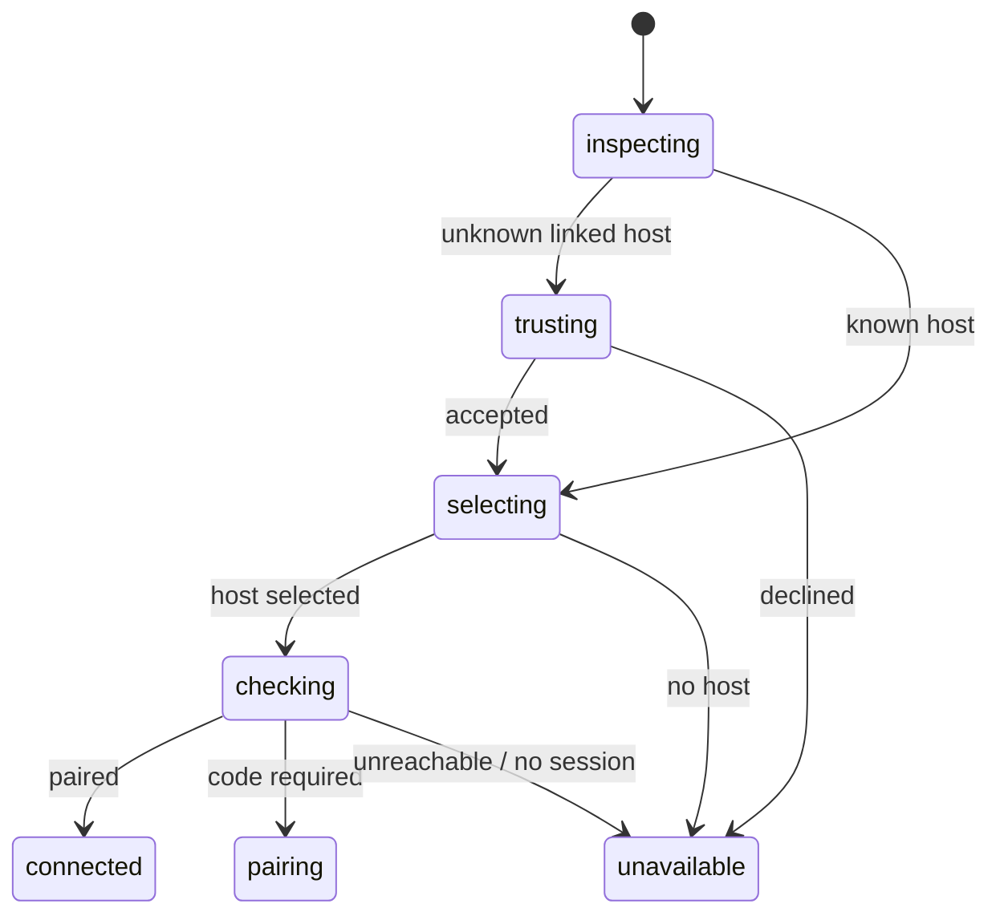
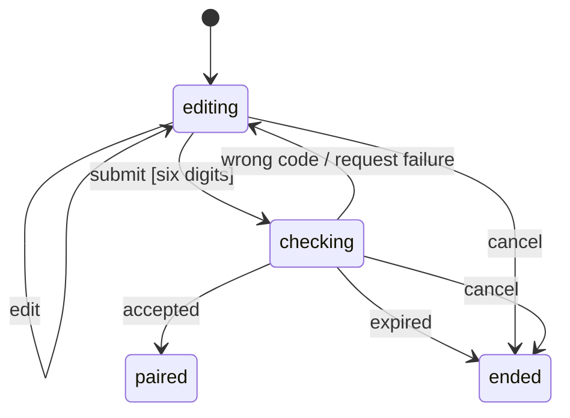
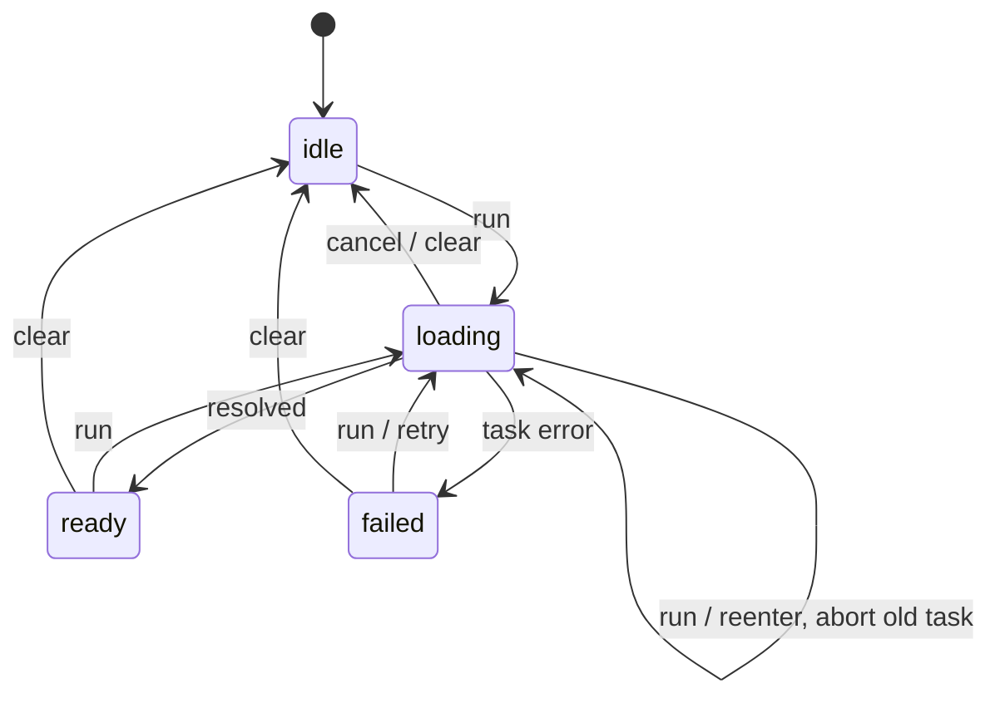
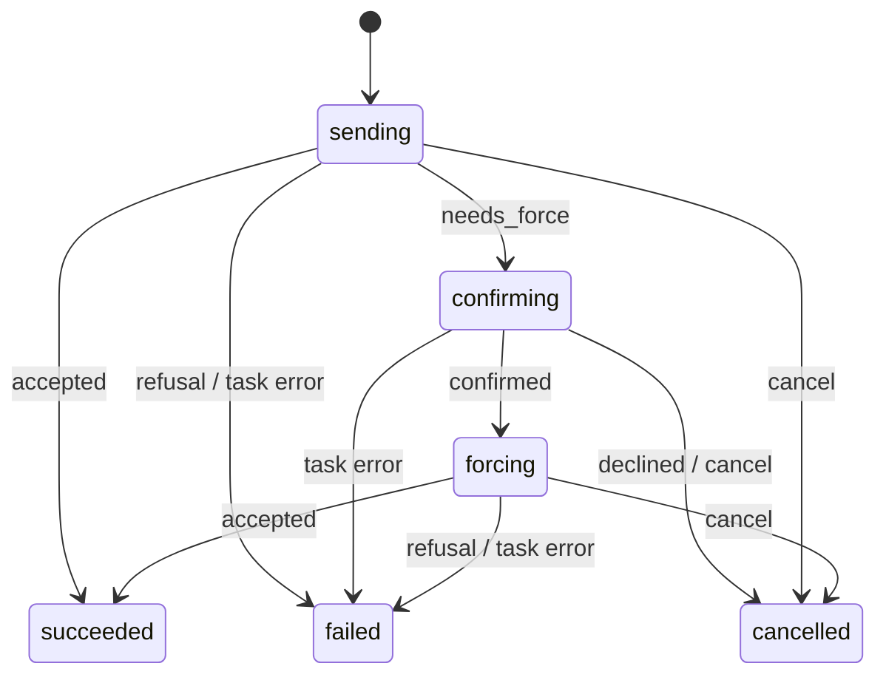
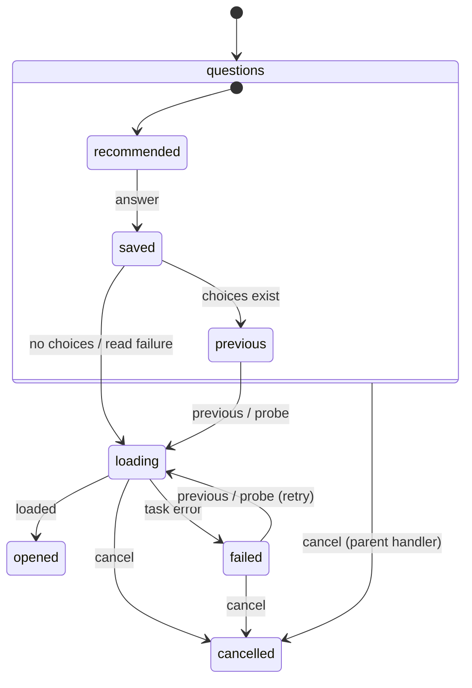
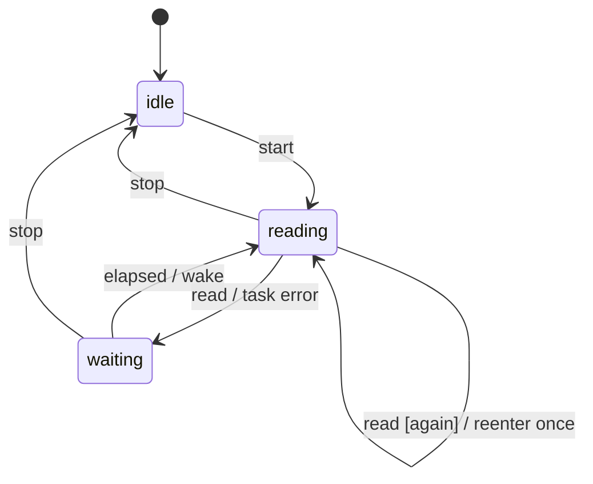
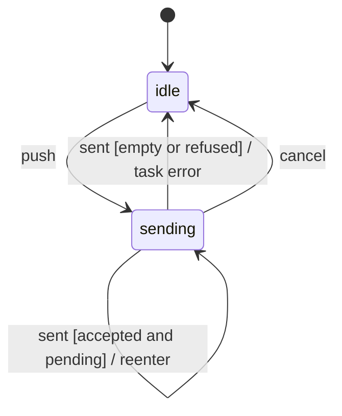
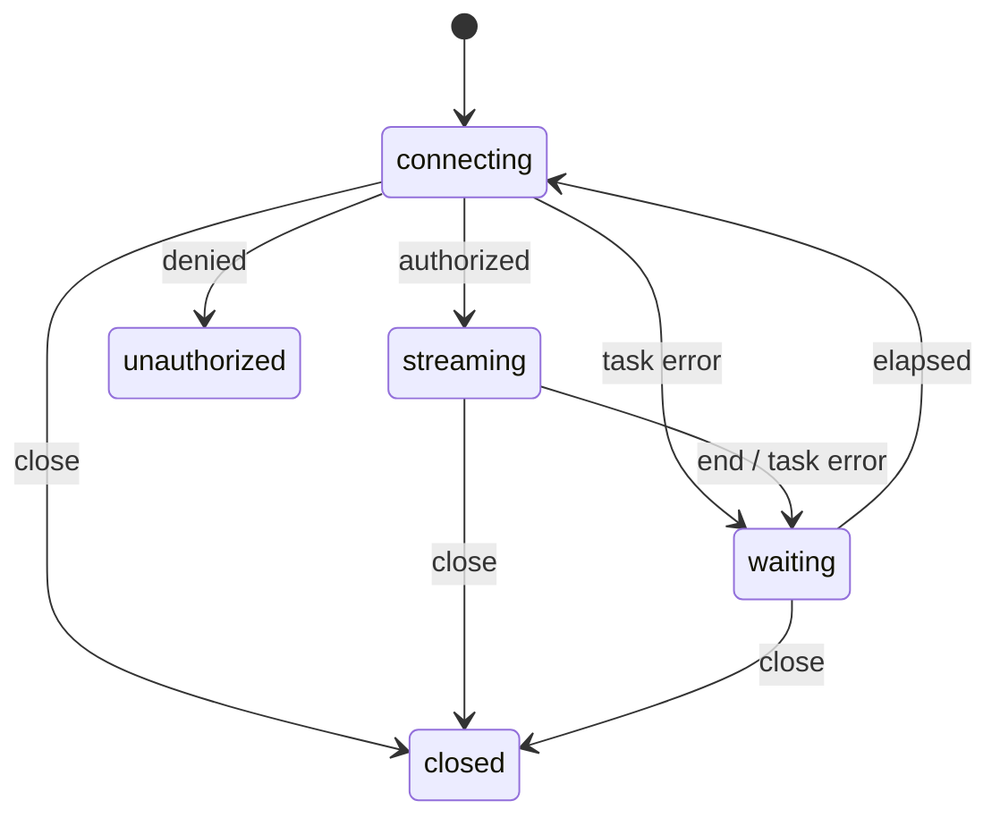
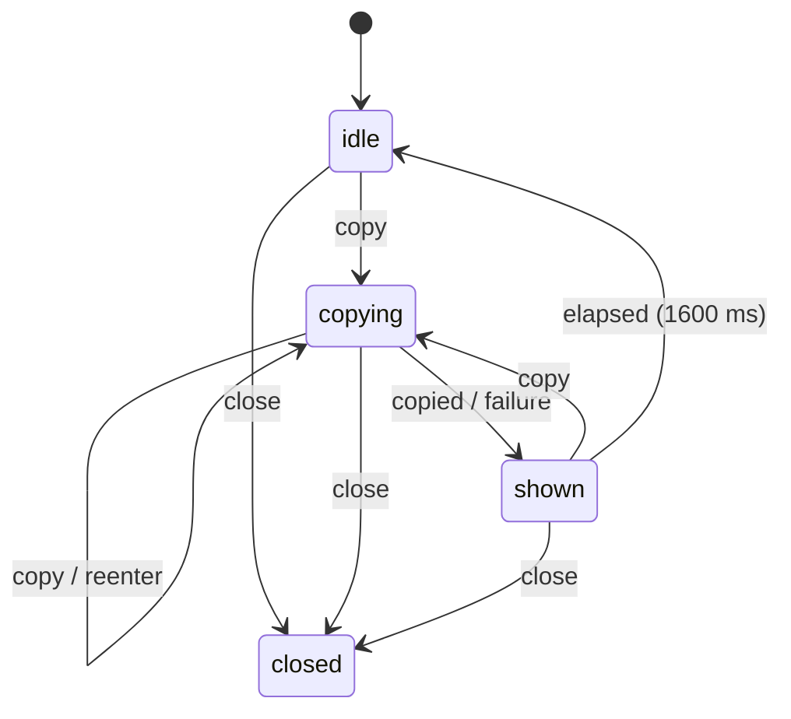
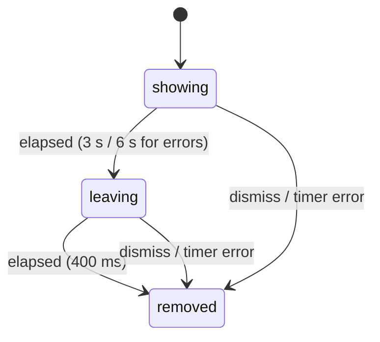

# 0032: Actors own web application and UI state

Status: accepted

## Context

The UI mixed shared/local signals, mutable controller fields, DOM form values,
and asynchronous request flags. Cached controllers could outlive the mounted
owners of their subscriptions. Requests implemented cancellation separately.

## Decision

Use `@reactre/state` for all application and interactive UI state. Pin the
Reactre source submodule to main commit
`8bae29b9fce00ab1e192f906e15191c6057550d7`, retaining its Apache-2.0 license.
Both tests and production compile `.machine.ts` with the upstream state
compiler and other TS/TSX with the core compiler.

The state compiler needs OXC 0.156.0. Its published parser, types and six native
bindings for macOS/Linux arm64/x64 are vendored with MIT licenses, provenance
and hashes in `web/vendor/oxc`. This build-only dependency never enters the
browser bundle. Local file overrides and offline frozen installs preserve
offline builds. `web/build.test.ts` checks the build dependency budget and
hashes; the existing daily OSV check includes the npm pins. See the parser's
`VENDOR.md` for reproducible updates and its manifest-only patches.

`valueState` owns drafts, selections, preferences and SDK data in value actors.
`createRequest` owns asynchronous phases, results and failures. `observeActor`
projects specialized machines. Core signals in these three adapters only notify
subscribers: all values come from actor snapshots. Memos, keyed list accessors
and effects derive values or connect resources. `web/ownership.test.ts` rejects
competing state primitives in production UI.

Upstream contracts exclude optional properties, dynamic records, Map/Set,
callbacks and class instances. The existing SDK uses the first four. The
data-only `wire` boundary encodes them losslessly into string contracts,
including bigint and typed SDK/auth errors. It only decodes locally encoded
data, not untrusted persisted snapshots. Decoded projections reject mutation,
including collection methods. Workflow control fields remain explicit typed
state/event contracts. Serialization costs allocation; no performance
improvement is claimed. Direct normalized SDK contracts would require a
separate upstream capability/design change.

DOM nodes, observers, transport readers, callbacks, disposers, ID allocators and
timer handles remain resources outside snapshots. Pure transformations and
protocol parsers use local scratch variables. URL/localStorage/sessionStorage
initialize actors or receive their outputs; they are not live state containers.
No competing store or legacy renderer ships in the production UI.

## Consequences

Controllers now have explicit lifetimes and consistent stale-result rejection.
The build gains a pinned parser and its integrity/advisory checks. Serialization
adds allocation at the SDK boundary; browser behavior and performance-sensitive
terminal interaction remain covered by regression tests.

## Ownership and cleanup

| Scope | Actor-owned data | Lifetime |
| --- | --- | --- |
| App/session | Navigation, server/channel snapshots, events, credentials, HTTP caches, preferences | Page |
| Startup/pairing/stream | Trust decisions, pairing attempts, reconnect/backoff | Startup, pairing screen, connection |
| SDK pages | Resources, drafts, mutations, previews, search | Mounted page |
| Files/diffs/artifacts | Selection/filter/groups, requests, polling | Explicit cached controller; hiding cancels work, replacing disposes it |
| Messages/log | Expansion, body actors, bounded log history, page request | Cache/page; tab exit cancels reads |
| Route dialog | Setup questions, catalog probes, draft/validation, submission, GitHub/inbox reads | Dialog/form |
| Terminal | Queue, poll, mode/measurement/scroll data, composer draft/send phase | Panel |
| Controls | Palette, form values, disclosure, resizing, appearance, tooltips, toast/copy feedback | Control or page preference |

Leaving a task aborts its signal. Reentry replaces work; the library rejects late
results even for non-cancellable transports. Callbacks check abort before
external effects. Stopping a request settles its callers as cancelled.
Mutations do not retry automatically. Cancellation cannot undo a command that
the server has already accepted.

## Statecharts

Names match `web/src/state/*.machine.ts`. Disposal aborts active tasks and
timers; final states accept no further events. Startup task errors lead to
`failed`; cancel from any active startup state leads to `cancelled`.

Invalid/duplicate pairing submits are declined. A corrected code retries from
editing; credentials only update if the host generation still matches.

Requests preserve the previous result during refresh; clear removes it. The
adapter's cancel only cancels active work, preserving completed errors/results.
Page reads, route submission and previews use this machine. Partial route
results display the server's individual steps; Back clears submission while
preserving the editable draft.

Full catalog, GitHub account, inbox and submission requests have separate
actors. Folder edits replace account probes; closing cancels all outstanding
requests. Inbox keys keep an old result from describing another draft.

Repeated start is ignored. Wake during a read coalesces to one follow-up.
Terminal, diff, artifact and channel refreshes use this poll machine.

Stream retries start at 500 ms and cap at 8 s; success resets the delay.
Closing cancels fetch/reader and delay. Authorization refusal ends retries.

Single-use lifetimes use open → closed; ordinary values use active → active
on replace. Neither has another mutable boolean owner.

## Validation

`make web-check` checks format, SDK/state boundaries, normal/strict types,
compiler integration, workflow transitions, cancellation, stale responses,
immutable projections, cached lifetimes and existing regressions.
`make web-e2e` builds and drives Chrome against the mock API, including pairing,
navigation, dialogs, route forms, terminal input, artifacts, docs and cached
tabs. `make build` embeds the UI in the Go executable. The PR records actual
latest-head results. Real remote agent sessions and server-side rollback are
not simulated by the browser suite.
