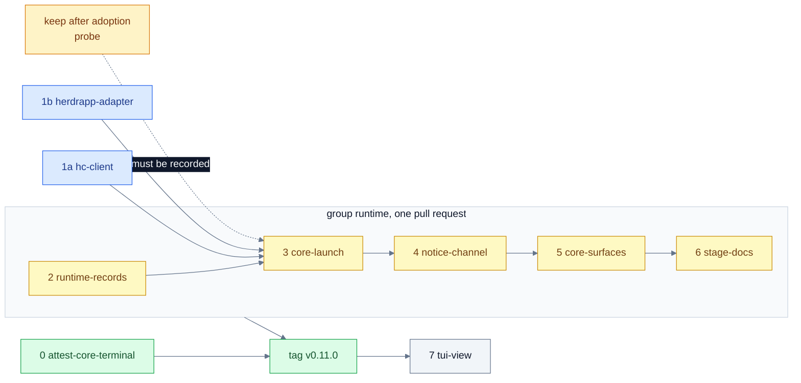

# Plan: the herdr-core backend

> Source design: [`herdr-core-backend-spec.md`](herdr-core-backend-spec.md) ("the spec"). Section marks such as §10 refer to it.
>
> Place in v1.0.0: step 19 of the v1.0.0 roadmap ("The herdr-core backend", its pull request 18), built as stage 5b of the v1 implementation plan, after the web (step 17) and before the release (step 18), with its own tag `v0.11.0`. It keeps the number 19 although it is built before the release, so nothing earlier is renumbered.

**Status:** implementation plan, 2026-11-11. Nothing in it is built yet. The spec is the authority for behaviour; this plan says in which order the behaviour is built, by which pull request, and what proves each one. Where the two differ, the spec wins and this plan is corrected.

**Outcome.** `herdsman up` gains a second execution backend. Each agent is a herdr-core terminal, placed in the native herdr app where a person watches it and can take over. Agents are identified by their process, not by a pane. Instructions are pulled as notices, and on herdr-core `0.1.19` no automation types into a terminal. The Herdr TUI stays as the other backend, one config line away. New installations select core; every existing installation keeps the backend it has (§5).

The roadmap's gates for this step, which every phase below serves:

1. An upgraded installation keeps its backend.
2. A recovery shell at an agent's address receives nothing.
3. A restricted worker reads its own notice and cannot reach core.

## Architectural decisions

Durable decisions that every phase relies on. Each one is settled in the spec; the section is named so that a phase never restates it.

- **Ownership (§4).** Herdsman owns routes, roles, tasks, approvals, dispatch, budgets and recovery. Core owns terminal processes, history, status transport and input arbitration. The app owns its layout and presentation. The optional TUI view owns only its mirror panes. Core's parent/child and notification features are not used for orchestration: every Herdsman launch sets `no_parent:true` and `no_notify:true`.
- **Backend selection (§5).** `[runtime] backend = "herdr-core" | "herdr-tui"`, overridden for one run by `--backend`. The installation default is a record in the account store, written once by the migration: `herdr-tui` on an existing store, `herdr-core` on a new one. `config init` writes the backend into new files; `config update` never adds it. No automatic fallback: a missing core or app stops with a diagnostic that names `backend = "herdr-tui"`. An existing route keeps its persisted backend; a conflicting override fails with `backend_migration_required`.
- **Configuration (§5).** `Runtime runtime = 18;` in `proto/herdsman/config/v1/config.proto` (17 is `Retention`), with `[runtime.core]`, `[runtime.app]` and `[runtime.tui_view]`. A strict section: an unknown key stops the command. All four config formats, the docs and the SDK types are generated from the message.
- **Contracts first.** New surfaces are proto before code: `RuntimeService` and `NoticeService` in `proto/herdsman/daemon/v1/`, runtime references beside the existing pane fields in `core/v1`. The `runtime` and `notice` verbs are thin SDK clients. Released pane fields (`UpCaller.pane`, `PeerInfo.pane` and `session`, `InventoryAgent.pane`, `herdr_socket`) stay; golden files gain cases and none is rewritten.
- **Execution identity (§6).** One execution is one harness launch: a random `execution_id`, a generation, and process evidence `(pid, process start time)`. A core address, `created_ms`, a name, a label or a status is never identity. Execution records go into new tables in the route store, because `parties.pane`, `parties.session`, `launches.pane` and `launches.session` are `NOT NULL`; legacy rows are left alone.
- **Callers by process (§6).** The daemon reads the socket peer and walks its ancestors to a registered execution's PID with the recorded start time. Anything the caller presents is a hint for error messages only. A recovery shell fails this check because it is another process.
- **Launch wrapper (§6, §8, §13).** A three-moment handshake on one connection: authenticate the wrapper by process, run the prelude in the launch environment with the secrets the policy grants, then register the execution and `exec` the harness. The harness environment is built from empty plus an allowlist. Nothing secret goes into `terminal.run` `env`, labels, argv, titles or core documents.
- **Delivery (§10).** No automation presses Enter or sends keys on core `0.1.19`. An instruction is a notice with the states `issued`, `claimed`, `handled` and `returned`; every gate is checked at issue and again at claim. Claude Code is woken by `herdsman notice wait` held as a background command; Codex by one fixed line through `codex queue`. The wait is started before the work and names its claim. A typed submit is one person's explicit action, with `if` and `force:false`.
- **Worker socket (§13).** A second daemon socket that serves only `NoticeService` for the calling execution, with its own request limit. Every managed agent uses it. Under the restricted profile it is the only daemon socket the sandbox allows, by its exact path; core's socket stays refused.
- **Visibility (§7).** Placement labels at launch (`herdsman.owner`, `.route`, `.agent`, `.execution`, `.role`, `herdr.space`, `herdr.tab`), with opaque IDs allocated in the launch intent. The app-to-core binding is verified once per app home and core identity with a random placement challenge; later launches gate on labels read back from core, so a closed window does not stop an unattended launch. States: `unverified`, `pending`, `verified`, `missing`.
- **Inventory (§6).** On a shared core the inventory covers what the route created: members, children by parent chain (agent child, declared command, unclassified child), impostors, other routes' members, foreign agents, plain terminals. The restricted profile keeps the whole-core rule and therefore needs a dedicated core.
- **Ledger (§12, §13).** An execution is an `exclusive` resource keyed by `(pid, start time)` with its core address beside it. A recovery shell and an unclassified child are `associated`, and nothing stops them without a person naming them.
- **Operations (§8, §19).** The launch transaction is a set of steps of the `up` operation on the existing engine: intended before the effect, done after it is confirmed. Reconciliation verifies identity, not existence. Notices are outbox rows. A person's typed submit is a `never` step. The final-report request is one step of the stop operation per execution.
- **Packages (§15).** `internal/runtime` (provider contract and records), `internal/runtime/legacytui` (the TUI as a provider), `internal/runtime/core` (the core provider and harness adapters), `internal/hc` (core protocol client), `internal/herdrapp` (native app adapter), `internal/notice` (notice domain). Each joins the import guard's server list in the pull request that creates it. No module is added; the dependency budget does not change.
- **Events.** Execution loss, `needs_attention` with its reason (`compaction_due`, `goal_paused`, `interrupted`, a dialog), `not_waiting`, `wake_unanswered`, `notice_held`, `claim_stuck`, claim outcomes other than `completed`, stop report outcomes, visibility changes and unresolved sends are event kinds on the existing stream.
- **Platforms.** Claimed for macOS on Apple silicon until core and the app are shown on the Linux runner. On any other machine `runtime doctor` says why and names the TUI backend, and the Linux acceptance run skips the core gates by name.
- **Fallback.** If a gate that needs a herdr-core change is still open at the release candidate, or no harness passes "Long run with no person" for each coordinator role, the backend ships as an experiment (`experimental = true` in `[runtime.core]`) and the TUI is the default everywhere. `v1.0.0` does not wait.

## Delivery map

Eight pull requests. Three land on their own; the `runtime` group lands as one integrated pull request; the TUI view is optional and lands after the tag.

| Phase | Pull request | Lands as | Starts after | Spec |
| --- | --- | --- | --- | --- |
| 0 | `attest-core-terminal` | Own PR | Nothing; fixes the current release | §6, §17 step 0 |
| 1a | `hc-client` | Own PR (library) | Bootstrap modules | §4, §11 |
| 1b | `herdrapp-adapter` | Own PR (library) | Bootstrap modules | §7 |
| 2 | `runtime-records` | Group `runtime` | Stage 4, `restricted-profile`, `daemon-on-sdk` | §4 to §6, step 1 |
| 3 | `core-launch` | Group `runtime` | Phases 1a, 1b, 2 integrated; `launch-spec`, `teardown`; the `keep` probe recorded | §7, §8, §11 to §13, step 2 |
| 4 | `notice-channel` | Group `runtime` | Phase 3 integrated; `events-stream`, `restricted-profile` | §10, §13, step 2 |
| 5 | `core-surfaces` | Group `runtime` | Phase 4 integrated; `web-pages`, `tui-forms`, `automations`, `mcp-server`, `traces-eval` | §9, §15, §16, steps 3 and 4 |
| 6 | `stage-docs` (5b), then tag `v0.11.0` | Group `runtime` (last), promotion drill | Phase 5 integrated | §18 item 8, §19 |
| 7 | `tui-view` | Own PR, optional, experimental | The `runtime` pull request | §14, step 5 |

Green lands on its own and gates the tag, blue is a library pull request, yellow is integrated into the one `runtime` pull request in order, amber is a probe that is still owed, and grey is optional and comes after the tag.

## Before work starts

**Entry.** Stage 5 merged. Phases 0, 1a, 1b and 2 do not depend on the probes and start from the queue as soon as their prerequisites merge.

**Owed probes (§18 item 2).** Each is recorded in the route file before the phase that needs it is dispatched.

| Probe | Blocks | Why |
| --- | --- | --- |
| `keep` set to false after app adoption, and whether it stays false | Phase 3 | Decides whether a lost program leaves a recovery shell at all, and so step 3 of the launch transaction (§8, §12) |
| herdr-core and the app on the Linux runner; the socket allowance on Linux | Linux claim only | Without it, the backend is claimed for macOS on Apple silicon |
| Recovery answer by status (a turn a person ended leaves a claim open) | Phase 4 gate "Claim recovery" | N24 ordered recovery by hand |
| Codex's queue while a dialog or the transcript view is open, and across the versions the adapter allows | Phase 4 Codex adapter | N30 tested a resting session only |
| Codex with hooks on: whether a turn-end hook runs after an interrupt | Phase 4 Codex adapter (optional improvement) | Not run, because it runs the owner's own hooks |
| Codex's compaction level with no limit set; what else pauses a Codex goal | Phase 5 checkpointer | N32 measured a set limit only |
| How the Codex adapter learns its session id with provenance | Phase 4 | The probes read the newest session file |
| That a stop leaves nothing of a Codex execution running | Phase 3 stop, phase 5 qualification | N31 found an orphaned background command |
| A held notice with a real harness | Phase 4 gate "Held notices" | Checked in the state model only |

**Owner decisions still open (§18).** Each phase states what it builds while the decision is open, so no phase waits on an answer.

| Decision | Until it is made |
| --- | --- |
| The start line passed as the harness's initial prompt (one added argument, an exception to the launch-commands rule) | Adapters declare the person's path only: `up` reports `needs_attention` with the line |
| A harness kind on this backend arrives with a Herdsman adapter | Only Claude Code and Codex adapters exist; any other kind is refused by name on core |
| Codex woken through its own message queue | Built behind the adapter; if refused, Codex is qualified as attended and every notice needs a person's line |
| A restricted Codex worker resting on the experimental `network_proxy` feature | Built and pinned to tested Codex versions; if refused, no restricted Codex worker on core |
| The installation record versus changing the constant before the tag (§5) | The record is built; it holds in either order |

## Phase 0: launcher attestation on core terminals

**Spec:** §6 "Launcher attestation on core", §17 step 0, §18 item 1. **Roadmap:** "The launcher attestation fix for core terminals lands first, as its own pull request."

### What to build

The current release has a gap on any machine with `hc` installed: `hc run -- herdsman up …` started by an agent meets every attestation check and approves a pair. Close it in the process-table check, before any core client exists.

- In `attest` and the daemon's caller inspection, a process named `hc` or `herdr-core` among the caller's ancestors marks a core terminal. The process just below it is the terminal's program. A herdr-core process below another is skipped.
- When that program is not a shell waiting for a person (only flags after its name), the pair stays pending and `up` prints the command a person can run. `--pair manual` does not lift it.
- A shell program passes, as today's "terminal outside herdr".
- `herdsman doctor` gains a `herdr-core` check: when a core is already running, compare each holder from `hc server status --json` with the names the check knows; an unknown holder fails the check and stops `up`. It never starts a core (N14), and says when nothing was tested.
- ADR 0025 states what the check proves and its three stated limits (a shell driven through `terminal.send`, a detached process, a renamed core).

The change is written and tested, uncommitted, in a local worktree (branch `fix/attest-core-terminal`); this phase commits it, rebases it on `main` and runs it through the gate.

### Acceptance criteria

- [ ] `hc run -- herdsman up` from a managed agent's process tree leaves the pair pending; the same command typed by a person in a shell does not.
- [ ] A command string under `sh -c` and a script are treated as commands, not as a person's shell.
- [ ] The check passes in a private core started as `hc` and in one started as `herdr-core` (N12).
- [ ] `doctor` fails on a holder it does not know, and reports "nothing tested" with no running core.
- [ ] A machine without `hc` behaves exactly as before; existing attestation tests are unchanged.
- [ ] One run of `hc run -- herdsman up` in a throwaway route before release (§18 item 1).
- [ ] `security-review` passes.

---

## Phase 1a: core protocol client

**Spec:** §4, §11. **Roadmap:** the herdr-core coupling row of the compatibility contract.

### What to build

Herdsman's own client for herdr-core: newline-delimited JSON over core's Unix socket, no third-party module.

- One file lists every method and event Herdsman uses. A capability check compares that list with core's schema at `hello`, and a core missing a listed method fails by name.
- `hello` returns and the client records the core identity and protocol generation.
- Separate control and subscription connections. A subscription installs its snapshot and sequence as a new local epoch; `missed` replaces the cache with the fresh snapshot; a disconnect discards ordering; a sequence is never carried across a core restart (E09).
- Bounded message sizes; unknown optional fields tolerated.
- A fake core (`hctest`) at the pinned protocol generation and the previous one, used by every later phase.

### Acceptance criteria

- [ ] Every listed method has a scenario against the fake core at both generations.
- [ ] A core that lacks a listed method fails the capability check by name.
- [ ] Snapshot/event race, sequence reset after restart and forced `missed` rebuild state correctly.
- [ ] Frame parsing is fuzzed.
- [ ] The dependency budget test is unchanged; `internal/hc` is on the import guard's server list.
- [ ] `security-review` passes.

---

## Phase 1b: native app adapter

**Spec:** §7. **Roadmap:** "The native app".

### What to build

An adapter over the app's own command (`herdr-app`), never its layout document.

- The binding challenge: freshly allocated random space and tab IDs written only on the selected core; the configured app must show that exact placement and terminal as local (`machine:null`). The result is persisted with the core identity, app home and app version; a changed endpoint, app home or copied layout invalidates it.
- Adoption and placement: observe the adopted pane through app `ls`, name only owned containers through explicit-target commands, and read every command's effect back.
- Membership reads for "pane present" and "agent listed".
- A fake app command (`apptest`) for the later phases.

### Acceptance criteria

- [ ] An app on another core or session cannot verify a same-named or same-address terminal (gate "Endpoint mismatch").
- [ ] Placement is read back, never assumed from a `pending:true` reply.
- [ ] `herdr.seen`, `herdr.pinned` and `where` are never written.
- [ ] A missing or unsupported app is reported with `backend = "herdr-tui"` named as the alternative.
- [ ] `internal/herdrapp` is on the import guard's server list.

---

## Phase 2: runtime records and the TUI as the first provider

**Spec:** §4 to §6, §15, §17 step 1. **Roadmap:** "Executions, not panes" and "select".

### What to build

The tracer bullet for this phase runs the whole existing product through the new contract with no change in behaviour: `herdsman up` on the TUI goes through a provider and writes an execution record, and every identity consumer reads it.

- Contracts: `RuntimeService` proto, runtime references beside the pane fields in `core/v1`, and `Runtime` (field 18) in `config/v1`, with generated config formats, docs, SDK types and descriptor goldens.
- `internal/runtime`: the provider operations (`Capabilities`, `EnsureExecution`, `Inspect`, `Observe`, `Read`, `Deliver`, `Interrupt`, `Stop`, `EnsureVisible`/`Show`), the execution record of §6, and the normalized observation fields of §9 (process lifecycle, readiness, program status, visibility, orchestration, task outcome) kept independent.
- `internal/runtime/legacytui`: the TUI behind the provider, over the existing `internal/herdr` calls.
- Store: a migration that adds the execution tables to the route store and the installation default to the account store, listed in `MIGRATIONS.md` with its fixture. No existing column changes.
- Backend resolution in the order of §5, shared by `up`, task launches, automations and setup.
- A backend-neutral identity verifier replacing `inbox.LiveIdentity(*herdr.Client, pane)`, with an audit of every consumer: registration, daemon intake, courier, cardwatch, alerts, checkpoint guard, route inbox, resume, automations and web actions.
- Verbs: `runtime doctor`, `runtime ls`, `runtime default` (print and set), and `--backend` on `up` (accepting `herdr-tui` only until phase 3).

### Acceptance criteria

- [ ] The whole existing suite passes on the TUI provider with no change in behaviour.
- [ ] Gate "Upgrade": an existing installation and an existing config file keep `herdr-tui` with no config change; a new installation and a new `config init` file select core; `config update` adds no backend.
- [ ] Gate "Migration": old TUI routes continue; an older binary refuses the migrated store by name (`ErrSchemaNewer`); rollback by config works on the new binary.
- [ ] An unknown key in `[runtime]` stops the command; a conflicting override on an existing route fails with `backend_migration_required`.
- [ ] Every graph caller of `LiveIdentity`, `AgentGet`, `AgentPrompt`, `ReadPane` and the pane lifecycle is listed and either migrated or marked legacy-only.
- [ ] Conformance for `RuntimeService`; golden files gain cases and none is rewritten.
- [ ] `internal/runtime` is on the import guard's server list; `security-review` passes.

---

## Phase 3: one managed agent on core, visible in the app

**Spec:** §7, §8, §11, §12, §13 (all but the worker socket). **Roadmap:** "The native app", "Recovery shells are left alone"; gate 2 of the step.

### What to build

The tracer bullet: `herdsman up --backend herdr-core` starts one agent as a core terminal, the agent appears in the app, its identity survives reconnects, and a stop ends exactly it. No instruction is delivered yet beyond the start line through a person.

- **Launch transaction** as steps of the `up` operation: preflight (endpoints, capabilities, binding state, `argv[0]` resolved as the core sees it, repository roots readable through core), reserve, spawn with `terminal.run` (`no_parent`, `no_notify`, `rm:false`, `keep:true`, labels, the wrapper and a descriptor reference), reconcile an uncertain spawn over live and finished records, authenticate, prelude, register, visibility, readiness, enroll. States and terminal outcomes as in the §8 diagram, including `outcome_unknown`, `conflict`, `needs_attention` and `waiting_for_visibility`.
- **Core wrapper** in `internal/launch`: authenticated by process, environment built from empty plus the allowlist of §13, granted secrets fetched after authentication, prelude steps run as its children with their `.start` and `.rc` markers, registration, then `exec` of the harness. A failure exits with a code and never leaves a shell as a successful agent.
- **Visibility**: label readback, adoption through the phase 1b adapter, the four visibility states, the dispatch gate that does not wait for the window, and `app_closed` reported apart from `missing`.
- **Reconciliation**: the execution, identity, inventory and visibility reconcilers of §11 on the phase 1a client, with a full pass on start and reconnect, a 30-second safety pass, and the timing defaults of §11.
- **Inventory** of §6 with its classes, the restricted-profile rule kept, and `runtime doctor` naming the rule in force and any fault.
- **Pause and stop through the provider**, without the final-report step (phase 4 adds it): one interrupt at most and none at rest; stop verifies that the address still holds the recorded process immediately before `terminal.kill`, ends the processes the ledger records under the execution (N31), and verifies termination before retiring enrollment.
- **Recovery shells**: a lost execution is marked lost and its readiness revoked; nothing is typed; a replacement gets a new terminal and tab; one recovery plan per route; shells are `associated` in the ledger and never killed unless a person names them.
- **Ledger**: executions as `exclusive` resources keyed by `(pid, start time)`; unclassified children and recovery shells as `associated`; children counted against the member's budget through the parent chain.
- **Caller identity by process** on the main socket for core executions.
- `up` grammar unchanged except the added `--backend`; `up` reports its two waits that need a person; ADR 0024 updated for them.

### Acceptance criteria

These gates of §17, against the fake core and fake app and, on macOS, against private real core and app sessions:

- [ ] Core path: a new installation's launch uses core with no TUI binary or server present, and persists its backend.
- [ ] Native visibility: a real coordinator and worker appear in the right space, tab and pane, and the terminal is interactive.
- [ ] Endpoint mismatch, end to end.
- [ ] Identity replacement: killing a kept harness leaves a same-address shell that inherits nothing and passes no caller or checkpoint check (roadmap gate 2).
- [ ] Launch crash points: killing the daemon at each step never yields a duplicate or a hidden successful launch.
- [ ] Reconnect and Events: daemon, app and core restarts preserve the surviving execution and rebuild event state.
- [ ] User UI actions: app quit preserves the execution; park holds dispatch; move and rename are preserved; close ends the execution with no resurrection.
- [ ] Caller identity, Inventory, Secrets at rest, Prelude environment, Environment, Recovery shells.
- [ ] Unattended launch: with the app closed and the binding verified earlier, a new execution launches; with no verification ever, it waits at `waiting_for_visibility`.
- [ ] `security-review` passes.

---

## Phase 4: notices, wakes and the worker socket

**Spec:** §10, §13 "The worker socket", §12 pause, stop and resume. **Roadmap:** "Nothing typed by automation", "How an instruction reaches an agent", "Stop", "Wait rules", "Restricted workers"; gate 3 of the step.

### What to build

The tracer bullet: the first brief of a core route is issued as a notice, the waiting agent is woken with nothing typed, claims it through the worker socket, works, and acknowledges it with an outcome; a pause, a resume and a stop each reach that agent with no person on Claude Code.

- **Contract**: `NoticeService` with `Wait`, `Read` and `Ack`, and thin verbs `herdsman notice wait [--after <id>]`, `read`, `ack`. Each reply names the next command. A notice document carries schema version, id, kind, execution, generation, issue time and content digest.
- **Notice domain** (`internal/notice`): the four states and what a repeat does in each; claim tokens and processing records reusing the inbox's claim discipline; outcomes `completed`, `interrupted`, `abandoned`, with non-`completed` outcomes returned to the issuer as events; each kind declares whether its action is safe to do twice.
- **Gates at issue and at claim**: approval and policy generation, exact execution and generation, route hold, visibility, per-execution order with an open claim first.
- **The wake follows the claim**: a notice that cannot be claimed wakes no one; the daemon looks again when a gate changes and after each notice call; `notice_held` after a grace period; one closing of a gate costs one wake at most.
- **Open claims**: `Wait` returns an open claim first when recovery is due (resume after a pause that interrupted, a person's order, or a non-`working` status past the grace period); `--after` names the claim the caller works on; `claim_stuck` after three ignored recovery answers; no recovery answer under a hold or while stopping.
- **Wait limits and ownership**: a wait budget of its own (128 per daemon, one per execution) beside the stream slots; admission in preflight; 30-second polls renewed inside the command; ownership by the highest wait generation, journaled, with `replaced` for any lower generation every time, also after a restart; a five-second renewal window; `not_waiting`.
- **Worker socket**: a second socket in the daemon's private run folder serving only `NoticeService` for the calling execution, identified by process, with its own request limit of 32; its path passed to the harness in a non-secret variable.
- **Adapters** in `internal/runtime/core/adapters`: Claude Code holds the wait as a background command; Codex gets one fixed line through `codex queue` to its recorded session id, with `wake_unanswered`, nothing queued under a hold, and `needs_attention` with `interrupted` after an interrupt. Each adapter carries its versioned start line (with the pause sentence), its start path, its rest state, and what an interrupt does at rest, in a turn and at each dialog. Codex requires `--no-daemon` in the user's command and refuses a launch without it.
- **Restricted Codex worker on core**: the restricted profile builds a Codex permissions profile (writable folders as `filesystem` entries, `network.enabled = true`, the worker socket as `allow` under `network.unix_sockets`) with the `network_proxy` feature, selected as `default_permissions`; `CheckHarnessArgs` refuses a user argument that sets `permissions`, `default_permissions` or that feature; a sandbox with plain network access is refused. The TUI backend keeps the older keys.
- **Stopping phase and the final-report notice**: a route in `stopping` refuses ordinary notices and typed submits; only the stop operation issues `final_report`, one journaled step per execution, with its five checks; outcomes `reported`, `report_timeout`, `report_unavailable`, `not_reached`; a daemon restart while stopping issues no second notice and moves the deadline once.
- **Pause and resume by adapter**: Claude Code interrupted once in a turn; Codex not interrupted by default, with `pause_pending` until its turn ends; resume issues no continue prompt where an open claim or an issued notice exists, and reports `resume_partial` until every execution can be woken.
- **A person's typed submit**: one named execution, `if` and `force:false`, at least one status since registration, one outstanding per execution; states `queued`, `pending_in_core`, `typed`, `rejected_before_write`, `unresolved`; never retired by time; `dispatch_draining` at pause.
- `Deliver` on the core provider issues notices only. The first brief, the continue prompt, the checkpoint prompt and the task launch prompt move to notices in this phase for `up` and control; phase 5 moves the remaining surfaces.

### Acceptance criteria

These gates of §17:

- [ ] First-dispatch gate, `if` and first status, State guards, No automated submit (a core that records its calls sees no `terminal.send` or `terminal.keys` from any automated path).
- [ ] Input race: both fixtures stay in the suite and record what core does; no automated path sends to either.
- [ ] Send uncertainty and Outstanding send: no replay at any age; `unresolved` with the three choices.
- [ ] Wake without input for Claude Code and Codex, including the start path with startup dialogs present.
- [ ] Interrupt discipline: no interrupt at rest, never two in a row.
- [ ] Notice lifecycle, Claim recovery, Held notices, Wait ownership, Wait capacity.
- [ ] Stop reports, including a daemon restart in the stopping phase.
- [ ] Restricted worker: a real restricted Codex worker claims and acknowledges its own notice through the worker socket, is refused another execution's notice and every other daemon service, and cannot connect to core's socket; a plain-network sandbox is refused (roadmap gate 3).
- [ ] `security-review` passes.

---

## Phase 5: every surface on the runtime contract, and the switch

**Spec:** §9, §15, §16, §17 steps 3 and 4. **Roadmap:** "Attended or unattended", "If herdr-core is not ready", "Platforms".

### What to build

The tracer bullet: a full route with coordinators, workers, pair messages, the checkpointer, watch, task and worktree launches and the web runs on core end to end, and a new installation selects core.

- **Remaining typed paths**: the checkpointer issues the checkpoint prompt as a notice and sends no compact command on core, issuing an early checkpoint below the harness's own compaction level and `compaction_due` where a harness does not compact by itself; `resume-goal` types nothing on core and reports `goal_paused`; the task launch prompt is a notice; web actions that type become a person's typed submit; checkpoint transcript lookup uses adapter conversation evidence and refuses to guess.
- **Services**: courier, cardwatch and checkpoint registered as daemon-managed services or core executions, one owner each, with typed execution references in place of `TARGET=<pane-id>`; the old variables keep working for TUI routes.
- **Status, web and TUI form**: status and the web route page show process state, readiness, visibility, attention reasons and unresolved items as separate fields; the `up` form gains a backend field prefilled from config and `doctor`; web controls call the provider through the SDK.
- **Automations and MCP**: the new event kinds reach automations; MCP tools follow from the descriptors.
- **Route file check**: a runtime reference column beside Pane, accepted by backend.
- **Harness qualification**: each fact in the §9 table rechecked for the release's harness versions and models, more than once; each harness qualified as attended or unattended, and `up` names the steps that will need a person before the route starts.
- **`runtime doctor` complete**: backend source, binding state, environment source and agent markers, inventory rule and foreign-agent count, root readability through core, app support for the machine.
- **The switch**: the installation default and `config init` select core only if at least one harness in each coordinator role passes "Long run with no person"; otherwise the experiment marker applies.
- **Traces and performance**: launch steps, notice issue/claim/handle and typed submits as spans; the `up` budget case gains a core variant with the A/A control, reported as a 95% confidence interval.

### Acceptance criteria

These gates of §17:

- [ ] Real harness qualification, Codex process ownership, Pair boundary, Lifecycle, Teardown, Public surfaces, Status forgery, Privacy grants, Platform.
- [ ] Long run with no person for each harness qualified as unattended; for an attended harness, the named steps and their events, with nothing typed.
- [ ] The `up` budget on core with its A/A control, reported as a 95% confidence interval.
- [ ] A new backend that works only for `up` is not accepted: the consumer audit from phase 2 has no remaining legacy-only item on the core path.

---

## Phase 6: documentation, release and the tag

**Spec:** §16, §18 item 8, §19. **Roadmap:** "Built as step 19 … with its own tag `v0.11.0`".

### What to build

- ADRs: a new ADR for the backend and its per-installation default; one for delivery by notice with no automated typing; one for the worker socket; ADR 0024 for the two waits of `up`; ADR 0025 for what attestation proves on core.
- The threat-model rows of §16.
- Generated command and config pages; the herdsman skill's references for the core path (or a stated TUI-only scope until it has one).
- Two compatibility contract rows: the herdr-core coupling (one pinned protocol generation per release, one list of methods and events, a capability check, a fake core at the pinned and previous generation in CI) and runtime references (stored, never derived).
- Release notes: compatible core, app and harness versions; each harness's level; the remaining window before `terminal.kill`; that an older binary refuses the migrated store; the experiment status if the fallback applies.
- `acceptance/requirements.md` declares `herdr-core` and `herdr-app` per platform; the gates are scripted cases under `acceptance/`.
- Tag `v0.11.0` through the promotion drill. The release route then runs its coordinators on core where their harness is unattended, with the TUI one config line away; a coordinator with attended steps stays on the TUI and a second, attended route exercises core.

### Acceptance criteria

- [ ] Every gate of §17 is green on macOS, and on the Linux runner for each capability `requirements.md` declares there.
- [ ] The `runtime` group pull request, `attest-core-terminal`, `hc-client` and `herdrapp-adapter` are merged.
- [ ] The promotion drill passes, including rollback by `backend = "herdr-tui"`.
- [ ] Upstream requests of §10 sent (guarded submit, `if` for `done`, send id with query and cancel, a deadline on the wait for human quiet, the time of the last human input), and the app's confirmation dialog requested (§18 item 3). Whether they are answered does not hold the tag.
- [ ] If a gate that needs herdr-core is open, the backend ships with `experimental = true` and the TUI is the default everywhere.

---

## Phase 7: optional TUI view (after the tag)

**Spec:** §14, step 5.

### What to build

An experimental view of a core execution in the Herdr TUI: dedicated containers, attach by immutable core address, a controlled attach helper that reattaches, durable report sequences, and mirror close that never ends the execution. It is not an identity provider and never calls TUI `agent.prompt` for a core agent.

### Acceptance criteria

- [ ] Gate "Optional TUI": create, attach, report, reattach, close, lost events, stale report expiry, moved panes, collision and crash recovery.
- [ ] Not a gate for `v0.11.0` or `v1.0.0`; core and app continue when the TUI is down.

---

## Cross-cutting rules for every phase

- **Contracts first**: a surface is a proto message or service before it is code; descriptor goldens, `spec cli` and the MCP golden gain entries; nothing released is renamed.
- **One verifier per question**: identity, visibility and gates each have one function that every consumer calls; no consumer re-derives them from labels, names or status.
- **Tests behave**: acceptance cases run against private core, app and TUI homes and sessions; no fixture stops a user's server. At least one visual app inspection and one real harness run per supported release combination.
- **Prove locally**: every CI step runs on the exact commit before a push.
- **Reviews**: `solid` and `code-review` on every phase; `security-review` on phases 0 to 4.
- **Privacy**: no local machine paths, no secrets and no prompt text in code, fixtures, logs or diagnostics; diagnostic bundles are explicit and bounded.

## Risks

| Risk | Mitigation |
| --- | --- |
| A gate needs a herdr-core change that is not released in time | The experiment fallback; the tag does not wait |
| Codex's queue or `network_proxy` changes between versions | The Codex adapter pins the versions where its suite passed; `runtime doctor` reports an unpinned version |
| The `keep` probe shows that `keep` cannot stay false | Recovery-shell handling of §12 is built in phase 3 either way; the probe only removes work |
| Harness probes were single runs with one model each | Phase 5 re-runs each §9 fact more than once for the release's versions and models |
| Shared generated files (descriptor golden, man pages) conflict across concurrent pull requests | Take `main`'s side and regenerate on every rebase |
| Linux is unproven | Claim macOS on Apple silicon; Linux core gates skip by name until shown |

## Out of scope

Remote execution, Windows, unqualified harnesses, automatic migration of a live TUI process, automatic installation or update of upstream software, writing the app's layout document, and a required core-to-TUI bridge (§1).
