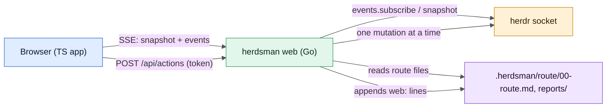

# Plan: herdsman CLI, web app and landing page

Status: draft, 2026-10-24. Nothing is built yet.

## Goal

Ship one `herdsman` binary through GitHub releases. It carries every herdsman command, including a new `herdsman web` that opens a light and dark web app on localhost, where you watch and operate every agent of a route directly. A static landing page explains the project. Users download one binary and install nothing else: no Node, Bun, Python or Go at run time.

## Decisions

| Topic | Decision |
| --- | --- |
| Control | Full direct control from the browser: prompt any agent, send keys, start, restart and delete panes and agents |
| Layout | Same repo. `cmd/` and `internal/` hold the Go CLI, `web/` the app's TypeScript, `site/` the landing page. `skills/` stays installable with `gh skill install` |
| Binary | Go, one static binary per OS and architecture. The built web app is embedded with `embed.FS`. goreleaser publishes the GitHub releases |
| Frontend | TypeScript with no React, no npm and no `node_modules`. `bun build` compiles it to JS, `bun check` type-checks it and `bun fmt` formats it, on the latest Bun (1.4.4 or later). Bun is a build-time tool only |
| Access | Binds to `127.0.0.1` only, with a random token per run |
| Scripts | All bash scripts move into CLI subcommands in a single PR, and the scripts are deleted in that PR |
| PRs | 1) CLI skeleton, releases and `herdsman web`. 2) Landing page. 3) Port every script |
| Release | Changed on 2026-10-25. `v0.1.0` and `v0.2.0` shipped PR 1. `v1.0.0` ships PR 1, the docs page at `/docs/` (in place of PR 2), and the pairing hardening; the skill keeps its shell scripts. PR 3 ships in a later `1.x` release |
| Homebrew | goreleaser publishes the formula to `arafathusayn/tap` |
| Agents | Agent-type agnostic: no harness-specific UI. Starting an agent takes any `kind` and command line. PR 1 operates existing routes and does not start new ones |
| Machines | The local herdr session only |

## How it talks to herdr

herdr already has a socket API (`herdr api schema --json`, protocol 22 on herdr 0.9.4). It sends newline-delimited JSON requests and responses over `~/.config/herdr/herdr.sock` and has:

- `session.snapshot`: every workspace, tab, pane and agent, with its status, folder and title.
- `events.subscribe`: `pane.agent_status_changed`, `pane.created`, `pane.closed`, `pane.exited`, `tab.*`, `workspace.*`, `pane.output_matched` and more.
- Writes: `agent.start`, `agent.prompt`, `agent.send_keys`, `pane.split`, `pane.close`, `pane.rename`, `tab.create`, `tab.focus` and the rest.

The Go side talks to this socket directly rather than running `herdr` subprocesses. At startup it checks `endpoint_compatible` and `private_protocol`, and refuses to run, with a clear message, on a protocol it does not know. Because the protocol is private and can change with herdr releases, CI pins a herdr version and a contract test records the expected schema.

The browser gets live state over one SSE stream and sends every action as a POST. The Go server is the only process that touches herdr, and it writes each human action into the route log.

## PR 1: CLI skeleton, releases and `herdsman web`

### CLI

- `herdsman version`, `herdsman help` and `herdsman web [--port 7878] [--session <name>] [--route <folder>] [--open]`.
- Go standard library first. Each extra module must earn its place; goldmark for rendering Markdown is the likely one.
- Layout: `cmd/herdsman/main.go`, `internal/herdr` (socket client and types), `internal/route` (finds and parses route folders), `internal/web` (HTTP server, SSE, action queue, embedded `dist/`).

### Server

- **Security.** Binds to `127.0.0.1`, and a `--host` flag needs an explicit opt-in. It prints `http://127.0.0.1:7878/#t=<token>`. The token sits in the URL fragment, so it never reaches logs, and only lets a browser ask to pair: the terminal prints a 6-digit code that the browser must send back. A paired browser gets a device secret that it sends as a bearer token; no cookies, so a request carries authority only when the app adds the header. Every request checks the `Host` header against DNS rebinding (loopback, `--host` and `--allow-host` names). Reason: pane input runs any command as the user.
- **Hosts and CORS.** The app may be hosted on its own site and reach any host across origins. The server answers CORS preflights for any origin, including Chrome's private network access preflight, and needs no origin check: without the bearer secret a call does nothing. The app keeps a list of hosts with a device secret each, and a hosted link carries `#host=<url>&t=<token>`.
- **Live state.** On connect the server sends one snapshot over SSE, then forwards each herdr event as it arrives.
- **Pane view.** The socket has no raw output stream, so the server polls `pane.read` (`recent-unwrapped`) for the panes that are open in a browser, about once a second, and sends only text that changed (hash diff).
- **Action queue.** A single goroutine runs mutations one at a time, following herdr etiquette in [`references/herdr.md`](../skills/herdsman/references/herdr.md):
  - It records the focused tab before a start, prompt, key or zoom, and restores it with `tab.focus` as the next mutation.
  - It refuses actions on the orchestrator's own pane, such as close or `esc`, unless the request says `force`.
  - It reads the pane after each prompt and reports whether the prompt landed, was queued or was dropped (`agent_prompted` or not).
- **Route awareness.** The server finds `.herdsman/<route>/00-route.md` from `--route` or from the agents' folders, then parses the task table, which maps agent names to task, role, branch and contract. Every web action is appended to the run-state list as `- HH:MM web: <action>`, the same format as `route-log.sh`, so the orchestrator sees what the human did.

### App (TypeScript, no framework)

- A small `h()` DOM helper and a signal-style store of about 100 lines. ES modules are bundled by `bun build --minify` into `internal/web/dist/`.
- Views:
  - **Team board**: cards grouped by role (orchestrator, implementers, integrator, reviewers, checkpointer). Each card shows a status pill (working, idle, blocked, done or unknown), harness, model, pane, time in its state and the latest report line.
  - **Agent detail**: a live pane tail; a prompt box (multi-line, with Cmd+Enter to send); a key bar (`esc`, `enter`, `tab`, `alt+up`, `ctrl+]`), where each key asks for confirmation, because a key is an action; and buttons for start, `/exit`, restart, rename and delete (herdr `pane.close`).
  - **Route**: `00-route.md` rendered, the checklist with its ticks, the task table, and the reports and reviews as a timeline.
  - **Events**: a filterable stream of herdr events and web actions.
- Theme: CSS custom-property tokens with `prefers-color-scheme`, plus a toggle for light, dark and system, stored in `localStorage`. The app works at phone width, for use through an SSH tunnel.
- Keyboard: `j`/`k` move between agents, `/` focuses the prompt and `g r` opens the route.

### Build and release

- `bun check`, `bun fmt --check` and `bun build` for `web/`. `go vet`, `go test` and `go build` for the Go code. A `Makefile` with `make web`, `make build` and `make check`.
- `dist/` is gitignored, and a `.gitkeep` keeps `go:embed all:dist` compiling. goreleaser's `before` hook runs `bun build`.
- Targets: darwin and linux on amd64 and arm64. Windows is skipped unless herdr supports it.
- Install: a GitHub release archive with checksums. A Homebrew tap needs a `homebrew-tap` repo (open question).
- Tests: Go tests against a fake herdr socket server that replays recorded events, plus a contract test against the pinned herdr schema.

### Manual test

1. Start a two-implementer route under herdr, then run `herdsman web --open`.
2. Every agent shows with its role. Status pills change within a second when an agent starts or stops working.
3. Prompt an idle implementer from the browser. The prompt arrives, your herdr focus returns to the tab you were on, and `00-route.md` gets a `web:` line.
4. Toggle light, dark and system, and narrow the window to 375 px.
5. A request without the device secret gets 401; a request for another `Host` gets 403.
6. Serve `internal/web/dist` from another origin, open the printed hosted link, pair, and use the app; add a second host from the Hosts dialog.
7. Artifacts lists the HTML pages in the session's folders and shows one; Messages shows the adjutant's channel when `--inbox` names it.

## PR 2: Landing page (`site/`), replaced by the docs page at `/docs/`

- Static HTML and CSS, plus a little TypeScript compiled by `bun build`. Deployed to GitHub Pages by an Actions workflow on changes to `site/`.
- Sections: hero ("Run a whole team of coding agents from one conversation"), the team (four roles), how a route runs (the six steps as a diagram), a screenshot of the web app in light and dark, install (`brew` or a release download, then `herdsman web`), and links to the README and the skill.
- It shares the web app's design tokens (`web/tokens.css`), so the page and the product look like one system. It works in light and dark, with no tracking and no external scripts.

## PR 3: Port every script into the CLI (after `v1.0.0`)

| Script | Subcommand |
| --- | --- |
| `agent-status.sh` | `herdsman status` |
| `checkpointer.sh` | `herdsman checkpoint start\|now\|probe\|status\|stop` |
| `route-check.sh` | `herdsman route check <folder> [launch]` |
| `route-log.sh` | `herdsman route log <folder> "<text>"` |
| `run-check.sh` | `herdsman run-check -- <command>` |
| `wait-event.sh` | `herdsman wait` |
| `watch-implementers.sh`, `watch-prs.sh`, `watch-reviewer.sh` | `herdsman watch implementers\|prs\|reviewer` |

- Behavior parity first. The 633 lines of `scripts/test/*.sh` become Go table tests, with the fake `herdr` (as a fake socket) and the fake `gh` (still on `PATH`, because `watch-prs` keeps running `gh`).
- Update `SKILL.md` and every reference that names a script. The skill's start gate checks `herdsman version` next to `HERDR_ENV=1`, and the README install gains the binary step.
- `run-check` today is copied into the route folder and run by implementers and reviewers as `/bin/bash <route folder>/run-check.sh`. After the port, agents call `herdsman run-check`, so the binary must sit on a `PATH` that every harness sandbox can run, or the route folder gets a copy or symlink of it. Check this with Codex and Claude Code sandboxes before the scripts are deleted.
- Delete `skills/herdsman/scripts/` in the same PR.

## Risks

- **Private herdr protocol.** A herdr update can break the bridge. Mitigation: the compatibility check at startup, a pinned version in CI, and a clear error that names both versions.
- **Direct control bypasses the orchestrator's judgment.** The route log line keeps it informed, but it does not stop a human and the orchestrator from prompting the same agent at once. An optional "orchestrator paused" banner, set when the orchestrator's pane is idle, may help (later).
- **Unauthenticated localhost exposure.** It is covered by the token, the Host and Origin checks, and the loopback-only bind. No CORS headers are ever sent.
- **Polling cost** of `pane.read` with many open panes. Only the panes the browser shows are polled, with a cap of about 8.

## Answered questions

1. Homebrew: goreleaser publishes to `arafathusayn/tap`. The tap repo does not exist yet, and the release job needs a token that can push to it.
2. New routes: out of PR 1, and agent-type agnostic.
3. Machines: the local session only.
4. Landing page domain: still open. Until it is decided, the page uses `arafathusayn.github.io/herdsman`.
