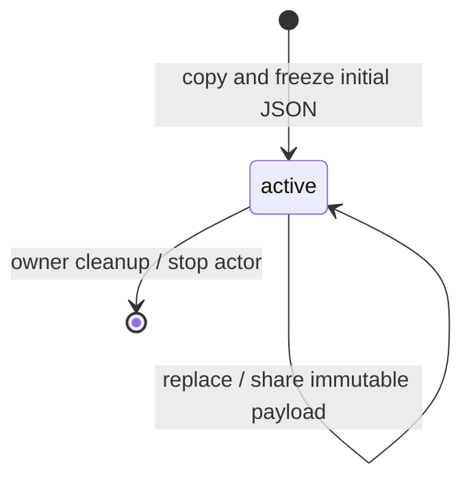

# Reactre upstream adoption

Base: Herdsman `3bc76cc71710c962202965d3833ef7250eace0a7` (PR #122).
Upstream: Reactre `63542a92765fbd401e37ce3b99fe47f429e2cd0f`, fetched from
origin/main; PRs #2–#5. Upstream implementation work remains separate.

1. Advance the source submodule without changing OXC 0.156.0 or its hashes/licenses.
2. Use the public compiler analysis-host API, with strict builds and conservative
   runtime preloads. Retain bundler/runtime source mapping and machine compilation.
3. Move the app snapshot's JSON domains to a typed payload machine. Copy/freeze
   at ingress; preserve equal-update suppression, independent domain identity,
   atomic updates, navigation, bounded activity and owner cleanup. Retain the
   generic wire/request adapters for extended values and existing lifecycle UX.
4. Verify compiler failures/externals, static template text, JSON contracts,
   immutability, equality and cleanup; run web checks and production browser checks.
5. Build every benchmark entry and run five iterations with unchanged workloads,
   correctness gates, CPU throttling, load safeguard and identical-build control.
   Record results without assigning or promising ranks; open a stacked PR.

## Application payload ownership

Incoming patches pass through `immutableData` before comparison. Equal domains
retain identity; an entirely equal patch dispatches nothing. Request and other
multi-step statecharts remain in ADR 0036. No persisted actor format changes.

Unknown input still requires domain validation. `immutableData` does not replace
a schema, support resources or restore freezing through JSON serialization.
The benchmark already uses typed payloads and shares its renderer between state
and signals; application data-boundary changes are not benchmark optimizations.

## Verification

Implementation source: `c4eb85b300a220cc5cf99da7206f93052bd8a61c`.
`make web-check` passes 345 tests, formatting, ownership/SDK guards, normal and
strict types and both benchmark type checks. `make web-e2e` passes 316 browser
checks against the mock API. `make build` and every benchmark build pass.

The full five-iteration run completes all 960 samples without errors; signals
ranks third and state fourth of 15. The 1.357% control gap exceeds both
entries' gaps from second place. See the [full evidence](../bench/web/herdsman-ui-cases/UPSTREAM-RESULTS.md).
The top-two signals target remains unmet in the recorded ranking. The state
top-five target is met. These measurements do not establish a causal speedup
from this vendor update.

The follow-up PR is #123, stacked on unmerged #122. Upstream Reactre source and
unrelated checkouts remain untouched; nothing is merged by this task.

## Follow-up adoption of Reactre PR #6

Advance the source pin from `63542a92765fbd401e37ce3b99fe47f429e2cd0f` to
`f0cb6cb9f7d9c9a96c25fb25ece2d54adb702c27`, verified against origin/main.
Upstream removes a discarded array allocation for last-reader unsubscription
and makes selector notifications honor their comparator. Reader counting and
cleanup remain covered upstream. No public API migration is needed downstream.

Keep Herdsman's existing actor ownership and whole-snapshot bridges. There are
no imports of `@reactre/state/utils/select` in this downstream source. Selecting
narrow values is workload-dependent and can lose core batching advantages;
the upstream results do not justify changing every bridge or claiming a new rank.

Re-run web checks, production browser checks, the embedded build and a full
five-iteration benchmark with the existing competitors, gates and A/A control.
Record new source provenance separately from the earlier measurements above.

Validation on implementation `1da043c334b32a928399f0733585ddd5249db475`: all 345 web tests,
type/format/ownership checks, 316 production browser checks and the embedded
build pass. The full five-iteration run passes all 960 samples and correctness
gates; state ranks third and signals fourth. The state top-five target is met,
while signals' top-two target remains unmet. The 0.833% A/A gap exceeds the
0.27% gap between the Reactre entries. See [the new report](../bench/web/herdsman-ui-cases/REACTRE6-RESULTS.md).
These results do not establish a causal improvement over the earlier run.
