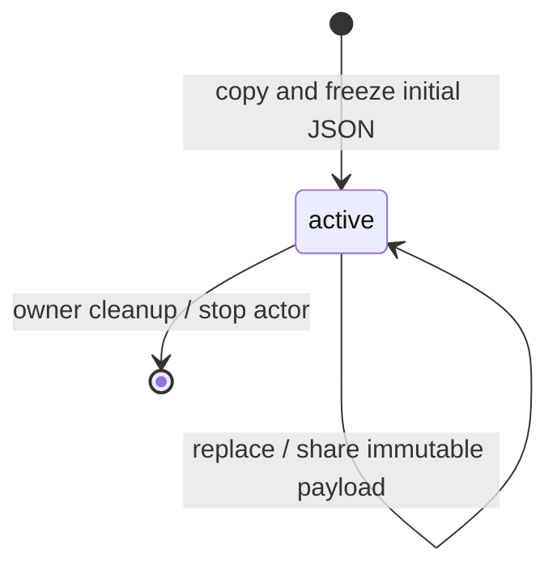

# Reactre upstream adoption

Base: Herdsman `3bc76cc71710c962202965d3833ef7250eace0a7` (PR #122).
Upstream: Reactre `63542a92765fbd401e37ce3b99fe47f429e2cd0f`, fetched from
origin/main; PRs #2–#5. Upstream implementation work remains separate.

1. Advance the source submodule without changing OXC 0.156.0 or its hashes/licenses.
2. Use the public compiler analysis-host API, with strict builds and conservative
   runtime preloads. Retain bundler/runtime source mapping and machine compilation.
3. Move the app snapshot's JSON domains to a typed payload machine. Copy/freeze
   at ingress; preserve equal-update suppression, independent domain identity,
   atomic updates, navigation, bounded activity and owner cleanup. Retain the
   generic wire/request adapters for extended values and existing lifecycle UX.
4. Verify compiler failures/externals, static template text, JSON contracts,
   immutability, equality and cleanup; run web checks and production browser checks.
5. Build every benchmark entry and run five iterations with unchanged workloads,
   correctness gates, CPU throttling, load safeguard and identical-build control.
   Record results without assigning or promising ranks; open a stacked PR.

## Application payload ownership

Incoming patches pass through `immutableData` before comparison. Equal domains
retain identity; an entirely equal patch dispatches nothing. Request and other
multi-step statecharts remain in ADR 0036. No persisted actor format changes.

Unknown input still requires domain validation. `immutableData` does not replace
a schema, support resources or restore freezing through JSON serialization.
The benchmark already uses typed payloads and shares its renderer between state
and signals; application data-boundary changes are not benchmark optimizations.
