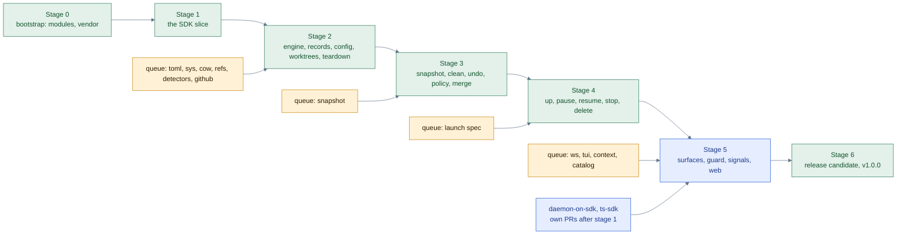

# herdsman v1.0.0: implementation plan

Status: plan, 2026-11-07, revised four times after design reviews, the last two on 2026-11-08; architecture frozen by the fourth review (see Provenance). Source of scope: [`worktree-layer-and-up.md`](worktree-layer-and-up.md) (the roadmap; every section name below refers to it). Source of method: the herdsman skill (`skills/herdsman/SKILL.md` and its references). Nothing in this plan changes the roadmap's scope; it says in which order, by whom and under which gates the roadmap is built.

## Goal

Build the eighteen roadmap pull requests (step 0, the daemon, is merged as `c7887c2`) in the shortest wall time the machine allows, with parallel implementer agents, a reviewer loop on every branch, and the herdsman skill running the whole thing. The end state is the `v1.0.0` tag on a release candidate that passed the acceptance suite, the benchmark gate, the recovery drills and the reproducible-build check.

## Paths

Every path in this plan is relative to the repository root unless it starts with `/`. The roots, once:

| What | Full path |
| --- | --- |
| Main checkout (never pulled during a route; holds the plan files until they are committed) | `/Users/arafat/code/github/a/herdsman/` |
| This plan | `/Users/arafat/code/github/a/herdsman/plans/v1-implementation-plan.md` |
| The roadmap | `/Users/arafat/code/github/a/herdsman/plans/worktree-layer-and-up.md` |
| The skill | `/Users/arafat/code/github/a/herdsman/skills/herdsman/SKILL.md`, references under `/Users/arafat/code/github/a/herdsman/skills/herdsman/references/` |
| A task's worktree (the roadmap's default template `{{ repo_path }}/../{{ repo }}.worktrees/{{ task }}`) | `/Users/arafat/code/github/a/herdsman.worktrees/<task>/` |
| A file a contract names, for task `<task>` | `/Users/arafat/code/github/a/herdsman.worktrees/<task>/<path from the Owns column>` |
| The integrator's worktree of stage `<n>` | `/Users/arafat/code/github/a/herdsman.worktrees/int-<n>/` |
| Route folder (route file, contracts, reports, `run-check.sh`) | `/Users/arafat/code/github/a/herdsman/.herdsman/<route>-<date>/` |
| Task reports | `/Users/arafat/code/github/a/herdsman/.herdsman/<route>-<date>/reports/<task>.md` |
| Private inbox of the route | `/Users/arafat/.herdsman-private/herdsman-<route>/` |
| The release binary the route runs | `/Users/arafat/.herdsman/bin/current`, a symlink to one of the exact release binaries `/Users/arafat/.herdsman/bin/herdsman-<version>` (each unpacked from the release archive kept with its `checksums.txt` under `/Users/arafat/.herdsman/releases/<version>/`); the route's `PATH` puts that directory first, so returning to a version is one symlink switch that needs no version's own commands. Homebrew's `herdsman` is the user's install and is upgraded in the drill too, but never the recovery path. An implementer's build goes to `<its worktree>/bin/herdsman` and never replaces any of these |
| Daemon state of the route's own herdsman | the state directory the daemon reports in `herdsman daemon status --json`; a promotion drill uses an isolated one (see Dogfooding) |
| Memory for the project | `/Users/arafat/.claude/projects/-Users-arafat-code-github-a-herdsman/memory/` |

A directory path ends with `/` and means every file under it. A file path names one file. A file that exists today is marked `(existing)` where a task changes it; everything else is created by the task that owns it. File names inside a new package are the plan's proposal; the directory is the ownership boundary (Decisions, 9).

## What bounds the time

Three facts, stated as what they are.

1. **The release path has a serial spine, and it is longer than the lifecycle.** The SDK slice, the operation engine, worktree creation with ownership, recovery (snapshot, clean, undo, landing), the route proof (`up`), and after them the restricted profile, the web, packaging and the platform acceptance. Each stage below needs the one before it to be merged. Agents do not shorten that chain; smaller stages and earlier integration do.
2. **The count is 48 task rows, 51 task instances (`stage-docs` runs once per stage, 2 to 5) and 28 pull requests**, not eighteen: each roadmap step splits into a library part (a package with fixtures and fuzz corpora, no shared files) and a wiring part (the verb, the daemon service, the acceptance gate), and the spine stages combine their parts through an integrator. The numbers are counted from the tables below (rows, and rows whose "Integrate with" is an own pull request plus one per group); a change to a row changes them. That is the review workload to budget for (Review loop).
3. **The machine bounds throughput, and the right concurrency is measured, not assumed.** Every check runs one at a time behind `run-check` with `GOMAXPROCS=1` (the user's rule), so a task's check is scoped to the packages it owns and only the integrator and the release candidate run the whole suite. Concurrency starts at four implementers and rises in steps of two, to a ceiling of eight, only while the measurements say it helps (Dispatch).

Two moves cut the spine. The first integrated slice is small: one real request through a generated client, the daemon handler, the error shape and the conformance test, with the common types fixed by that slice and every other service's messages finalized beside its first consumer. And library tasks start before their consumers exist, against the interface the roadmap section defines, with a named consumer that sends a handoff when the boundary needs to move.

## Ground rules for every route

These come from the user's standing decisions and the repository's contracts. Each contract quotes the ones that apply.

- **Machine first.** One check at a time through the route's `run-check.sh`, `GOMAXPROCS=1`, `go test -p 1`, a load gate at half the cores. A task's check is `go test -p 1` on the packages it owns plus `go vet` and `staticcheck` on them, run from the module that holds them; `make check` is the integrator's and the release candidate's. Web checks through Bun single-threaded; browser checks headless, one at a time, closed at once.
- **Dependency policy, precisely.** Every Go module the build resolves is either copied under the one `vendor/` at the repository root (written by `go work vendor` for the workspace of the three Go modules, built with `-mod=vendor`; Modules and checks) or `third_party/` (a copy imported through a `replace`), each with a `VENDOR.md` naming the upstream, its commit, its license and the re-vendor steps; the budget test checks that every `require` line of every module maps to such an entry and that `vendor/modules.txt` resolves no other module; CI builds with `GOFLAGS=-mod=vendor GOPROXY=off`, so no network is needed. Vendored code is still third-party code: it is listed in the SBOM and watched for advisories. What the standard library cannot do and no vendored copy provides is written in the repository (Longevity contract). A task that needs a new dependency stops and reports; it never adds one.
- **Contracts first.** Every surface is a proto message or service before it is code; verb files and the web use only the SDK; the import guard (Modules and checks) enforces it.
- **No breaking changes.** Add, never rename; SemVer on every artifact; golden tests; `buf breaking` in CI (Compatibility contract).
- **Conventional Commits**, one logical change per commit, no attribution lines in commits or pull request bodies, pull request bodies in the `pr-description` format.
- **Formatting:** `gofmt`; `bun fmt` in `web/`, nothing else.
- **Benchmarks** only with an A/A control, reported as 95% confidence intervals, on a quiet machine (Performance).
- **No routine questions until `v1.0.0`.** The orchestrator decides routine choices and records each in `00-route.md` with how to reverse it; the dispatch interview takes the saved picks (`herdsman models last`). That rule never grants authority: when a required gate cannot be satisfied, a spending limit is reached, or a step needs the user's own go (a commit of the plan, a merge the standing authorization does not cover, a credential), the orchestrator stops that item and reports the blocker. It never invents permission to bypass a gate.
- **Merges** run under the standing authorization: squash through the asynchronous merge API pinned to the reviewed head, at local pass, green CI and Greptile 5/5 on that head.
- **Draft until the local review passes.** A ready pull request triggers Greptile and Copilot at once; a credit spent on a head that will change is wasted. Greptile costs one credit per review; the balance was 43 on 2026-11-07 with automatic recharge off. The per-pull-request budget is in Review loop.
- **Dogfood boundary.** The route runs the release binary behind `/Users/arafat/.herdsman/bin/current` (Paths). Implementers build into their worktree and never install. A tag is promoted only through the drill in Dogfooding.

## Dependency inventory

The module graph today, with a disposition and an owner for each entry. The budget gate (`internal/guard/budget_test.go`) is written against this table and cannot pass before every migration row is merged.

| Dependency | Used by (today) | Disposition | Owner task | Stage |
| --- | --- | --- | --- | --- |
| `github.com/mattn/go-sqlite3` | `internal/daemon` (the store), `internal/routedb` | Copy under `third_party/go-sqlite3/` with `VENDOR.md`, imported through `replace`; cgo stays (release builds already use it) | `deps-vendor` | 0 |
| `golang.org/x/sys` | `internal/daemon/admincli.go`, `peer_darwin.go`, `peer_linux.go`, `proc_darwin.go`, `internal/inbox/source.go` | Keep, vendored under `vendor/golang.org/x/sys/` with `VENDOR.md`; the five existing call sites stay as they are. New consumers (`internal/cow`, `internal/tui`) call it through `internal/sys/`, a thin application-facing package written by the `sys-facade` queue task, so that a later replacement touches one package (Decisions, 6) | `deps-vendor` (the copy), `sys-facade` (the facade) | 0, queue |
| `rsc.io/qr` | `internal/termqr/` | Copy under `third_party/qr/` with `VENDOR.md`, imported through `replace` | `deps-vendor` | 0 |
| `google.golang.org/protobuf` (new) | `sdk` | `vendor/google.golang.org/protobuf/` with `VENDOR.md`; the SDK module's only dependency | `sdk-slice-proto` | 1 |
| `github.com/arafathusayn/herdsman/sdk` (new, the repository's own) | root, `sdk/conformance` | A workspace module (`go.work`), never vendored; the root `go.mod` requires it and carries `replace => ./sdk` so that `go mod tidy` (the maintenance mode, one module at a time) resolves it locally; the consumer smoke test proves it builds without the workspace or the `replace` | `bootstrap-modules` | 0 |
| `connectrpc.com/connect` (new, test only) | `sdk/conformance` | A test-only dependency of the conformance module, which ships in no binary; listed in that module's `VENDOR.md` and excluded from the SBOM by rule | `sdk-slice-wire` | 1 |
| Bun, `bun-types`, puppeteer-core | `web/` build and `web/e2e` | Tools, pinned by version; not shipped | unchanged | |

What the budget counts, since the three readings differ: the list of upstream codebases (one `VENDOR.md` each) is the budget and the SBOM input; the direct `require` lines must equal that list; and the no-network build is a separate check that passes or fails on its own. All three are reported by name in `make check`.

## Stages

A stage is a release checkpoint: an entry condition, the tasks whose output it needs, an exit gate, and a tag where the table in Dogfooding says so. A stage is not a barrier for the queue: a task starts when the pull requests it names under "Implement after" are merged, whatever stage is current (Dispatch). Stage tables list every task with the files it owns, its scope in the roadmap's terms, what it must prove and who runs that proof, what must be merged before it starts, and what it lands with.

"Integrate with" is one of: a **group** (the stage's integrator combines the group's branches into one pull request, in the order given, and runs the group gate), or **own PR** (the task pushes its own pull request after the local review passes). The integrator of a stage is `int-<n>`.

### Stage 0: bootstrap

Entry: this plan and the roadmap committed on `main` (the user's go; the one step the orchestrator cannot take) and their commit pinned in every contract of the stage. Two tasks, own pull requests, the second after the first; the queue's library tasks become ready as each merges.

| Task | Owns | Scope | Must prove | Implement after | Integrate with |
| --- | --- | --- | --- | --- | --- |
| `bootstrap-modules` | `MODULES.md` (the module manifest: root, `sdk`, `sdk/conformance`, `sdk/ts`, `web`, each with its check command), `Makefile` (existing: `check` becomes the aggregate over every module; `check-root`, `check-sdk`, `check-conformance`, `check-sdk-ts`, `check-web` targets), `.github/workflows/tests.yml` (existing: one job per module), `.github/workflows/sdk-consumer.yml` (the external-consumer smoke test), `internal/guard/imports_test.go` (the import guard with its server list, its wiring allowlist and the fixtures under `internal/guard/testdata/allowed/`, `internal/guard/testdata/rejected/` and `internal/guard/testdata/mixed/`), `go.work` (the three Go modules), `sdk/go.mod` (module `github.com/arafathusayn/herdsman/sdk`, at `sdk/`), `sdk/version/version.go` (the one package the smoke test imports), `sdk/conformance/go.mod` (module `github.com/arafathusayn/herdsman/sdk/conformance`, `replace ../`), `go.mod` (existing: `require` and `replace => ./sdk`) | Modules and checks: every module checked from its own root in workspace mode; the consumer smoke test builds a throwaway module outside the repository in the external-consumer mode (Modules and checks, build modes: `GOWORK=off`, `GOFLAGS` unset, no `replace`, `GOPROXY=direct`) that requires the SDK at the commit under test; the import guard as Modules and checks defines it, file by file | `make check` runs every module and fails when any fails; the smoke job builds the consumer against `sdk/version` at the pushed commit with the repository's flags cleared, and the job fails when `GOFLAGS` reaches it; the guard passes the `allowed` fixture (an SDK call plus a local form), rejects the `rejected` fixture (a direct `internal/wtree` call from a verb file), and on the `mixed` fixture (one package holding an allowlisted wiring file that imports a server package and a thin verb file that does not) passes the thin file and reports only the wiring file as allowlisted; `main.go` and `cmd_daemon.go` pass by the allowlist | none | own PR |
| `deps-vendor` | `third_party/go-sqlite3/`, `third_party/qr/`, `third_party/README.md`, `vendor/` (written by `go work vendor`: `golang.org/x/sys` with its `VENDOR.md`, and `modules.txt`), `VENDOR.md` templates, `go.mod` (existing: the two `replace` lines), `.goreleaser.yaml` (existing: the `go mod tidy` hook removed, the build in the repository mode of Modules and checks), `Makefile` `deps-verify` target (the maintenance mode: tidy per module and a re-vendor that leaves no diff), `.github/workflows/tests.yml` (existing: the `deps-verify` job), `internal/guard/budget_test.go` (reads every module's `go.mod` and `vendor/modules.txt`), `internal/guard/network_test.go` (the `-mod=vendor`, `GOPROXY=off` build), `.github/dependabot.yml`, `renovate.json`, `.github/workflows/vuln.yml` (daily `govulncheck` and OSV, advisories against every `VENDOR.md` pin), `.github/workflows/reproducible.yml`, `.github/ISSUE_TEMPLATE/yearly-routine.md`, `MAINTAINING.md`, `SECURITY.md`, `docs/threat-model.md`, `docs/adr/` (one `NNNN-<decision>.md` per roadmap decision, `README.md` index) | Dependency inventory rows 1 to 3, and Longevity contract rows: the budget test against the inventory, the no-network build, Dependabot and Renovate on every upstream pin, the daily advisory job, the reproducible-build check, the yearly routine, the ADRs, the threat model | Each guard has a test that fails when its rule is broken; the budget test lists the upstream codebases by name and fails on an unlisted `require` in any module; the no-network build passes from every module root; the release build runs on the tag's commit with the network off (`GOPROXY=off`) and produces the binary; `deps-verify` fails on a planted stale `vendor/modules.txt`; the advisory job fails on a planted old pin | `bootstrap-modules` | own PR |

Exit: the two pull requests merged; `make check` green with the aggregate target; the budget test passes; the plan commit pinned. No tag.

### Stage 1: the first slice

Entry: stage 0 merged. One group, `sdk`, integrated by `int-1`, merge order `sdk-slice-proto`, `sdk-slice-wire`. In every table, an "Implement after" entry marked *(integrated)* names a task of the same group: the consumer branches from the group's recorded integration commit that contains it, not from `main` (Dispatch). Every other entry names a pull request that must be merged on `main`.

| Task | Owns | Scope | Must prove | Implement after | Integrate with |
| --- | --- | --- | --- | --- | --- |
| `sdk-slice-proto` | `proto/herdsman/core/v1/core.proto` (`Error`, `Version`, `Plan`, the id types, the domain types the slice needs), `proto/herdsman/daemon/v1/message.proto` (`MessageService` with `Status` only), `proto/herdsman/{config,plugin,suggest,cli}/v1/README.md` (reserved packages, no messages yet), `buf.yaml`, `buf.gen.yaml`, `buf.lock`, `cmd/protoc-gen-herdsman-go/`, `sdk/core/v1/`, `sdk/daemon/v1/` (generated), `sdk/testdata/descriptor.golden`, `vendor/google.golang.org/protobuf/`, `vendor/VENDOR.md`, `Makefile` (existing: `proto`, `proto-check`), `cmd/herdsman/cmd_spec.go` (`spec proto`, `spec descriptor`) | The herdsman SDK, Contracts, for the slice only: the common types once, one real service, the generator (one interface per service, `NewHandler`, `NewClient`), generated code committed and checked for staleness, `buf breaking` against an empty baseline, `spec proto\|descriptor` | `buf lint` clean; generated Go compiles; a golden of the `FileDescriptorSet`; `herdsman spec proto\|descriptor` prints it; the budget test still passes with protobuf-go as the SDK module's only dependency | stage 0 | group `sdk` |
| `sdk-slice-wire` | `sdk/rpc/` (`handler.go`, `client.go`, `codes.go`, `errors.go`, `fuzz_test.go`), `sdk/client/` (`dial.go`, finds the socket as the CLI does), `internal/daemon/rpc.go` (the mux and the one handler), `internal/daemon/services.go` (the registration list, owned by the integrator afterwards), `cmd/herdsman/cmd_message.go` (existing: `message status` through the generated client), `sdk/conformance/go.mod` (existing: connect-go, test only), `sdk/conformance/VENDOR.md`, `sdk/conformance/unary/`, `sdk/conformance/daemon/` | Transports, the unary binding in full: path shape, both content types, the Connect error table, `Connect-Protocol-Version`, `Connect-Timeout-Ms`; the daemon serves it on its socket beside the 0.x routes; `message status` is the first verb that is a thin client | connect-go calls the binding unchanged for every error code and both encodings; `message status` through the client equals the 0.x output byte for byte; fuzz target on the request path; the consumer smoke test builds against the published client | `sdk-slice-proto` *(integrated)* | group `sdk` |

Exit: the `sdk` pull request merged; the group gate (the conformance run against the daemon on macOS and Linux) green; **tag `v0.6.1`** from `main` at the merge, through the normal release workflow, with no `sdk/` tag (SDK tags start at `v0.7.0`). It exists so that the first promotion drill has a previous release with a daemon: `v0.6.0` has none. It is not installed on `PATH`. Keep its archive and `checksums.txt` under `/Users/arafat/.herdsman/releases/v0.6.1/` and its binary at `/Users/arafat/.herdsman/bin/herdsman-0.6.1`. When stage 2 closes and before the `v0.7.0` drill starts, install its daemon with that binary (`daemon install`) and seed it with a scripted throwaway route (`daemon route create`, a Herdr session of its own so that the route's Herdr link answers, and scripted messages sent with `send`), until `daemon status --json` exits 0 with `status` `ok` and the route is listed. From here every later task that adds a service owns that service's `.proto` file and finalizes it beside its first consumer (Shared files).

### Stage 2: the lifecycle foundation

Entry: stage 1 merged. Two groups: `engine` (`int-2`, order `ops-engine`, `records`, `config-load`) and `worktrees` (`int-2`, order `wtree-core`, `wtree-verbs`, `teardown`, `bench-harness`). The libraries the stage consumes are queue tasks (Stage libraries) and start in stage 0 or 1.

| Task | Owns | Scope | Must prove | Implement after | Integrate with |
| --- | --- | --- | --- | --- | --- |
| `ops-engine` | `internal/ops/` (`journal.go`, `operation.go`, `reconcile.go`, `locks.go`, `preconditions.go`, `outbox.go`, `schema.sql`, `crash_test.go`, `crashharness/`), `internal/statedir/` (`dir.go`: one state directory every path derives from, overridable by `HERDSMAN_STATE_DIR`, reported by `daemon status --json`), `internal/daemon/inspect.go` (the inspect mode: `daemon run --inspect` opens and migrates the state directory, serves reads, and runs no effect: no reconciliation retry, no hook, no automation, no process signal, no git or remote call, no outbox delivery; every mutating request returns `FailedPrecondition` naming the mode), `internal/daemon/admincli.go` (existing: `status --json` adds `state_dir`, `supervisor_file` (the plist or unit path `supervisor.go` writes), `inspect`, `schema` with `current` from `PRAGMA user_version` and `expected` from the highest migration the binary ships, and `counts` (the routes, tasks and messages held; `tasks` stays zero until `records` adds its table), and `digest`, a canonical hash over the stable ids and payload fields of every route, task, message and operation, computed by `internal/daemon/store/digest.go`), `internal/daemon/store/migrate_fixture_test.go` and `internal/daemon/store/testdata/schema-<n>/` (a fixture database per released schema version, migrated forward and compared by stable ids, representative payloads and the digest, not by counts), `internal/daemon/store/MIGRATIONS.md` (every intentional transformation a migration makes, the list the fixture test and the drill read), `proto/herdsman/daemon/v1/ops.proto` (`OpsService`), `internal/daemon/ops_service.go`, `cmd/herdsman/cmd_ops.go` | Operations, Design review: pending, intended, done; intent before effect; idempotency keys; reconciliation by key then identity; locks per task and target ref; preconditions; the outbox; the crash-injection harness; `herdsman ops`; the state directory; the inspect mode the promotion drill rehearses on | The harness kills the process at every step boundary of a scripted operation and the reconcile leaves one effect, never two; `ops` golden; two daemons with two state directories run side by side (the drill's precondition); the sentinel gate: a copied state directory holding an `intended` step whose effect targets a sentinel path (a file to create, a process id to signal) is opened with `--inspect`, the status reports `inspect: true` and the migrated schema, and the sentinel is untouched after the start and after an `ops` listing; the fixture test fails when a migration changes a payload or an association that `MIGRATIONS.md` does not list | stage 1 | group `engine` |
| `records` | `internal/project/` (`project.go`, `task.go`, `store.go`, `schema.sql`, `resolve.go`, `bind.go`, `slug.go`, `store_test.go`), `proto/herdsman/daemon/v1/project.proto`, `proto/herdsman/daemon/v1/task.proto` (records methods; the worktree verbs are added by their owners), `proto/herdsman/core/v1/core.proto` (existing: `Project`, `Task`), `internal/daemon/project_service.go`, `internal/daemon/task_service.go` (records methods), `cmd/herdsman/cmd_project.go`, `cmd/herdsman/cmd_task.go` | Projects, tasks and the context repo, Model: the tables, `ProjectService` and `TaskService` records, `project` and `task` verbs without `start` and `done`, `project bind` and `unbind`, resolution from a folder | The projects-and-tasks tests in Tests: CRUD through the SDK against a temp store; a task refused on a second project (no update path for the project id) | `ops-engine` *(integrated)* | group `engine` |
| `config-load` | `proto/herdsman/config/v1/config.proto` (the `Config` message and `ConfigService`), `sdk/config/` (`load.go`, `bind.go`, `precedence.go`, `defaults.go`, `sources.go`, `codec.go`, `bin.go`, `jsonschema.go`, `normalize.go`, `strict.go`, `load_test.go`, `testdata/fixtures/`), `sdk/internal/encoding/` (existing from `toml-codec`, bound here), `internal/approvals/` (`store.go`), `internal/daemon/config_service.go`, `cmd/herdsman/cmd_config.go`, `cmd/herdsman/cmd_spec.go` (existing: `spec jsonschema`) | Configuration and The config spec is an IDL: `config.Load` binding TOML, YAML, JSON and `.bin` to the generated message through the descriptor; precedence; defaults with sources; `get`, `set`, `unset`, `show`, `export`, `update`, `init`, `schema`; kebab-case normalization; the approvals store; strictness of `[policy]` and `[launch]` | One fixture set runs through all four decoders; `config show` prints each value with its source; a misspelled key in `[policy]` stops the command; `config export` round-trips without loss | `sdk-slice-proto`, `toml-codec` | group `engine` |
| `wtree-core` | `internal/wtree/` (`templates.go`, `resolve.go`, `shortcuts.go`, `state.go`, `schema.sql`, `collect.go`, `status.go`, `cache.go`, `ecosystem.go`, `register.go`, `wtree_test.go`, `testdata/`), `internal/gitrun/` (`run.go`, the one git helper with the scrubbed environment and the `logs/commands.jsonl` trace) | Architecture, `internal/wtree`: templates with the `FuncMap`, path and branch resolution, shortcuts, the SQLite state (schema 1, migrations forward only), `ls` collection with the bounded pool and SHA-keyed caches, status cells without an mtime cache, resource registration; the `gitrun` helper every git call goes through | Templates, shortcuts and ecosystem detection unit tests; `ls` collection on a twenty-worktree fixture under the first-paint target; the exec-helper guard passes | `engine` merged, `cow-clone`, `ref-reader` | group `worktrees` |
| `wtree-verbs` | `proto/herdsman/daemon/v1/task.proto` (existing: `New`, `Go`), `cmd/herdsman/cmd_wt_new.go`, `cmd/herdsman/cmd_wt_ls.go`, `cmd/herdsman/cmd_wt_go.go`, `cmd/herdsman/cmd_hook.go`, `cmd/herdsman/cmd_config_shell.go`, `internal/hooks/` (`parse.go`, `run.go`, `approve.go`, `result.go`, `hooks_test.go`), `internal/daemon/task_service_wtree.go`, `internal/shell/` (the `cd` wrapper and completions), `internal/wtree/integration_test.go` | `herdsman new` (all five steps, through herdr when reachable), `ls` (`--full`, `--all`, `--statusline`), `go` (every selector), `hook` (`--dry-run`, `--approve`, `--from`), `config shell install`, `--json` everywhere; `internal/hooks` with the twelve keys in string, map and pipeline forms | The integration tests in Tests with real git in a temp dir: `new` from a base, `ls` columns, `go pr:<n>` against the fake `gh` from `landing-github`; `herdsman ls --json \| jq` documented | `wtree-core` *(integrated)*, `landing-github` (the fake `gh` only) | group `worktrees` |
| `teardown` | `internal/ledger/live_process.go`, `internal/ledger/live_container.go`, `internal/ledger/signal.go`, `internal/ledger/revalidate.go`, `internal/ledger/table.go`, `internal/ledger/log.go`, `proto/herdsman/daemon/v1/ledger.proto` (`LedgerService`), `internal/daemon/ledger_service.go`, `cmd/herdsman/cmd_wt_teardown.go`, `cmd/herdsman/cmd_resource.go` (`resource add`), `cmd/herdsman/cmd_wait.go` (existing: the health check reads the ledger), `acceptance/teardown/`, `acceptance/requirements.md` (the capabilities each platform must provide; first entries) | Ownership evidence and `herdsman teardown`: execution ids, live detection, revalidation before every signal, process groups only when every member is exclusive, compose stop, nothing removed; the `resources` table; the waiter's health check reads it | The real-platform gate, run by the integrator as the group gate: task A's teardown leaves task B, shared services and human processes untouched under overlapping signals; `make acceptance` gains its first gate | `wtree-verbs` *(integrated)*, `ledger-detect` | group `worktrees` |
| `bench-harness` | `bench/worktrees/` (`harness.go`, `fixtures.go`, `cases.go`, `aa.go`, `report.go`, `wt.version`, `results/<date>-<wt version>.md`), `.github/workflows/bench.yml`, `Makefile` (existing: `bench`) | Performance, the gate: fixtures (20 and 50 worktrees, the 2 GB ignored tree, every integration state), the cases of the commands this stage ships (`ls`, `ls --full`, `new`, `go`; `clean-down` adds `clean --merged` and `merge-verb` adds both `merge` strategies in stage 3), the budget cases without a `wt` equivalent for the ledger scan and `teardown` (`up-command` adds the `up` budget in stage 4), the A/A control, the results file recording the source commit, the machine, the git, Go and `wt` versions; the `bench-results` check compares the recorded commit with the last commit to the measured packages | A results file committed from a quiet run through `run-check`; the check fails when the recorded commit is older than the last commit to `internal/wtree`, `internal/cow` or `internal/ledger` or records a lost case, and the results include the ledger scan and `teardown` budgets | `wtree-verbs`, `teardown` *(all integrated)* | group `worktrees` (last) |

Exit: both group pull requests merged; the teardown gate green on macOS and the Linux runner; **tag `v0.7.0`** through the promotion drill. From here the route creates implementer worktrees with `herdsman new` and ends each task with `herdsman teardown <task> -y`.

### Stage 3: recovery

Entry: stage 2 merged. One group, `recovery` (`int-3`), merge order `undo-ops`, `clean-down`, `policy-enforce`, `commit-diff-each`, `merge-verb`. Recovery lands before any verb that deletes a route or lands code, which is why `delete` and `merge` are here and after `clean`.

| Task | Owns | Scope | Must prove | Implement after | Integrate with |
| --- | --- | --- | --- | --- | --- |
| `undo-ops` | `internal/ops/undo.go`, `internal/ops/retention.go`, `internal/ops/export.go`, `internal/ops/import.go`, `internal/ops/undo_test.go`, `proto/herdsman/daemon/v1/ops.proto` (existing: `Undo`, `Export`, `Import`), `cmd/herdsman/cmd_undo.go`, `cmd/herdsman/cmd_export.go`, `cmd/herdsman/cmd_import.go` | Undo: restore a snapshot into a fresh worktree or the original path, re-create the branch, re-import volumes, scratch and preserved ignored files; `[retention]` and the cap; `export` and `import` of the whole account, where `export` runs under an export barrier: it takes the account lock so that every mutating operation and the retention sweep wait, copies each SQLite database with `VACUUM INTO` (a consistent copy of one database; it coordinates nothing beyond it, [`VACUUM`](https://www.sqlite.org/lang_vacuum.html)), copies every snapshot bundle and preserved archive the copied records reference and the rest of the state directory, writes all of it into a temporary directory beside the destination, and renames it into place as the last step, so an export either exists whole or not at all; a more concurrent export is a later version | `undo` restores a snapshot taken by `internal/snapshot` of a scripted dirty tree: tree, branch, an ignored `.env`; the cap full makes the caller's operation refuse, not drop; the export gate: `export` runs while a scripted loop creates snapshots and the retention sweep prunes them, and every export that completes imports into an empty state directory with every referenced snapshot present and a record-for-record match through the SDK, while an export interrupted by a kill leaves no destination directory (the promotion drill does not depend on `export`; Dogfooding). The end-to-end "ignored files survive `clean` and return with `undo`" gate belongs to the group gate, run by the integrator after `clean-down` lands | stage 2, `snapshot-manifest` | group `recovery` |
| `clean-down` | `proto/herdsman/daemon/v1/task.proto` (existing: `Clean`, `Down`, `Prune`), `cmd/herdsman/cmd_wt_clean.go`, `cmd/herdsman/cmd_wt_down.go`, `cmd/herdsman/cmd_wt_prune.go`, `internal/wtree/clean.go` (the eight steps), `internal/wtree/inventory.go`, `internal/wtree/trash.go`, `internal/wtree/branchdelete.go`, `internal/daemon/task_service_clean.go`, `acceptance/clean/`, `bench/worktrees/cases.go` (existing: the `clean --merged` case), `bench/worktrees/results/<date>-<wt version>.md` | `herdsman clean`, the eight steps with the inventory invariant; `down` as one plan; `prune`; `clean --merged` in one pass; `--force-irreversible` | The gates (group gate): an ignored `.env` and database survive an ordinary `clean` and come back with `undo`; a failed snapshot or an uncaptured path refuses deletion; the branch is deleted only on ancestry, a landing record or a merged pull request; a results file from a quiet run through `run-check` includes the `clean --merged` case and records no lost case | `undo-ops` *(integrated)* | group `recovery` |
| `policy-enforce` | `internal/policy/` (`policy.go`, `compose.go`, `budget.go`, `admission.go`, `interrupt.go`, `runtime.go`, `protected.go`, `checks.go`, `policy_test.go`), `proto/herdsman/config/v1/config.proto` (existing: `Policy`), `internal/daemon/policy.go` (the admission check on every operation), `cmd/herdsman/cmd_cost.go`, `acceptance/budget/` | Policy and budgets: the `[policy]` section, the three promises (admission hard, interruption best effort, runtime through `teardown`), restrictive composition, `protected`, `required_checks`, `landing`, `review`, `max_agents`, `deny`; `herdsman cost` from measured usage | A `wall` deadline refuses a new operation; a `machine` limit stops the task's exclusive processes within `grace` and leaves a shared server running (group gate); composition tests by minimum and union | stage 2 | group `recovery` |
| `commit-diff-each` | `proto/herdsman/daemon/v1/task.proto` (existing: `Commit`, `Diff`), `cmd/herdsman/cmd_commit.go`, `cmd/herdsman/cmd_wt_diff.go`, `cmd/herdsman/cmd_each.go`, `internal/commitmsg/` (`parse.go`, `generate.go`, `fallback.go`, `commitmsg_test.go`, `testdata/`), `internal/daemon/task_service_commit.go` | `commit` with the Conventional Commits parser, the bounded generator and its deterministic fallback, `--squash`; `diff` in its three modes; `each` | Parser golden; the generator's fallback produces a valid conventional subject with no harness installed; `diff` output byte-equal to git's | stage 2 | group `recovery` |
| `merge-verb` | `proto/herdsman/daemon/v1/task.proto` (existing: `Merge`), `cmd/herdsman/cmd_wt_merge.go`, `internal/landing/pipeline.go`, `internal/landing/candidate.go`, `internal/landing/review.go` (the tuple binding), `internal/landing/record.go`, `internal/landing/confirm.go`, `internal/landing/pipeline_test.go`, `internal/daemon/task_service_merge.go`, `acceptance/landing/`, `bench/worktrees/cases.go` (existing: the `merge` cases), `bench/worktrees/results/<date>-<wt version>.md`, `.github/workflows/bench.yml` (existing: the `bench-results` check's packages) | `herdsman merge`, the seven steps: candidate worktree, the review tuple binding with patch-id as a diagnostic, `--waive-review`, the landing record, `exact` and `delegated`, confirm, then `down` (from `clean-down`) only after `confirmed` | The gates (group gate): under `exact` a moved target is refused and nothing lands; a conflict resolution, a target move and a whitespace-only change each make the review stale; a lost response reconciles by fetching; `down` never runs after an unconfirmed landing; a results file from a quiet run through `run-check` includes both `merge` strategies and records no lost case, and the `bench-results` check also compares the recorded commit with the last commit to `internal/landing` | `clean-down`, `policy-enforce`, `commit-diff-each` *(all integrated)*, `landing-github` | group `recovery` (last) |

Exit: the group pull request merged; every gate of roadmap pull requests 6 and 7 green on both platforms; **tag `v0.8.0`** through the drill. From here the route lands its own pull requests with `herdsman merge`, closes tasks with `herdsman down`, and runs `undo` in the drill's lifecycle exercise.

### Stage 4: the route proof

Entry: stage 3 merged. One group, `route` (`int-4`), merge order `up-command`, `route-control`.

| Task | Owns | Scope | Must prove | Implement after | Integrate with |
| --- | --- | --- | --- | --- | --- |
| `up-command` | `proto/herdsman/daemon/v1/route.proto` (`RouteService`), `proto/herdsman/config/v1/config.proto` (existing: `Launch`), `cmd/herdsman/cmd_up.go`, `internal/route/` (existing; new files `up.go`, `folder.go`, `inbox.go`, `workspace.go`, `pair.go`, `attest.go`, `up_test.go`), `internal/daemon/route_service.go` (`Up`, `Get`, `List`), `internal/herdr/herdrtest/` (existing fake herdr, extended with `pane.process_info`), `acceptance/up/`, `bench/worktrees/cases.go` (existing: the `up` budget case), `bench/worktrees/results/<date>-<wt version>.md` | `herdsman up`, the nine steps, as one resumable operation on the engine with the launch spec; the pair attestation through `pane.process_info`; `--dry-run`; `--web` only when asked | The fake herdr end-to-end test with a scripted `/dev/tty`; the gates (group gate): a real route starts without manual channel repair; a retry after a crash never launches a second agent; a prelude step that crashes after its effect and before its marker, with the pane destroyed, is neither rerun nor marked done on resume; a results file from a quiet run through `run-check` includes the `up` budget | stage 3, `launch-spec` | group `route` |
| `route-control` | `cmd/herdsman/cmd_pause.go`, `cmd/herdsman/cmd_resume.go`, `cmd/herdsman/cmd_stop.go`, `cmd/herdsman/cmd_delete.go`, `internal/route/control.go`, `internal/daemon/route_service_control.go` (`Pause`, `Resume`, `Stop`, `Delete`) | `pause`, `resume`, `stop`, `delete` as operations; `pause` as the best-effort interrupt through herdr; `delete` as a destructive verb on the snapshot and undo pipeline of stage 3 | Each verb is idempotent and journaled; `delete` refuses without a verified snapshot and is undone by `undo`; the pair left pending is reported by `status` | `up-command` *(integrated)* | group `route` |

Exit: the group pull request merged; the gates of roadmap pull request 8 green; the promotion drill run with `up` itself (Dogfooding); **tag `v0.9.0`**. From here `herdsman up` starts the route.

### Stage 5: the remaining product

Entry: stage 4 merged, though every task below starts as soon as its own "Implement after" set is merged, from the queue. Groups: `surfaces` (`int-5`, order `tui-forms`, `plugin-host`, `suggest-service`), `guard` (`int-5`, order `restricted-profile`, `multi-repo-tasks`), `signals` (`int-5`, order `traces-eval`, `mcp-server`, `automations`), `web` (`int-5`, order `events-stream`, `web-gateway`, `web-pages`, `web-docs`). `daemon-on-sdk` is its own pull request.

| Task | Owns | Scope | Must prove | Implement after | Integrate with |
| --- | --- | --- | --- | --- | --- |
| `daemon-on-sdk` | `proto/herdsman/daemon/v1/message.proto` (existing: the rest of `MessageService`), `internal/daemon/` (existing: the 0.x JSON routes, SSE and integer header removed), `cmd/herdsman/cmd_message.go` (existing), `cmd/herdsman/cmd_daemon.go` (existing), `sdk/conformance/daemon/` (existing, every method) | The remaining daemon and message commands moved onto the SDK; one API (Transports); the 0.x surface removed as contract rule 7 allows | Conformance passes for every method; the skill's message commands work unchanged; no listener or route outside `/rpc` | stage 1 | own PR |
| `ts-sdk` | `proto/herdsman/cli/v1/cli.proto` (`CommandSpec`), `sdk/ts/` (`package.json` with no dependencies, `tsconfig.json`, `build.ts`, `src/client.ts`, `src/stream.ts`, `src/generated/`), `cmd/protoc-gen-herdsman-ts/`, `cmd/herdsman/cmd_spec.go` (existing: `spec cli`), `sdk/conformance/cli/`, `Makefile` (existing: `check-sdk-ts` filled in) | `@herdsman/sdk` with the types generator, `createClient` on `fetch`, the async iterator over the JSON subprotocol, zero dependencies, built with Bun; `spec cli` and its golden; the conformance scenarios for a CLI | `bun check` strict; the TypeScript client passes the same unary conformance scenarios as the Go client against the daemon; `spec cli` golden | stage 1 | own PR |
| `tui-forms` | `internal/tui/forms/` (`up.go`, `go.go`, `teardown.go`, `clean.go`, `down.go`, `taskcreate.go`, `forms_test.go`, `testdata/frames/`), `cmd/herdsman/form_up.go`, `cmd/herdsman/form_go.go`, `cmd/herdsman/form_teardown.go`, `cmd/herdsman/form_clean.go`, `cmd/herdsman/form_down.go`, `cmd/herdsman/form_task_create.go`, and one line in each of those six verb files that calls its form when it has no arguments and a terminal (a handoff to the integrator) | The TUI, one form per command, the plan as the last screen, prefilled defaults from `doctor`, the config and the project; `--plain`; `--no-tui`; a non-terminal takes the scripted path | The pty test runs each form end to end; `up` without arguments opens its form; golden frames | stage 4, `tui-runtime` | group `surfaces` |
| `plugin-host` | `proto/herdsman/plugin/v1/plugin.proto`, `proto/herdsman/daemon/v1/plugin.proto` (`PluginService`), `internal/plugin/` (`host.go`, `handshake.go`, `registry.go`, `approval.go`, `plugin_test.go`), `sdk/plugin/` (`serve.go`, `host.go`), `internal/daemon/plugin_service.go`, `cmd/herdsman/cmd_plugin.go`, `examples/plugins/codec-kdl/`, `examples/plugins/detector-example/`, `examples/plugins/backend-gitea/`, `examples/plugins/generator-example/`, `examples/plugins/column-example/`, `sdk/conformance/plugin/`, `cmd/herdsman/main.go` (existing: the registry built once with the built-ins, a handoff to the integrator) | `herdsman.plugin.v1` (experimental): the handshake, the registry, `plugin list\|describe\|install\|remove\|verify\|run`, one example plugin per extension point, built-ins registered through the same interfaces | Conformance passes for each example plugin through `plugin verify`; a plugin that fails its handshake is skipped by name | stage 3 (the extension points exist), `ts-sdk` | group `surfaces` |
| `suggest-service` | `proto/herdsman/suggest/v1/suggest.proto`, `internal/daemon/suggest_service.go`, `internal/suggest/apply.go`, `cmd/herdsman/cmd_suggest.go` | `suggest`, `show`, `add`, `apply` with the per-checksum approval and a terminal, `source`; `SuggestService` | `apply` refuses without a terminal; `--json` carries the reasons; the service passes conformance | `suggest-catalog`, stage 2 | group `surfaces` |
| `restricted-profile` | `internal/profile/` (`profile.go`, `restricted.go`, `clone.go` with `--reference --dissociate`, `roots.go`, `profile_test.go`), `internal/secrets/` (`keychain_darwin.go`, `keychain_linux.go`, `inject.go`, `redact.go`, `secrets_test.go`), `internal/doctor/` (existing; new file `enforcement.go`), `cmd/herdsman/cmd_up.go` (existing: `--pair manual`), `acceptance/restricted/` | Profiles: `restricted` with per-task dissociated clones as the sandbox root, Codex's folder sandbox, `[policy] roots`, `--pair manual`, `doctor` reporting what is enforced; secrets from the keychain at process start, redaction in logs, pane tails and the web | The gates (group gate): source branches deleted and `git maintenance run` executed in the main repository leave every task usable; an exported snapshot restores on a machine without the source; a secret never appears in a log or a tail | stage 4 | group `guard` |
| `multi-repo-tasks` | `proto/herdsman/daemon/v1/task.proto` (existing: `Start`, `Done`, `Link`), `cmd/herdsman/cmd_task.go` (existing), `internal/project/multi.go`, `internal/project/repos.go`, `internal/daemon/task_service_multi.go`, `internal/context/outbox.go`, `internal/context/search.go`, `cmd/herdsman/cmd_project_context.go` (existing: `search`) | `task start` and `done` across repositories with per-repository state; events appended from the outbox by `task`, `merge`, `up` and route close; knowledge search | `task start` across two repositories; `merge` lands each by its repository's policy; `down` takes all down; every event kind in the grammar appears once in a scripted route | stage 4, `context-repo` | group `guard` |
| `traces-eval` | `internal/trace/` (`span.go`, `collect.go`, `otlp.go`, `eval.go`, `findings.go`, `stats.go`, `trace_test.go`, `testdata/`), `cmd/herdsman/cmd_trace.go`, `cmd/herdsman/cmd_eval.go` | Traces and evaluation: spans per turn, command, check, review and hook; `trace --otlp\|--json`; `eval` (experimental) with the gate's statistics; reviewer findings recorded with outcomes, nothing ranked | An OTLP collector fixture receives the spans; `eval` reports counts and intervals with an A/A control and refuses to rank without a labeled set | stage 4 | group `signals` |
| `mcp-server` | `internal/mcp/` (`server.go`, `tools.go`, `schema.go`, `stdio.go`, `mcp_test.go`, `testdata/tools.golden`), `cmd/herdsman/cmd_mcp.go` | `herdsman mcp` generated from the descriptors: tool names from service and method, input schemas from the request messages, the same `Plan` on every mutating tool, policy applied | A golden of the tool list; a mutating tool returns its `Plan` under `dry_run`; the policy's `deny` applies | stage 3, `daemon-on-sdk` | group `signals` |
| `automations` | `internal/automations/` (`config.go`, `trigger.go`, `actions.go`, `approval.go`, `automations_test.go`), `proto/herdsman/config/v1/config.proto` (existing: `Automations`), `internal/daemon/automations.go` | `[automations]` (experimental): event kinds to a shell template, a built-in or a plugin action, per-checksum approval, logs, `--dry-run` | A `review.p0` event pauses a route in the fake herdr; an unapproved template never runs; the experimental marker prints once per run | `plugin-host`, stage 4 | group `signals` |
| `events-stream` | `proto/herdsman/daemon/v1/events.proto` (`EventService`, `StreamFrame`), `sdk/events/` (`subscribe.go`, `frames.go`, `wait.go`), `sdk/internal/ws/` (existing from `ws-framing`, bound here), `internal/daemon/event_service.go` (the per-topic bounded queue, cursors, `Wait`) | Transports, the stream: `Subscribe`, `Unsubscribe`, `Event`, `Lagged`, ping, cursors, `Wait` as the long poll over the same topics; the web is the first consumer | A slow subscriber gets `Lagged` and resumes from its cursor; `Wait` returns the same events as the stream for a scripted topic; conformance for both | `ws-framing`, `daemon-on-sdk` | group `web` |
| `web-gateway` | `internal/web/` (existing; new files `gateway.go`, `forward.go`, `session.go`, `stream_proxy.go`, `gateway_test.go`), `cmd/herdsman/cmd_web.go` (the `web` verb, moved out of the existing wiring) | `herdsman web` as a gateway: static app, the RPC services and the stream forwarded over the socket with the browser's session attached, the session token, localhost only | The gateway passes conformance as a daemon would; the stream resumes from a cursor after a reconnect; no listener outside localhost | `events-stream` *(integrated)*, `ts-sdk` | group `web` |
| `web-pages` | `web/src/` (existing app, rebuilt), `web/src/sdk/`, `web/src/pages/projects/`, `web/src/pages/tasks/`, `web/src/pages/suggestions/`, `web/src/pages/cost/`, `web/src/pages/traces/`, `web/src/pages/worktrees/`, `web/src/pages/route/`, `web/src/pages/new-route/`, `web/e2e/` (existing, extended), `web/build.ts` (existing), `web/public/` (existing) | The app rebuilt on `@herdsman/sdk`: projects and tasks, Suggestions, cost and traces, the worktrees tab with queued `teardown`, `clean`, `down` and `undo`, the route controls, the New route form on the launch spec; the recorded web preferences (sidebar theme switch, mobile layout, no green outlines, logo C) | `make check-web` and `make web-e2e` in headless Chrome; every page renders from the SDK alone | `web-gateway` *(integrated)*, `suggest-service`, `traces-eval`, `multi-repo-tasks` (the `surfaces`, `signals` and `guard` pull requests) | group `web` |
| `web-docs` | `docs/` (`index.md`, `commands/` generated from `spec cli`, `config.md` generated from the descriptor, `sdk.md`, `plugins.md`), `README.md` (existing), `skills/herdsman/SKILL.md` (existing), `skills/herdsman/references/` (existing: the files the stage docs tasks have not already updated), `.github/workflows/docs.yml`, `Makefile` (existing: `docs`) | Contracts and references rewritten for the whole product; the skill's templates read `spec cli`; docs regenerated from the specs in CI | The docs job's diff is empty after regeneration; every verb in `spec cli` has a page | `web-pages` *(integrated)* | group `web` (last) |

Exit: the four group pull requests and the two own pull requests merged; every gate of roadmap pull requests 10 to 16 green on both platforms; **tag `v0.10.0`**.

### Stage 6: release

Entry: stage 5 merged. Three tasks, own pull requests, then the release candidate.

| Task | Owns | Scope | Must prove | Implement after | Integrate with |
| --- | --- | --- | --- | --- | --- |
| `release-pipeline` | `.github/workflows/release.yml` (existing), `.github/workflows/release-build.yml` (existing), `.github/workflows/fuzz.yml`, `.goreleaser.yaml` (existing: signing, provenance, SBOM over `vendor/` and `third_party/` and every copied file, conformance excluded by rule), `cmd/herdsman/cmd_update.go`, `internal/update/` (`verify.go`, `replace.go`, `update_test.go`), `docs/man/` generated, `MAINTAINING.md` (existing: the release section) | Signed releases with provenance and an SBOM that lists every shipped upstream component, copied code included; `herdsman update` verifying before replacing; the release job rebuilds the tag twice and compares checksums; the nightly fuzz job with the committed corpora; man pages from the specs | A release candidate tag produces identical checksums twice; `update` refuses a bad signature; the SBOM lists every `VENDOR.md` entry under `vendor/` and `third_party/` | stage 5 | own PR |
| `acceptance-suite` | `acceptance/` (existing gates; new `run.go`, `platform.go`, `report.go`, `drills/`), `acceptance/requirements.md` (existing: final form), `.github/workflows/acceptance.yml`, `Makefile` (existing: `acceptance`) | Tests, the first bullet: every gate of stages 2 to 5 as one suite on macOS and Linux, each a scripted end-to-end failure case; `requirements.md` declares which capabilities each platform provides (docker, `lsof`, btrfs loopback, a keychain, a pty) and a gate whose declared capability is missing fails the run; only a capability declared absent for that platform skips its gate, by name; the recovery drills (restore from `export` on a clean machine) | The suite runs on the release candidate on both platforms with no skipped gate that the platform declares it can run; a planted missing tool fails the run instead of skipping | stage 5 | own PR |
| `docs-final` | `docs/releases/v1.0.0.md`, `internal/doctor/deprecations.go`, `internal/doctor/deprecations_test.go`, `docs/experimental.md`, `README.md` (existing) | Release notes from the Conventional Commits history; `doctor` lists every deprecated key, flag and wrapper; the experimental surfaces named once | `doctor` has a test per diagnosis; the notes name every `BREAKING` subject (there are none) and every experimental surface | stage 5 | own PR |

Release candidate, in this order and all through `run-check`: `make check`; `make acceptance` on macOS and on the Linux runner; `make bench` with the A/A control on a quiet machine and the results file committed; the recovery drills; the reproducible-build check; the promotion drill. Then `v1.0.0`.

### Stage libraries (queue tasks)

Library tasks have no stage of their own: each has its own "Implement after" set (most need only the check infrastructure of `bootstrap-modules`) and is dispatched by priority (Dispatch), which is the stage of its first consumer. Each contract names that consumer and the roadmap section that defines the boundary; the consumer's implementer sends a `handoff:` line when the boundary needs to move, and the library's owner fixes it in a fix round. All are own pull requests except `stage-docs`, which lands in its stage's group.

| Task | Owns | Scope | Must prove | Implement after | Consumer (priority) |
| --- | --- | --- | --- | --- | --- |
| `sys-facade` | `internal/sys/` (`peercred_darwin.go`, `peercred_linux.go`, `proc.go`, `clone_darwin.go`, `clone_linux.go`, `term_unix.go`, `sys_test.go`) | The application-facing package over the vendored `golang.org/x/sys`: peer credentials, process identity `(pid, start time)`, `clonefile` and `FICLONE`, raw terminal mode; the only package outside `internal/daemon` and `internal/inbox` that imports `x/sys` (an import-guard rule). The five existing daemon and inbox call sites are not migrated | Each function has a test on macOS and Linux; the guard rejects a planted `x/sys` import elsewhere | `deps-vendor` | `cow-clone`, `tui-runtime` (stage 2) |
| `toml-codec` | `sdk/internal/encoding/toml/` (`decode.go`, `encode.go`, `lexer.go`, `fuzz_test.go`, `testdata/corpus/`), `sdk/internal/encoding/yaml/` (`decode.go`, `fuzz_test.go`, `testdata/corpus/`), `sdk/internal/encoding/frontmatter/` (`parse.go`, `fuzz_test.go`), `sdk/internal/encoding/tree/`, `.github/workflows/encoding-suites.yml` | TOML 1.0 reader and writer (comments kept), YAML plain subset reader, front matter parser; all fuzzed; the official TOML and YAML suites as CI tools. Inside the SDK module so that `sdk/config` needs no root package | Official suites pass for the supported subset and the unsupported cases are listed by name; corpora committed; the writer round-trips the roadmap's example file byte for byte | `bootstrap-modules` | `config-load` (stage 2) |
| `cow-clone` | `internal/cow/` (`clone.go`, `clone_darwin.go`, `clone_linux.go`, `clone_other.go`, `clone_test.go`, `testdata/`) | `Clone(src, dst)` per-file `clonefile` on darwin, `FICLONE` on linux (through `internal/sys`), copy elsewhere, never hard links, mtimes preserved, `shared` or `copied` per file | The copy-on-write test in Tests on APFS; the Linux btrfs case in CI; a cross-volume destination reports `copied` | `sys-facade` | `wtree-core` (stage 2) |
| `ref-reader` | `internal/gitrefs/` (`reader.go`, `packed.go`, `loose.go`, `reftable_fallback.go`, `aheadbehind.go`, `differential_test.go`, `testdata/`) | The zero-fork ref reader of Performance; the reftable fallback; one `for-each-ref --format='%(ahead-behind:...)'` for every branch | The differential test in Tests against `git for-each-ref` on linked worktrees, loose over packed, symbolic, unborn and detached heads, SHA-1 and SHA-256, concurrent `git` writes | `bootstrap-modules` | `wtree-core` (stage 2) |
| `ledger-detect` | `internal/ledger/` (`evidence.go`, `identity.go`, `detect_process.go`, `detect_port.go`, `detect_container.go`, `detect_registered.go`, `plan.go`, `plan_test.go`, `testdata/lsof/`, `testdata/ps/`, `testdata/docker/`, `testdata/plan.golden`) | Teardown and cleanup in depth, the four detectors from fixture output; evidence levels; identity `(pid, start time)`; the plan document; no signals | The plan from fixture snapshots, golden; a changed evidence level between two snapshots stops the plan | `bootstrap-modules` | `teardown` (stage 2) |
| `landing-github` | `internal/landing/backend.go`, `internal/landing/github/` (`open.go`, `merge.go`, `status.go`, `rules.go`, `reconcile.go`, `github_test.go`), `internal/landing/ghtest/` (the fake `gh`) | The GitHub backend over `gh`: open, merge through the asynchronous API with the head pinned and `merge_action = direct_merge`, status, the base's rules, lost-response reconcile by fetch; the fake `gh` | The merge scenarios against the fake `gh`; a missing up-to-date rule is reported as `delegated` only | `bootstrap-modules` | `wtree-verbs` (fake only, stage 2), `merge-verb` (stage 3) |
| `snapshot-manifest` | `internal/snapshot/` (`manifest.go`, `take.go`, `verify.go`, `restore.go`, `bundle.go`, `preserved.go`, `rebuildable.go`, `caps.go`, `snapshot_test.go`, `testdata/`) | Snapshots: the manifest, the complete bundle, `preserved.tar`, rebuildable patterns, `file_cap`, verification, restore into a folder, mode 700 | A dirty tree with staged, untracked and ignored files restores byte for byte without the source repository; a file over the cap is listed, not captured; a corrupt bundle fails verification by name | `bootstrap-modules` | `undo-ops` (stage 3) |
| `launch-spec` | `internal/launch/` (`spec.go`, `grammar.go`, `steps.go`, `wrapper.go`, `markers.go`, `plan.go`, `grammar_fuzz_test.go`, `testdata/wrapper.golden`) | The launch spec and its grammar: marked prelude steps with `retry`, `once`, `probe`; the `pane.run` wrapper; the `.start` and `.rc` marker reader; the dry-run plan | Golden of the wrapper for every step form; the marker reader's three states each map to the documented decision; fuzzed grammar | `bootstrap-modules` | `up-command` (stage 4) |
| `ws-framing` | `sdk/internal/ws/` (`frame.go`, `server.go`, `client.go`, `fuzz_test.go`, `testdata/corpus/`), `.github/workflows/autobahn.yml` | RFC 6455 framing without extensions, server and client, fuzzed, Autobahn as a CI tool; inside the SDK module so that `sdk/events` needs no root package | Autobahn passes; fuzz corpus committed | `bootstrap-modules` | `events-stream` (stage 5) |
| `tui-runtime` | `internal/tui/` (`runtime.go`, `model.go`, `keys.go`, `keys_fuzz_test.go`, `render.go`, `plain.go`, `pty_test.go`, `testdata/frames/`), `internal/tui/components/` | The TUI runtime and components (The TUI), raw mode through `internal/sys` | Golden frames per component; fuzzed key parsing; a pty test runs one form end to end; the budget unchanged | `sys-facade` | `tui-forms` (stage 5) |
| `context-repo` | `internal/context/` (`layout.go`, `event.go`, `append.go`, `check.go`, `log.go`, `ulid.go`, `context_test.go`, `testdata/`), `cmd/herdsman/cmd_project_context.go` (`init`, `check`, `note`), `cmd/herdsman/cmd_project_log.go` | The context repo: layout, `Append`, `Check`, `Log`, the event grammar, ULID file names, topological `log`, `--json` | The forked-chronology test; `check` refuses a cycle, a missing parent, a malformed file; `project log` golden | `records` (the `engine` pull request) | `multi-repo-tasks` (stage 5) |
| `suggest-catalog` | `internal/suggest/` (`entry.go`, `sources.go`, `rank.go`, `remote.go`, `bundled.go`, `validate.go`, `suggest_test.go`, `testdata/machines/`), `catalog/suggest/`, `Makefile` (existing: `catalog-check` under `check-root`) | The entry format, sources in precedence, deterministic ranking with reasons, the bundled catalog validated at build, the pinned remote fetch | Ranking deterministic on fixture machines; a remote source pinned and its update shows the diff; no network in tests | `bootstrap-modules` | `suggest-service` (stage 5) |
| `stage-docs` (one per stage, 2 to 5) | `skills/herdsman/references/` (existing: the file each adopted verb replaces a shell line in), `docs/commands/<verb>.md` | The skill's references updated for the verbs the next route dogfoods, in the same stage the verb lands | The reference names the verb and its flags exactly as the verb's `--help` prints them; from stage 5 on, exactly as `spec cli` prints them, which the `docs` job of `web-docs` then checks | the stage's verb tasks *(integrated)* | the stage's group (last) |

## Dependency diagram

Green is the serial spine, blue the work that hangs off it, amber the queue tasks that start before their consumers exist.

## Dispatch

- **The queue.** Every task is a row above with an "Implement after" set. A prerequisite is in one of two states. *Merged*: its pull request is on `main`; this is what every entry means unless marked otherwise, and the only state that counts across groups and stages. *Integrated*: the entry is marked *(integrated)* and names a task of the same group whose branch passed its local review and was combined by the integrator onto the group branch; the integrator records that commit in `00-route.md` (`integrated: <task> at <commit>`), and the consumer's worktree branches from that commit instead of `main`. When the producer takes a later fix, the integrator re-records the commit and the consumer rebases before its own review. A task is ready when every prerequisite is in its named state. Ready tasks are ordered by priority: first the tasks of the current spine stage, then library tasks by their consumer's stage, then `daemon-on-sdk` and `ts-sdk`, then stage 5 tasks whose set is already merged. A free slot takes the first ready task. A stage's exit gate is a checkpoint and a tag, not a planning barrier: the next stage's contracts are written and its queue is ordered while the drill runs. It is a dispatch barrier: no task starts until the drill has recorded its result, because steps 2, 4 and 5 of the drill stop the daemon every route runs on (Dogfooding, the maintenance gate). The drill is bounded (five steps on a small state directory) so that the barrier costs an hour, not a stage.
- **Concurrency.** Four implementers at the start. After each stage the orchestrator records four numbers in `00-route.md`: the mean wait on the check gate per check, the mean review turnaround per round, the share of tasks that needed a re-merge or a handoff fix, and the tasks completed per day. Concurrency rises by two, to at most eight, only when the gate wait and the review turnaround did not grow in the last stage; it falls by two when either grew by half. Reviewers: one, a second with the user's go when reviews queue up (the skill's rule).
- **Topology.** One herdsman route per stage, long-lived; tasks that become ready during the stage are added as late tasks (the skill's "add a late task" phase). Inside the route, a group is an integrator phase that ends in one combined pull request with its own final review; an own-PR task follows the two-gate form (commit locally until the local review passes, then push and open the pull request). Stage 5 may run two groups' integrator phases in sequence under one integrator, or two integrators when the groups own disjoint files.
- **Due times.** Set per task at launch by the orchestrator from the task's size, enforced from outside as the skill says. This plan sets no hours: the gate queue and review rounds decide them.

## Shared files

Each shared file has one owner, the stage's integrator, who makes the final decision on it. Ownership decides who edits the file, not where the edit lands: a task's implementation, its registration, its generated changes and its check wiring land in the same pull request. Another task submits its change as a `handoff:` line (the exact lines, or a patch file under the route folder); the integrator applies it as a wiring commit on the task's own branch before the task's final review (for a group task, during the combine phase on the group branch). No pull request merges with a handler that is not registered or a check that is not in the aggregate gate, and no separate registration pull request exists. The list:

| File | Owner | Why it is shared |
| --- | --- | --- |
| `proto/herdsman/*/v1/*.proto` | the task that owns the service's first consumer writes the file; after it is merged, the stage's integrator applies additions from handoffs; `buf breaking` guards every change | messages for one service come from several verbs |
| `go.mod`, `go.sum`, `go.work`, `vendor/`, `sdk/go.mod`, `sdk/conformance/go.mod` | the stage's integrator (after stage 0, where the two bootstrap tasks each own their lines) | one dependency list |
| `Makefile`, `.github/workflows/tests.yml`, `MODULES.md` | the stage's integrator | one aggregate check |
| `cmd/herdsman/main.go` | the stage's integrator | the registry of codecs, detectors and backends built once |
| `internal/daemon/services.go` | the stage's integrator | the list of RPC handlers registered on the mux |
| `acceptance/requirements.md`, `Makefile` `acceptance` target | the stage's integrator | one capability declaration per platform |

Command registration is not shared: each verb file calls `register(command{...})` in its own `init` with its own help and exit table (`cmd/herdsman/main.go`, existing), so a new verb touches no common file. A daemon service handler lives in its own file (`internal/daemon/<service>_service.go`, or `task_service_<verb>.go` where several tasks extend one service) and is registered by one line in `services.go` through a handoff, applied on the task's branch as described above.

## Modules and checks

- **Modules.** Root (`github.com/arafathusayn/herdsman`: the binary, `internal/*`, the daemon); `sdk` (`github.com/arafathusayn/herdsman/sdk`, whose `go.mod` sits at `sdk/` so that the module path matches the directory Go resolves it from ([module paths and VCS directories](https://go.dev/ref/mod#vcs-dir)): generated messages and clients, `rpc`, `client`, `config`, `events`, `plugin`, `version`, and under `sdk/internal/` the encoding codecs and the WebSocket framing, so the SDK depends on nothing in the root module); `sdk/conformance` (its own nested module, test-only dependency on connect-go, ships nowhere); `sdk/ts` (Bun, no dependencies, no Go files); `web` (Bun, Reactre as a submodule). Go's `./...` does not cross module boundaries ([the go command's package patterns](https://pkg.go.dev/cmd/go#hdr-Package_lists_and_patterns)), so `make check` runs each module's tests, vet and staticcheck from that module's root, and `MODULES.md` is the list it iterates.
- **Vendoring across modules.** A module built with `-mod=vendor` uses only the main module's `vendor/` ([vendoring](https://go.dev/ref/mod#vendoring)), so three modules checked separately would need three copies. Instead the repository is a Go workspace: `go.work` lists `.`, `./sdk` and `./sdk/conformance`; `go work vendor` writes the one `vendor/` and `vendor/modules.txt` at the root (`go mod vendor` refuses to run in workspace mode and says so; checked on Go 1.27.1). A workspace vendor tree and a single-module vendor tree have different contents, so every command in the repository runs in one of the three modes below and never mixes them. Workspace modules are never vendored. The root `go.mod` requires the SDK and keeps `replace => ./sdk` so that `go mod tidy`, which acts on one module at a time, resolves it without a published tag.

| Mode | Where | Environment | What runs in it |
| --- | --- | --- | --- |
| Repository | any module root inside the checkout; `go.work` is found upward | `GOFLAGS=-mod=vendor GOPROXY=off` | every check (`make check` and each per-module target), `run-check`, the integrator's and the release candidate's gates, and the release build: `.goreleaser.yaml` loses its `go mod tidy` hook and builds in this mode, so a release never resolves a module over the network |
| Maintenance | the same checkout, in one explicit step (`make deps-verify`, run by `deps-verify` in CI and by a person who changes a dependency) | `GOFLAGS` unset, `GOPROXY=https://proxy.golang.org,direct`, `GOFLAGS=-mod=mod` where a command needs it | `go mod tidy -diff` in each of the three modules, then `go work vendor`, then `git diff --exit-code vendor/ go.work.sum go.sum sdk/go.sum sdk/conformance/go.sum`: the committed tree is exactly what the tool regenerates, or the job fails |
| External consumer | a throwaway module outside the checkout (the smoke job's temporary directory) | `GOWORK=off`, `GOFLAGS` unset (`env -u GOFLAGS`), `GOPROXY=direct`, no `replace` | `go build` of a module that requires `github.com/arafathusayn/herdsman/sdk` at the commit under test; the job first asserts `go env GOFLAGS` is empty, so an inherited `-mod=vendor` cannot turn the independence test into a vendored build |
- **SDK tags.** The SDK module is versioned with the binary: every binary tag `vX.Y.Z` from `v0.7.0` on is accompanied by the tag `sdk/vX.Y.Z` on the same commit, which is the form Go requires for a module in a subdirectory ([version tags for nested modules](https://go.dev/ref/mod#vcs-version)). The release workflow triggers on `v*` only, so an `sdk/` tag publishes nothing. Before the first SDK tag the `replace` is what resolves it inside the repository.
- **The import guard**, precisely. The rule is the boundary the roadmap states: a command may use local presentation helpers, and every operation goes through the SDK. The test keeps a *server list* of root packages that implement operations: `internal/daemon`, `internal/daemon/store`, `internal/ops`, `internal/wtree`, `internal/gitrun`, `internal/gitrefs`, `internal/cow`, `internal/ledger`, `internal/snapshot`, `internal/landing`, `internal/policy`, `internal/project`, `internal/route`, `internal/profile`, `internal/plugin`, `internal/context`, `internal/automations`, `internal/web`; the list may only grow, and a new package that opens the store, runs git, signals a process or writes under the state directory is added by the task that creates it. The unit the guard checks is the file, not the package: the client files (`cmd/herdsman/cmd_*.go`, `cmd/herdsman/form_*.go`, every Go file under `sdk/`) share `package main` or a module with files that are allowed to reach the daemon, and Go reports imports and `go list -deps` per package ([`go list`](https://pkg.go.dev/cmd/go#hdr-List_packages_or_modules)), so a package-level check would fail every thin verb for the wiring file beside it. The guard parses each checked file's import block with `go/parser` (`ImportsOnly`), runs `go list -deps` on exactly those import paths, and fails the file when that closure contains a package on the server list. Allowed anywhere in that closure: presentation packages (`internal/tui`, `internal/tui/forms`, `internal/tui/components`, `internal/termqr`, `internal/shell`) and any package not on the server list. Allowed by an explicit wiring list of files: `cmd/herdsman/main.go` and `cmd/herdsman/cmd_daemon.go` (the wiring that runs the daemon in-process) and the verb files that have not yet moved onto the SDK, listed by name and removed as they move; that list may only shrink, and the guard reports every allowlisted file it skipped so that the list is visible in each run. `web/` is checked by its own rule: the TypeScript client imports only `sdk/ts`, enforced by the web check. A second rule: `golang.org/x/sys` is imported only by `internal/sys`, `internal/daemon` and `internal/inbox`. The fixtures under `internal/guard/testdata/` are analyzed by the same function with the fixture's own `server/` package standing in for the server list: `allowed/` is a verb that calls the SDK and opens a local form; `rejected/` is a verb that calls `server/` directly; `mixed/` is one package with an allowlisted wiring file that imports `server/` and a thin verb file that does not, and the thin file must pass while the wiring file is reported as skipped. The SDK module importing the root module is impossible by construction (it would appear in `sdk/go.mod`, which the budget test reads).
- **Checks per task.** A contract names the module and the packages: `cd <module root> && go test -p 1 ./<packages>/...` through `run-check`, plus `go vet` and `staticcheck` on them. Web tasks: `make check-web` and `make web-e2e`. The integrator: `make check`. The release candidate: everything plus `make acceptance`, `make bench` and the reproducible-build check.

## Review loop

- **Who reviews.** Implementers on one harness, reviewers on another and a stronger model; a different model is a different sample, not an independent judge, so the reviewer also gets the requirements before the implementer's reasoning: the reviewer prompt names the contract and the diff first, and the implementer's report (`decisions:`) is read after the reviewer's own pass. Review skills in the reviewer contract: `solid` and `code-review` on every task; `security-review` on `sys-facade`, `sdk-slice-wire`, `ws-framing`, `events-stream`, `restricted-profile`, `web-gateway` and `release-pipeline`; `react-review` on `web-pages`.
- **Evidence by finding class.** A reproducible behavioral defect returns as a failing test first, then the fix. A contract or design finding (a wrong boundary, a missing `Plan`, a surface not in proto) returns as the contract change plus the test that reads the contract (a golden, a conformance scenario). A naming, documentation or structure finding returns as the change and the reviewer's own inspection on re-review; no test is written for it.
- **Bounds.** A finding is closed only by the reviewer's `pass`. After three rounds in which the same finding stays open, the orchestrator records a decision in `00-route.md` and takes one of three paths, none of which turns its decision into an approval. *Split*: the contested part is removed from the patch and lands alone later; the reduced head goes back to the reviewer for a pass. *ADR*: the question is an architectural one; a late task writes the ADR in `docs/adr/`, the pull request waits for it, and the reviewer re-reviews with the ADR in its prompt. *Accepted risk*, for a P1 only, never a P0: the orchestrator writes the finding, the reason and the follow-up task into `00-route.md` and into the pull request body under "Accepted risks"; the reviewer re-reviews with that record in its prompt and either passes with the risk noted or keeps the finding open, in which case the pull request is blocked and reported to the user as a blocker (a blocker is not a routine question). A pull request has a Greptile budget of four reviews; beyond it the pull request waits for the orchestrator's decision, and the credit balance is read before every ready-for-review. An integration group's final review of the combined head against `main` is never skipped.
- **Gate.** Draft until the local review passes, then ready; the merge needs local pass, green CI and Greptile 5/5 on the final head, through the asynchronous merge API pinned to that head (`uuid` under `details`); stacks merge from the top.
- **Context.** Every agent is compacted after a follow-up of its own work and cleared for a new task; the checkpointer keeps the orchestrator's memory current. A stage ends with the route close procedure and a memory checkpoint: lessons, the tag, the four dispatch numbers, the credit balance, the next stage's start state.

## Dogfooding

| After | Tag | The next route uses |
| --- | --- | --- |
| Stage 2 | `v0.7.0` | `herdsman new` for implementer worktrees; `teardown <task> -y` as each task's last step; `ls` in the orchestrator's status |
| Stage 3 | `v0.8.0` | `herdsman merge` for every landing, `clean` and `down` at route close, `undo` in the drill's lifecycle exercise |
| Stage 4 | `v0.9.0` | `herdsman up` starts the route, `pause` and `resume` at the budget |
| Stage 5 | `v0.10.0` | the web's route controls, `suggest` for the route's tooling, `restricted` for one implementer |
| Stage 6 | `v1.0.0` | everything, with the skill's references pointing at the verbs |

**The promotion drill**, before any tag is installed on `PATH`. The orchestrator of the closed stage runs it as the stage's last step, under the **maintenance gate**: the stage's route is closed, no other route is open, and the next stage's route does not dispatch a task until the drill's result is in the route file (Dispatch). Steps 2, 4 and 5 stop the daemon, and a route that shares it would lose its channel. The daemon's store is SQLite in WAL mode, so a copy of a running state directory is not a consistent backup ([SQLite's backup page](https://www.sqlite.org/backup.html)); every backup below is a directory copy taken from a stopped daemon, through `v1.0.0`. `export` and `import` (stage 3) are tested on their own and are not what the drill depends on, because the drill's backup is taken with the *previous* release, which at the stage-3 promotion does not have them. A daemon is always stopped the protocol-independent way: by its supervisor (`daemon stop` of the binary that started it, which is launchd or systemd underneath), or by `kill -TERM` of the pid that `daemon status --json` reports, checked against the process start time it reports; never by the other version's client. The evidence that a backup is valid is that the writer was stopped (the pid is gone and the supervisor reports it down), that the copy opens and passes `PRAGMA integrity_check` (the `sqlite3` tool ships with macOS and the Linux runner), and that the copy holds the records the stopped daemon last reported; whether a `-wal` or `-shm` file was present is recorded, not judged, and any such file is copied with the database so that SQLite reads it on open.

1. **Build and keep both artifacts.** Download the tag's release archive and `checksums.txt` into `/Users/arafat/.herdsman/releases/<version>/`, verify the checksum, unpack the binary to `/Users/arafat/.herdsman/bin/herdsman-<version>`; the current release's archive and binary are already there from its own drill (at the first drill, `v0.7.0`, the previous release is `v0.6.1`, kept there when stage 1 closed). Save the supervisor configuration as it is now: the launchd plist or systemd unit file that `daemon status --json` names (`internal/daemon/supervisor.go`, existing; at the first drill the previous release does not name it, so take the path that file writes), copied to `/Users/arafat/.herdsman/backups/<previous>-<date>/supervisor/`. Record both `--version` outputs in the route file, and the candidate's expected schema version from `daemon status --json` run against an empty temporary state directory.
2. **Back up.** Read the record counts (routes, tasks, messages) and the logical digest from `daemon status --json` (`digest`: a canonical hash over the stable ids and payload fields of every route, task, message and operation; `ops-engine`), stop the current daemon with its own binary, confirm the pid is gone, copy the whole state directory to `/Users/arafat/.herdsman/backups/<previous>-<date>/state/`, and verify the copy as a database, not as files: `PRAGMA integrity_check` returns `ok` on each database in the copy, and the counts read from the copy with `sqlite3` equal the ones read before the stop. Write that verification beside the copy. Start the current daemon again. At the first drill (`v0.7.0`) the previous release is `v0.6.1` (Stage 1 exit). Its `daemon status --json` reports `status`, `routes` (each with `route`, `status`, `flags`, `reason`), `herdr`, and `daemon` (`pid`, `version`, `start`, `private_home`, `socket`). It reports no `counts`, `digest`, `schema`, `state_dir` or `supervisor_file`, because `ops-engine` adds them in stage 2. So the state directory is `daemon.private_home`, and step 2's record comes from the disk, read from the copy after the stop: the row count of every table and `PRAGMA user_version` of each database in `daemon/routes/`, the SHA-256 of `daemon/routes.json` (where `v0.6.1` keeps its routes), and, for each route database, a SHA-256 over the stable columns of `messages` in `id` order (`id`, `sender`, `recipient`, `kind`, `reply_to`, `envelope`, `body_sha256`, `state`, `created_seq`, `created_at`, `origin`; `claim_token` is a lease and stays out). At that drill, step 3 checks that the candidate lists every route and message the backup held, then stops it and requires the same hashes from the migrated copy, equal or differing only by the transformations in `internal/daemon/store/MIGRATIONS.md`; only the `digest` comparison is skipped, because there is no baseline for it. Step 5 and the recovery do both of these checks: the `sqlite3` read of the restored state directory, before the previous daemon starts, equals step 2's record; and the previous daemon's `daemon status --json` exits 0 with `status` `ok`, `daemon.version` equal to the version recorded in step 1, `daemon.pid` a live process, and the backup's routes. `v0.6.1` has no `doctor`, so the recovery skips that one command at this drill. The `digest` comparison starts at the next drill, whose previous release reports it.
3. **Rehearse the migration, with effects off.** Make a second copy of the backup and start the candidate against it with `HERDSMAN_STATE_DIR=<copy>` on its own socket and `daemon run --inspect` (`ops-engine`, which is why the first drill is after stage 2). Check in `daemon status --json` that `inspect` is true, that `schema.current` equals the candidate's `schema.expected` recorded in step 1 (equal, not advanced: a release without a migration passes too), and that every route, task and message the backup held is listed, with the `digest` equal to step 2's, or differing only by the transformations the migration documents in `internal/daemon/store/MIGRATIONS.md` (then the fixture test of `ops-engine` has already asserted that exact difference). Stop the candidate by its pid. Only now plant the sentinel in that migrated copy (an `intended` step of a nonterminal operation whose effect targets a path and a process id that exist only for the drill): planted earlier, it would change the `digest` for a reason no migration documents, and the first drill's backup has no operation journal to hold it. Start the candidate on the copy again in the same mode. Check the sentinel: the path does not exist and the process was not signalled. Stop the candidate by its pid. The real state directory and the real resources the copied records name (worktrees, agents, containers, remotes) are not touched, because nothing in inspect mode acts on them.
4. **Exercise the lifecycle on fresh state.** Separately from step 3: an empty state directory, its own socket, the candidate in its normal mode, a throwaway repository and a throwaway task, the verbs the next stage will dogfood (`teardown`, `clean`, `undo`, `pause` and `resume` where they exist), with a scripted agent. Everything it creates is disposable and is removed at the end; stop the candidate by its pid.
5. **Promote.** Stop the current daemon with its own binary (the backup from step 2 is minutes old and nothing ran since; if anything did, take it again), switch `/Users/arafat/.herdsman/bin/current` to `herdsman-<version>`, check that `sha256` of the binary behind the symlink equals the entry in the tag's `checksums.txt` and that `current --version` prints the tag and the commit the rehearsal in step 3 ran (the promoted artifact is the rehearsed one, not a rebuild), run `current daemon install` and `daemon start`, then `doctor` and `daemon status --json`, and record the client and daemon versions, `schema.current` and the `digest` in the route file. Then roll back for real: stop the new daemon by its pid, move the migrated state directory aside, and run the recovery below exactly as written; `daemon status --json` must report the previous version serving the restored state with the counts and the `digest` of step 2. Then go forward again: stop it with its own binary, switch the symlink to the candidate, `daemon install` and `daemon start` with it, on the restored backup (it migrates once more), and check `daemon status --json` as before. Last, `brew upgrade --cask herdsman` for the user's own install, with its `sha256` compared to the same `checksums.txt` entry. The route file records all three results. Only a rollback that ran counts; a written restore line does not. The first drill (`v0.7.0`) also runs the recovery once more with the candidate replaced by an executable that exits at once (a two-line script at the candidate's path), and the previous daemon and state must come back the same way: that is the gate that recovery never needs the candidate.
6. **Docs.** The `stage-docs` task of the stage updated the skill's references for the verbs adopted, so the next route's contracts name them.

**Recovery**, the explicit actions a failure at any step after step 2 triggers, in this order. It never runs the candidate, because the candidate is what may be broken, and it never needs a package manager, because the known-good binary and the saved supervisor file are already on disk: stop the candidate's daemon with the operating system's supervisor commands (`launchctl bootout gui/$(id -u)/ai.herdsman.daemon` on macOS, `systemctl --user stop herdsman-daemon` on Linux; the labels are the ones `internal/daemon/supervisor.go` writes), and if a process with the recorded pid is still there, `kill -TERM` it; remove the candidate's supervisor file at the path the status recorded; restore the state directory from `state/` in the backup of step 2 and verify it as in step 2; switch `/Users/arafat/.herdsman/bin/current` to `herdsman-<previous>`; put the saved supervisor file from `supervisor/` back at its path and load it (`launchctl bootstrap gui/$(id -u) <plist>`, `systemctl --user daemon-reload && systemctl --user start herdsman-daemon`), which is the same as what `herdsman-<previous> daemon install` would write, so either may be used, the saved file when the previous binary is in doubt too; `current doctor` and `daemon status --json` must report the previous version, the previous schema, and the counts and `digest` of step 2. If the user's Homebrew install was already upgraded, it is left alone until the fixed tag exists: the route never resolves `herdsman` through it. A failure stops the promotion there: the fix is a task of the current stage, and the drill runs again from step 1. Every verb used this way is also a Must-prove line of the route that uses it, so a regression in the tool shows up in the work that uses it, with a verified backup and a rollback that ran behind it.

## Decisions this plan makes

Recorded here because no routine question goes to the user before `v1.0.0`.

1. The first slice fixes the common types (`Error`, `Version`, `Plan`, ids) and one real service; every other service's messages are written by the task that ships its first consumer. Reason: an early guess in proto becomes a permanent compatibility obligation; a reserved package costs nothing.
2. Concurrency is a measured ramp from four to at most eight. Reason: the gate serializes checks, and the right number is unknown until the first stage reports its waits.
3. Stages are checkpoints, the queue dispatches. Reason: a barrier makes the engine wait for the TUI.
4. The encoding codecs and the WebSocket framing live inside the SDK module, whose `go.mod` sits at `sdk/` under the path `github.com/arafathusayn/herdsman/sdk`. Reason: the SDK must build with no root package, and Go's `internal` rule does not stop a cross-module import; only the module graph does. The path must match the directory, or every external consumer fails to resolve it (the review found `sdk/go/` declared as `.../sdk`).
5. `delete` and `merge` land after `clean` and `undo` (stage 3 before stage 4). Reason: a destructive verb needs the recovery path first; the review found both edges missing.
6. `longevity-guards` became `deps-vendor`, in stage 0, with an inventory; `golang.org/x/sys` is vendored, not rewritten, and `internal/sys` is a thin facade written as a queue task for new consumers only. Reason: the budget gate had no migration owner for `x/sys` and `rsc.io/qr`; and the policy allows pinned, vendored upstream code, so rewriting working platform calls before the first SDK slice bought nothing for the offline build and added a platform-test burden on the critical path. The facade keeps a later replacement to one package.
7. Tags per stage, each through the promotion drill. Reason: the next route dogfoods the new verbs, which is the strongest test the roadmap can get, and the drill keeps the route that runs on the tool recoverable without the tool.
8. Greptile stays the merge gate with a four-review budget per pull request; the stand-in reviewer gate applies only at a zero balance. Reason: the balance is paid and one credit per review is cheap next to a route hour, and a budget bounds the loop.
9. File names inside a new package are the plan's proposal; the directory is the ownership boundary. Reason: a forced file list would be quoted against a better layout later.
10. Command registration stays per file as it is today (`register` in `init`); `help.go` is not a shared file. Reason: the code already does this; the roadmap's sentence about `help.go` describes the help texts of the first commands, not a registry.
11. A prerequisite is either merged on `main` or integrated on the group branch, and a group's consumers branch from the recorded integration commit. Reason: with "merged" as the only state, every group with an internal edge (proto before wire, engine before records, undo before clean) could not start its second task before its own pull request existed.
12. Wiring commits land on the task's branch, applied by the integrator before the final review. Reason: a registration pull request after the merge leaves a `main` where a handler exists unreached and a check exists outside the gate, and makes "passed conformance before merge" untrue.
13. Vendoring is workspace vendoring (`go.work`, `go work vendor`, one `vendor/`); the SDK is tagged `sdk/vX.Y.Z` beside every binary tag. Reason: `-mod=vendor` reads only the main module's `vendor/`, and three copies would drift.
14. An orchestrator's decision never closes a finding; a P1 may become an accepted risk that the reviewer re-reviews, a P0 never. Reason: the merge gate requires the reviewer's pass, and a decision that silently stood in for it would make the gate a formality.
15. The promotion drill rehearses the migration on a copy of real state, takes its backup from a stopped daemon, and runs the rollback for real. Reason: a directory copy of a WAL database is not a backup, an empty-state drill proves no migration, and a restore line that was never run is a hope.
16. The migration rehearsal runs the candidate in inspect mode (`daemon run --inspect`, `ops-engine`), with a planted sentinel, and the lifecycle exercise runs separately on fresh state. Reason: a copied state directory still names real worktrees, agents, containers and remotes, and the engine reconciles `intended` steps on start; a different directory and socket redirect none of those effects, only a mode that executes none does.
17. Promotion is an exclusive maintenance gate, the drill's backup is a stopped-daemon directory copy through `v1.0.0`, and recovery is a written sequence (stop, uninstall the supervisor entry, restore, previous executable, install, start, verify). Reason: a route and the drill cannot share the daemon the drill stops; the previous release at the stage-3 promotion has no `export`; and Homebrew leaves the candidate on `PATH` after a failure unless something puts the previous one back.
18. The import guard checks files, not packages: each client file's own imports, expanded with `go list -deps`, against the server list, with a fixture that holds a wiring file and a thin verb in one package. Reason: every verb file shares `package main` with the daemon wiring, so a package-level closure would fail every thin verb for its neighbour.
19. Three build modes, never mixed: repository (workspace, vendored, offline; the release build included, its `go mod tidy` hook removed), maintenance (tidy and re-vendor, verified by an empty diff), external consumer (workspace off, flags cleared). Reason: a workspace vendor tree and a single-module vendor tree differ, and an inherited `-mod=vendor` would turn the consumer test into a vendored build.
20. The route resolves `herdsman` through a symlink to exact release binaries kept with their archives and checksums, recovery uses the operating system's supervisor commands and the saved supervisor file, never the candidate, and the first drill runs recovery against a candidate that exits at once. Reason: a recovery that calls the broken binary's `daemon uninstall` stops before it restores anything, Homebrew's `upgrade` acts on what is installed and pins nothing, and the promoted artifact must be the rehearsed one.
21. `export` is a barrier in `v1.0.0`: account mutations and retention wait while every database and every referenced file is captured, and the result is renamed into place whole. Reason: `VACUUM INTO` is consistent for one database only; a record that names a snapshot pruned before its archive was copied makes an export that opens and cannot restore.

## Route start checklist

- This plan and the roadmap committed on `main` (the user's go) and the commit pinned in `00-route.md` and every contract; `origin/main` fetched; the main checkout is not pulled.
- The stage's tag behind `/Users/arafat/.herdsman/bin/current` through the promotion drill (`herdsman --version` and `daemon status --json` written in the route file).
- Greptile balance read from the billing page and written in the route file; recharge on, with the per-pull-request budget stated in the reviewer contract.
- `run-check.sh` written from the template, executable, tested with one `go test` through it from the module the first task uses.
- Saved picks shown and taken; the dispatch plan presented with every pane, worktree, branch, group and pull request named; concurrency at the number the last stage's measurements set.
- Contracts quote the task's row from this plan verbatim, with every owned path written in full under the task's worktree, the consumer named for a library task, the module and packages of the check, and the roadmap sections to read.

## Stage close checklist

- Every pull request of the stage merged at Greptile 5/5 on its final head; `make check` green on `main` for every module.
- The acceptance gates that exist run on macOS and on the Linux runner; `requirements.md` matches what each runner provides.
- The promotion drill run and the tag installed where the table says; the release workflow green.
- Agents cleared or compacted, panes closed, worktrees removed per the route close reference; snapshots kept.
- Memory: the stage's lessons, the tag, the four dispatch numbers, the credit balance, the next stage's start state.

## Risks of the execution, and what catches them

- **A library task guesses an interface its consumer needs differently.** The contract names the consumer and the roadmap section; the consumer sends a `handoff:` line; the library's owner fixes it in a fix round.
- **Proto changes after the slice.** Additive, by the first consumer's task and then the integrator, with `buf breaking` as the guard.
- **Reviewer anchoring across rounds.** A reviewer keeps its context for a re-review of the same head lineage; a fresh reviewer takes the final review of a combined head; the three-round bound ends a loop with a decision.
- **The gate queue starves a task.** A check waiting more than ten minutes is cancelled and listed under `gaps:`; the health check flags machine load every five minutes; the measurements lower concurrency.
- **A tag regresses the route that uses it.** The drill migrated a copy of the real state with effects off and exercised the lifecycle on fresh state first; the previous release and a verified backup stay, and the rollback to them was run once in the drill, with nothing from the candidate.
- **Credits run out mid-route.** The balance is read before every ready-for-review; the per-pull-request budget stops a loop; at zero the stand-in gate from memory applies for that pull request only, and the orchestrator reports it rather than buying.
- **Context loss in the orchestrator.** The checkpointer and the route file carry the state; a stage is small enough that a restart re-reads one route file.

## Provenance

The first version of this plan (2026-11-07, the same day) had rigid waves, a `proto-gen` task that wrote every service first, four dependency edges that pointed at later waves (`spec` before its file, `delete` before `clean`, `merge` without `down`, `undo` proven by a `clean` that depended on it), a budget gate with no migration owner for two of the three current dependencies, a `make check` that did not reach the nested modules, `help.go` named as a shared file in twenty rows, and a dogfooding rule that installed each tag over the running tool. A design review named all of them; the second version replaced waves with stages and a queue, started from one SDK slice, added the dependency inventory and the module checks, moved recovery before deletion and landing, and added the promotion drill and the review bounds. A second review of that version found the dispatch rule deadlocking every group with an internal edge, a promotion drill whose backup was a copy of a running WAL database and whose rollback was a sentence, an SDK module path that did not match its directory, nested modules that could not share one `vendor/`, registration deferred to a follow-up pull request, an import guard that forbade the TUI it asked for, an `x/sys` rewrite on the critical path with no benefit, a stale task count, a `spec cli` dependency two stages early, and an orchestrator decision that could stand in for a reviewer's pass. The third version fixed those (Decisions 11 to 15). A third review (2026-11-08) found the rehearsal on copied state still able to act on the real resources the records name, the dispatch rule and the maintenance window governing one daemon at once, a drill that called `export` on a release without it, a Homebrew failure that left the candidate on `PATH`, an import guard that checked packages where the files share one, a release hook that ran outside the vendoring mode the checks used, and drill assertions written as symptoms. This fourth version fixes those (Decisions 16 to 19) and changes no task's scope beyond the inspect mode in `ops-engine` and the build-mode files in `deps-vendor`. A fourth review (2026-11-08) found no P0 and asked for three gates before promotion and `export` are used: a recovery that never runs the candidate, an export barrier, and migration checks by ids and payloads rather than counts; they are in (Decisions 20 and 21, the digest and fixtures in `ops-engine`), and the review's instruction was to freeze the architecture and start the bootstrap and the SDK slice.
