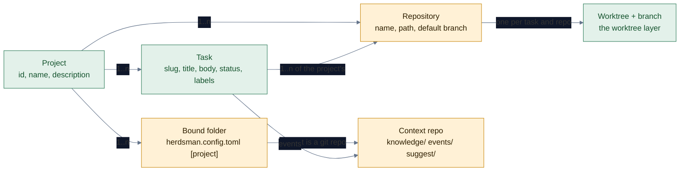
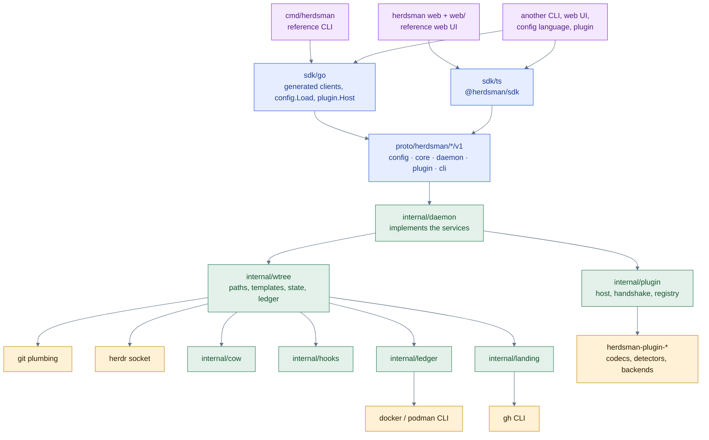

# Plan: herdsman v1.0.0 roadmap, the worktree layer and `herdsman up`

Status: draft, 2026-11-06. Nothing is built yet. Decisions below are made, not open; the Answered questions section records why.

Sequencing: this work starts after the herdsman daemon lands (`feat/daemon`, pushed to `origin/feat/daemon`, with its side branches `feat/daemon-adopt`, `feat/daemon-s16`, `feat/daemon-s27fix` and `docs/daemon-skill`; the daemon ships in v1.0.0). The worktree layer builds on the daemon's SQLite storage and its event channel, so the state tables below live in the daemon's store once it exists, and `herdsman up` starts the daemon as one of its steps.

## Goal

Make task worktrees a first-class part of herdsman, so that one command brings up an orchestrator and an adjutant with everything a task needs, and one command takes a task down again: `teardown` stops what it runs (processes, servers, containers), `clean` frees what it holds (worktree, branch, volumes, disk), and `down` does both. Around the worktree layer, two more pieces of the roadmap (user request, 2026-11-06): projects and tasks as records with a context repo that holds the project's knowledge base and chronology, so a task is something with a home and a history rather than a string; and `herdsman suggest`, a curated catalog of tips, MCP servers, skill repositories, harness plugins and Claude mods.

The reference point is [worktrunk](https://worktrunk.dev) (`wt`, v0.81, Rust): the most used git worktree manager for parallel agents. Its game is "worktrees as easy as branches": branch-addressed worktrees, a status list, a one-command merge, hooks, copy-on-write build caches, LLM commit messages, PR checkout, a picker and shell integration. herdsman matches the ones a route needs (the parity table marks what it leaves out) and goes past them where `wt` stops: `wt` knows a worktree, herdsman knows the task that lives in it, the agent that works on it, the review that gates it, and every process, port, container and volume that the task started.

## Current state

- No binary command creates a task worktree. Implementers run `git worktree add` themselves from contract text ([`contracts.md`](../skills/herdsman/references/contracts.md)). The orchestrator never creates one. `herdsman review start` prepares a detached reviewer tree and is Go-specific; the skill never calls it.
- Setup in a fresh worktree is prose: copy the `.env` files the gates need, frozen-lockfile install, own databases and ports per task, stop your servers when done. Nothing automates it, nothing checks it, and each worktree with its dependencies takes gigabytes ([`route-close.md`](../skills/herdsman/references/route-close.md)).
- Cleanup is a checklist line: read the pane, check for unpushed commits, `git worktree remove` without `--force`, never remove another session's tree. Leftover dev servers, containers and test databases are found by hand (`pgrep`, `df -h`, Postgres database counts).
- A route with an adjutant takes about sixteen manual steps from zero: install, skill, start herdr, `herdsman web`, pairing code, the New route form, `mkdir -m 700` the inbox, write `setup.json`, write `watch-targets.json` and `resume-targets.json`, the sandbox probes, type the attach command, approve the pair, start the courier and card-watch panes, answer the interview, give the go.
- herdr 0.9.5 already exposes `worktree.create|open|list|remove`, `workspace.create` with an `env` map, `pane.process_info`, `session.snapshot` and events over its socket (`herdr api schema`), and `internal/herdr` already speaks that protocol. The web app has a one-shot route starter (`POST /api/routes`) that creates the coordinator tabs and sends the first prompts, but the channel setup stays manual.

## Decisions

| Topic | Decision |
| --- | --- |
| Shape | New top-level verbs in the one `herdsman` binary: `up`, `new`, `ls`, `go`, `merge`, `teardown`, `clean`, `down`, `commit`, `diff`, `each`, `prune`, `hook`, `config`. `down` runs `teardown` then `clean`; all three exist, because stopping and freeing are different decisions with different safety rules and the user often wants one without the other. No second binary, no `wt`-style alias by default; `herdsman config shell install` adds the `cd` wrapper and completions, and can install a short alias (`hm`) on request |
| Addressing | A task id names everything: the branch (through a template), the worktree, the agent, the herdr workspace, the compose project, the port block, the report. Every command also takes a branch, a worktree path, `^` (default branch), `@` (current), `-` (previous), `pr:<n>`, `mr:<n>` and a PR URL |
| Config | The spec is a Protocol Buffers IDL (`proto/herdsman/config/v1/config.proto`), the single source of truth from which the Go structs, the JSON Schema and the `get`/`set`/`show` walkers are generated, so anyone can build an adapter in any language. Project file `herdsman.config.toml`, `herdsman.config.json`, `herdsman.config.yaml` (`.yml` too) or `herdsman.config.bin` (the message in binary wire format, the fastest parse), by default outside the repository, and user file `<user config>/herdsman/config.{toml,json,yaml}` (no approval). Every command takes `-c <path>` (any name, any place; a relative path resolves against the shell's folder), else `HERDSMAN_CONFIG`, else discovery: the repository's parent folder first (next to the `<repo>.worktrees` folder, which is where a config that agents must not edit belongs), then the repository root. One file per place; two formats side by side is an error that names both. A route records the path it was started with (`Config: <path>` in `00-route.md`), and every command run inside that route uses that file. All four formats map to the same keys and the same generated message. TOML through herdsman's own TOML 1.0 reader and writer, YAML through its own plain-subset reader (both fuzzed, both run against the official test suites in CI), JSON and binary through vendored protobuf-go (`protojson`, `proto`); no third-party dependency at runtime (see Longevity contract). `config get <key>` and `config set <key> <value>` read and write one value by dotted path in any of the formats, comments kept. `config init --format toml|json|yaml|bin` writes the detected defaults, TOML by default; the JSON and binary files carry no comments, so `config init` prints the explanations to the terminal for them |
| State | SQLite at `<common git dir>/herdsman/state.db`, shared by every worktree of the repo, never in the tree. Tables: `worktrees`, `tasks`, `resources`, `hook_runs`, `caches`, `archives`. Logs under `<common git dir>/herdsman/logs/` |
| Worktree path | `[worktree] path`, default `{{ repo_path }}/../{{ repo }}.worktrees/{{ task }}`: one sibling folder per repository, outside the main tree (test runners never recurse into it), and the worktrees folder itself is the agent sandbox root (Codex's writable root), so the config in the parent folder stays outside what an agent can write. `[branch] name`, default `{{ task }}` |
| Config schema | Every setting lives in a section; there are no top-level keys. `[schema] version = "1.0.0"` is a SemVer string (quoted, since bare `1.0.0` is not valid TOML): major changes when a key's meaning or shape changes, minor when keys or sections are added, patch when only defaults or docs change. A file with a higher major than the binary knows is refused with the version both sides have; a lower one is read and `config update` rewrites it. Sections: `schema`, `project`, `worktree`, `branch`, `setup`, `hooks`, `teardown`, `merge`, `commit`, `list`, `projects`, `suggest`, `aliases`. Unknown keys warn with a suggestion and never stop a command, except in `[policy]` and `[launch]`, where an unknown key is an error (a misspelled safety setting must not silently disable it); a key moved between versions is read from its old place with a deprecation line and rewritten by `config update`; the four formats mirror the same nesting, because all are bindings of the one proto message. Reason: a flat file cannot grow without renames, and a renamed key breaks every committed config at once |
| SDK | Every public surface is a contract in the herdsman SDK before it is an implementation: Protocol Buffers packages under `proto/herdsman/<area>/v1` (`config`, `core`, `daemon`, `plugin`, `cli`), served as plain HTTP RPC on the daemon's socket (`POST /rpc/<Service>/<Method>`, JSON or binary protobuf bodies, one multiplexed WebSocket for real-time updates with a unary long poll beside it; user decisions, 2026-11-06), with generated Go (`sdk/go`, its own module) and TypeScript (`sdk/ts`, `@herdsman/sdk`) clients and the descriptors published with every release. The bundled CLI, `herdsman web` and the daemon's built-ins are reference implementations that use only the SDK, so anyone can build a config language, a plugin for `herdsman plugin`, another CLI or another web UI against the same contracts and prove it with the conformance suite. Design rules: SOLID without class-based OOP and CUPID, each mapped to one concrete rule (see The herdsman SDK) |
| Setup | `[setup]` runs after create and before any agent: share ignored build caches by copy-on-write (per-file `clonefile` on APFS, per-file `FICLONE` on btrfs and XFS, both in parallel, plain copy elsewhere; never hard links, which would let one worktree's in-place write change another's), run the detected install command under `run-check`, copy only allow-listed `.env` files, allocate the task's port block. Defaults come from ecosystem detection; `herdsman config init` writes them into `.herdsman.toml` for review |
| Teardown | `herdsman teardown <task>` stops what the task started and keeps the tree. Candidates come from a resource ledger with four detectors (process cwd or the execution id in its environment, listening ports, container labels and bind mounts under the worktree, registered scratch folders and databases); only `exclusive` evidence, revalidated at execution, authorizes a kill, and `teardown` never deletes data (see Ownership evidence) |
| Cleanup | `herdsman clean <task>` frees what the task holds and refuses while the ledger shows the task still running (it names `teardown` and `down`): archive anything unpushed to `refs/herdsman/archive/<task>` and a bundle, remove the worktree through a trash folder with a background drain, delete the branch when it is integrated, remove the task's volumes and networks, drop its scratch and caches, prune. Refuses a dirty or unpushed tree without `--force`, and `--force` still archives first |
| Merge | `herdsman merge <task>` fetches first, verifies through `run-check`, refuses when a route's last review is not on the head, then squashes, rebases or merges by policy, lands locally (fast-forward), by push, or by the asynchronous GitHub merge API pinned to the head, and then runs `down` once the landed tree is confirmed |
| Commit messages | Generated by default, by a bounded generator (timeout, cost cap, one retry) with a deterministic fallback on every failure (type and scope from the branch, a subject from the diff stat); the archive commit in `clean` never waits on a model. Every commit the layer makes (`commit`, the squash in `merge`, the archive commit in `clean --force`) gets its message from the diff through `[commit.generation] command`, by default the first installed harness's non-interactive mode (`claude -p`, `codex exec`, `opencode run`) and otherwise any command that reads the prompt on stdin; `-m` overrides for one commit, `[commit.generation] enabled = false` turns it off. Messages follow the Conventional Commits convention (`type(scope): subject`, imperative, lowercase, a body that says why), enforced by a parser: a message that does not parse is regenerated once, then refused. Cached by diff hash and prompt hash |
| Branch names | Convention recommended and on by default: `[branch] name = "{{ type }}/{{ task }}"`, lowercase kebab-case, the type from the Conventional Commits set (`feat`, `fix`, `refactor`, `docs`, `test`, `chore`, `perf`, `build`, `ci`), at most 60 characters, validated at `new`. `--type` sets it (default `feat`); with `-p` and no task id, `new` asks the same generator for the type and a slug from the prompt, prints them, and proceeds. Integration routes prefix `wip/`. `wt` generates no branch names |
| Down | `herdsman down <task>` is `teardown` then `clean` as one plan with one confirmation, with the same selectors (`--merged`, `--route`, `--all`) and flags (`-y`, `--force`); it is what `merge` and route close call |
| Hooks | Twelve hook points (`pre|post` of `switch`, `start`, `commit`, `merge`, `teardown`, `clean`; `down` runs the teardown pair then the clean pair), per-hook timeouts, concurrent keys and ordered pipelines, approval per exact template for project hooks, logs per task. Templates are Go `text/template` with the `wt` variable and filter names (`{{ branch }}`, `{{ worktree_path }}`, `{{ task }}`, `sanitize`, `hash_port`, `codename`) |
| One command | `herdsman up <route> -p <prompt> -a <launch command> -o <launch command> [-c <config>]` runs doctor, starts or attaches herdr, creates the route workspace, the private inbox and its setup proof, starts the adjutant and the orchestrator through `herdr agent start`, enrolls both, approves the pair, starts the courier and card-watch panes, seeds the handshake, and sends the request. One command, no pause. The web parts are optional: only `--web` starts `herdsman web` on the route and prints its URL, pairing code and QR code |
| Compatibility | No breaking change in the foreseeable future (user rule, 2026-11-06): every public surface is enumerated with a growth rule and a golden test (see Compatibility contract); add, never rename; defaults never change behavior; every artifact carries a SemVer version; deprecations are machine-readable and nothing deprecated is removed before a major, of which none is planned; experiments are marked |
| Dependencies | herdsman depends on no third party at runtime (user rule, 2026-11-06, as `@reactre/core` re-implemented React and was vendored). What the standard library cannot do is re-implemented when the needed subset is small and its spec is stable (WebSocket framing, TOML, front matter, ULID, SemVer, Conventional Commits, the terminal), and vendored into this repository under our control when it is large and security-critical (protobuf-go, the SQLite amalgamation and driver, YAML), each with its license, upstream commit and a `VENDOR.md`; Dependabot and Renovate watch the upstream pins, `govulncheck` and OSV alerts run daily, and a CVE upstream is re-vendored within a day by a written procedure. Generated code is committed, so a build never needs a network, a proxy or a build tool |
| Guardrails | Autonomy earns trust through six additions (2026-11-06): `undo` for every destructive verb from the daemon's operation journal; `[policy]` with budgets that each carry one stated promise (admission hard, interruption best effort, runtime enforced by `teardown` on exclusive resources, tokens and cost measured), protected branches and an `exact` landing contract, `herdsman cost`; `herdsman mcp`, the same services exposed as MCP tools generated from the proto; traces per route exported as OpenTelemetry and `herdsman eval` comparing harnesses on golden tasks with the benchmark gate's statistics; a written and enforced security model (socket-only daemon, keychain secrets, redaction, signed releases); automations on event kinds with the same approval as hooks |
| Longevity | A twenty-year horizon (user rule, 2026-11-06): formats that outlive the software (SQLite, protobuf, Markdown, TOML, git), every rule of the Longevity contract guarded by a test or a CI job, a dependency budget enforced by a test, reproducible builds from vendored sources, hermetic tests under a time budget, a yearly maintenance routine written in `MAINTAINING.md`, and ADRs in `docs/adr/` for every decision in this plan |
| TUI | `herdsman up` with no arguments opens a form (user request, 2026-11-06): route name, prompt, adjutant and orchestrator commands with the detected harnesses as choices, config path, project and tasks, `--web`; it validates, shows the plan and runs on confirm. The TUI is herdsman's own (`internal/tui`), minimal, in the model-update-view shape Bubble Tea proved, with no dependency on it; flags skip the form, and a non-terminal gets the flags named instead |
| Contract start | The contract binds from v1.0.0. Surfaces of the 0.x releases that v1.0.0 keeps (the command line, the config, the route folder, the skill) are bound from the release that shipped them; surfaces that v1.0.0 replaces (the daemon's hand-written socket routes, which land experimental, and the web's `/api/` routes and SSE events of 0.x) are replaced before the tag, which SemVer allows below 1.0.0, so herdsman serves one API per surface and never two for good (decided 2026-11-06 on a side note, confirmed by the user) |
| Route lifecycle | `pause`, `resume`, `stop`, `delete` beside `up`, on the daemon's route record. `pause` keeps everything and interrupts the agents; `stop` ends sessions and service panes and keeps the work on disk; `resume` serves both; `delete` is the only removing one and archives the route folder first, refusing while agents run unless `--force` |
| Projects and tasks | `herdsman project` and `herdsman task` are the records that everything else hangs off (user request, 2026-11-06): a project owns tasks (one to many), folders and repositories; a task belongs to exactly one project for its whole life and names one or more of that project's repositories; the task id the worktree layer already uses (`{{ task }}`, the branch, the worktree, the agent, the port block) is the task record's slug, so `new`, `ls`, `go`, `merge` and `down` act on the same task `task list` shows. Full CRUD on both, stored in the daemon's account store, served by `ProjectService` and `TaskService`, stable ULID ids with human slugs |
| Context repo | A local folder bound to a project (`project bind`) is recorded in the daemon and in that folder's `herdsman.config.toml` under `[project]`, and the folder may hold the project's repositories as subfolders. A bound folder that is itself a git repository can be the project's context repo: the knowledge base (`knowledge/`), and the events and chronology as an append-only DAG (`events/<ulid>.md`, each with its parents), which routes, `task done`, `merge` and route close append to, and `project log` renders. Its file grammar is a contract surface |
| Suggest | `herdsman suggest` (`recommend` is an alias) is a curated, searchable catalog of tips, MCP servers, agent skill repositories, harness plugins and Claude mods, ranked for the harnesses and ecosystems detected on this machine and project. Entries are freeform Markdown with optional structured fields and remote repository links; sources are the bundled catalog, the user's own entries, the project's context repo and remote catalogs pinned to a commit. `suggest apply` prints an entry's recipe and runs it only with `--run` after the same per-checksum approval hooks use |
| Pair approval | No pause (user decision, 2026-11-06). `herdsman up` proposes both sides and approves the pair itself, because the human ran the command. It still prints both identities and the inspected checksum, and the approval record names who approved (`herdsman up`, its pid, the controlling terminal, the time), which `herdsman message status` shows. Two guards replace the pause: `up` refuses to approve a pair when it runs inside an agent's pane or under a harness process (it then leaves the pair pending and prints the approve line), and `--pair manual` restores the old flow for anyone who wants the inspection moment |
| Confirmation | `teardown`, `clean` and `down` print their plan and ask on a terminal; `-y` skips the question for a plan that destroys nothing unsaved. A dirty or unpushed tree needs `--force`, which has no non-interactive form except together with `--archive-only` |
| Benchmarks | `bench/worktrees` runs the same scenarios on `wt` and herdsman; herdsman must win every non-git-bound case by 95% confidence intervals with an A/A control. The win is proven by `make bench` on a quiet machine and its results file is committed; CI checks that the file is current and posts its own run as information, never as a required check (see Performance) |
| Platforms | macOS and Linux, as the releases are. Windows is out of scope |
| Versions | Part of the v1.0.0 roadmap (the user's title for this page, 2026-11-06): the daemon lands first, then the contracts, then the sixteen pull requests below, and v1.0.0 is tagged when all of it is in. Each pull request may ship a pre-release (`v1.0.0-rc.<n>`) so the cask and `herdsman web` are exercised before the tag |

## Feature parity with `wt`, item by item

Every `wt` feature from its docs and source, and the herdsman command that covers it. Nothing on the left is left out.

| `wt` | herdsman |
| --- | --- |
| `wt switch`, `-c`, `--base`, `-x <program>`, `--path`, `--clobber`, `--no-cd` | `new` (`--base`, `--agent <command>`, `--path`, `--clobber`), `go` (`--no-cd`, `--focus`) |
| Shortcuts `^ @ - pr:N mr:N`, PR URLs, fork PRs with `pushRemote` | the same shortcuts on every command; `go pr:<n>` sets the fork's push remote |
| Interactive picker with diff, working, committed, log, remote, summary, pr, comments tabs | `go` with no argument on a terminal: the `ls` table, filter as you type, preview from `diff` (the same views), the log, the PR and its comments through `gh` |
| `wt list`, `--full`, `--branches`, `--remotes`, every status symbol, CI column, custom columns, JSON schema | `ls`, `--full`, `--all`, the same symbols, CI and PR cells, `[list] columns` for custom template columns, `--json` with `schema` |
| `wt list statusline`, `--format claude-code` | `ls --statusline [--format claude-code]`, cache-only so it never blocks |
| LLM summaries | `ls --full` summaries, on by default with generation |
| `wt merge` (commit, squash, rebase, ff, remove), `--no-*` flags, backups to `refs/wt-backup` | `merge` with `--strategy`, `--land`, `--no-clean`, `--continue`; working-tree changes backed up to `refs/herdsman/backup/<task>` before a squash |
| `wt remove`, `--force`, `--delete-branch`, trash and background drain, `_delete-branch-if-safe` | `down` (`teardown` then `clean`), `--force` with an archive first, the same trash and drain, branch deleted only when integrated and unmoved |
| `wt step commit`, `squash`, `rebase`, `push` (local ff), `diff` | `commit`, `commit --squash`, `merge --strategy rebase --land local`, `diff` |
| `wt step copy-ignored`, `.worktreeinclude`, `exclude`, `--require-include` | `[setup] share` with copy-on-write, `[setup] exclude`, `.worktreeinclude` honored when present |
| `wt step for-each` | `each -- <command>` |
| `wt step prune`, `--min-age` | `prune`, `clean --merged` |
| `wt step eval` | `config eval` |
| `wt step tether`, `--reap` | the ledger and `teardown` |
| `wt step promote`, `relocate` (experimental) | not planned: the main checkout is never switched by a tool (the skill's rule), and the path template is the only place a tree lives |
| Ten hooks, pipelines, concurrent keys, `--dry-run`, approvals, `vars`, markers | twelve hooks, the same forms, timeouts, result files, approvals, `config vars`, agent state from herdr instead of markers |
| LLM commit messages, `--dry-run`, templates, `template-append`, lock-file filtering, 100 KB budget | on by default, the same prompt budget, Conventional Commits enforced, branch names generated too |
| `wt config shell install`, completions, `show`, `create`, `update`, `approvals`, `alias`, `state`, `plugins` | `config shell install`, static completions, `show` (with sources), `init`, `update`, `approvals`, `[aliases]`, `vars`; harness plugins are the herdsman skill |
| `worktree-path` template, `[projects]` overrides, `hash_port`, `codename`, `sanitize_db` | `[worktree] path`, `[projects]`, the same filters |
| Forges: GitHub, GitLab, Gitea, Azure through their CLIs | GitHub through `gh` first; `mr:<n>` through `glab` in the same release; Gitea and Azure when asked |
| Windows, Nushell, PowerShell | not planned; macOS and Linux, as the releases are |

## Where it beats `wt`

`wt`'s weak spots, from its own docs, changelog and source, and what herdsman does about each.

| `wt` today | herdsman |
| --- | --- |
| Knows a worktree. Activity is two markers, 🤖 and 💬, set by harness hooks that go stale after an interrupt | Knows the task: agent name and state from the herdr socket, pane, due time, route, review verdict, PR and CI, in the same row |
| Teardown is `tether` (experimental, polls every 250 ms, Unix only) and `--reap` (cwd-only discovery) | A resource ledger with four detectors, a plan you read before it runs, graceful then forced stops, containers and volumes included, and a report of what it could not attribute |
| Copies ignored files one reflink per file; a 14 GB `target/` takes 20 s | Clones whole directories in one `clonefile` call on APFS, so setup time does not scale with the file count; per-file reflink stays the Linux path |
| `merge` never fetches, lands only on a local branch, has no PR, no merge queue, no stacks | Fetch first, land locally, by push or through the merge API pinned to the reviewed head, merge-queue aware, stacked branches retargeted by the rules in [`git-and-github.md`](../skills/herdsman/references/git-and-github.md) |
| LLM messages are opt-in (`commit.generation` must be configured), the summary cache keys the diff only, and no format is checked | Generation is on by default with the first installed harness, the cache keys diff and prompt, every message must parse as a Conventional Commit, and branch names follow a convention the generator can fill from the prompt |
| Hooks have no timeout, no retry, no structured result; `vars` keys are limited | Timeouts, a JSON result file per hook run, task-scoped vars in SQLite, logs per task and hook |
| Project-hook approval blocks a non-interactive agent and is per exact string | Same safety, plus `herdsman hook approve --from <task>` for the human and a `--dry-run` that shows the plan an agent would run, so the route can pre-approve at dispatch |
| `cd` depends on the shell wrapper; `git wt`, aliases and IDE terminals break it | Same wrapper for `cd`, and inside herdr `go` focuses the task's pane or workspace, which no wrapper can break |
| No multi-agent orchestration: tmux and zellij recipes | The route: contracts, reviews, the integrator, the adjutant channel, one `up` |
| Picker is TTY-only | The same table in `herdsman web`, with `teardown`, `clean` and `down` as queued actions |
| 73 breaking changes in its changelog | `--json` output carries `"schema": {"version": "1.0.0"}` (the same SemVer rule as the config file) and its major changes only with a major release |

## Commands

Every command takes `--json` for machine output, `-C <path>` for the repository and `-c <path>` for the config file. Text output stays one line per item, as the other commands do. Exit codes: 0 done, 1 refused by a check, 2 usage or settings, 3 needs a confirmation that no terminal could give.

### `herdsman new <task> [--base <ref>] [--from pr:<n>] [--no-setup] [--agent <kind>[:<model>[:<effort>]]] [-- <prompt>]`

1. Resolves the base: `--base`, else the default branch, always fetched first (`git fetch origin <base>`), and refuses a base that is not an ancestor of the default branch unless `--base` names it explicitly (the rule in [`ownership-and-integration.md`](../skills/herdsman/references/ownership-and-integration.md)).
2. Renders the branch and path templates, refuses a path that is occupied, offers `--clobber` for a stale non-worktree folder (renamed to `.bak.<timestamp>`, never deleted).
3. Creates the worktree through herdr when a socket is reachable (`worktree.create`, so the tree is also a herdr workspace with `HERDSMAN_TASK=<task>` in its environment), else through `git worktree add`. Records the row in `state.db`.
4. Runs `pre-start` hooks (blocking), then `[setup]`, then `post-start` hooks in the background with their output in the task log.
5. With `--agent <command>`, runs that launch command in the workspace's pane exactly as typed (the same rule as `up`'s `-a` and `-o`), registers the agent name, and sends the prompt. Without it, prints the path, the port block and a launch line to copy.

Inside a route the orchestrator creates the tree with `herdsman new <task> --no-agent` before the launch (setup is not app code, lesson 22 of the adjutant-design route), and the contract says "your worktree is ready at `<path>`" instead of a `git worktree add` line.

### `herdsman ls [--full] [--all] [--route <folder>]`

One row per worktree of the repository, plus local branches without a tree under `--all`.

Columns: task, branch, status (`+` staged, `!` modified, `?` untracked, `✘` conflicts, `⊘` detached, `⊞` locked), `base↕` (ahead and behind the default branch, `⊂` integrated), `remote⇅`, agent (name and herdr state: working, idle, blocked, done, gone), review (last verdict and whether it is on the head), PR and CI (`#n` with the check state, from `gh`, cached 60 s), ports (listening ports of the task), containers (running ones), disk (logical size of the ignored files, with a note that clones share blocks), age, subject. `--full` adds the LLM summary.

The skeleton paints at once from one `git worktree list --porcelain`, one `for-each-ref` and one herdr snapshot; every other cell fills in from a bounded worker pool, SHA-keyed results cached in `state.db`, network cells last. Budget: under 150 ms to the skeleton and under one second to the full table with twenty worktrees, measured by `bench/worktrees` against `wt list` (A/B with an A/A control, 95% confidence intervals only, quiet machine).

### `herdsman go [<task>|<branch>|<path>|^|@|-|pr:<n>|<url>] [--no-cd] [--focus]`

Changes the shell's folder through the wrapper (a directive file, as `wt` does), and inside herdr also focuses the task's workspace or pane. With no argument it prints the table and takes a pick on a terminal. `pr:<n>` fetches the PR head, creates the local branch and a tree, and sets the push remote for a fork.

### `herdsman teardown <task>|--route <folder>|--all [-y] [--grace <seconds>] [--include associated]`

Stops what the task runs. It deletes nothing: no file, folder, database, volume or container is removed by `teardown`, ever; that is `clean`'s job, after a snapshot. The plan is printed as a table with one line per resource, its evidence level (see Ownership evidence) and its class (every teardown line is compensatable: a stopped process or container can be started again, and the plan records the command line, folder and environment needed to do so). It executes on a yes:

1. `pre-teardown` hooks, blocking. They are stop hooks (a custom `stop` script, a graceful shutdown call); a hook that deletes data belongs in `pre-clean`, the hook reference says so, and `hook --dry-run` shows the phase a template runs in.
2. Processes with `exclusive` evidence, identified as `(pid, start time)`: SIGTERM, wait `grace` (default 10 s), SIGKILL. A process group is signaled as a group only when every member of it is exclusive to the task; otherwise each exclusive pid is signaled alone. Each pid's start time and evidence level are re-read immediately before each signal, and a changed level stops the plan. The pane shell is never signaled; the agent is stopped through herdr.
3. Containers with `exclusive` evidence: `docker compose -p <project> stop` for the task's compose project, `docker stop` for others. Nothing is removed, no `down`, no `rm`; volumes and networks are untouched.
4. `post-teardown` hooks in the background.

`associated` resources are listed in the plan and acted on only with `--include associated` or a per-line yes on the terminal; `shared` and `unknown` resources are reported with what shares them and never acted on. The report lists what was stopped, what was left on purpose and what it could not attribute; an unattributed line goes to the human, never to a signal.

### `herdsman clean <task>|--merged|--route <folder>|--all [-y] [--force] [--keep-branch] [--delete-branch] [--force-irreversible <path>]...`

Frees what the task holds. It never stops anything: when the ledger shows the task still running (an exclusive process, a listener in its port block, a running container), it refuses and names `teardown` and `down`. The plan marks every line restorable, compensatable or irreversible, and the invariant it keeps is this: no path leaves the disk unless the verified snapshot holds it, the config names its pattern as rebuildable, or the person named the path. Then, in this order:

1. **Snapshot, before anything else.** A snapshot (see Snapshots) of the worktree and the task's data is taken, written and verified. It captures every file under the worktree, tracked, untracked or ignored, except paths that match the `[snapshot] rebuildable` patterns (build caches; Snapshots lists the defaults), so an ignored `.env` or a local database is in the snapshot, not lost with the folder. When the snapshot cannot be taken or verified, `clean` stops here and removes nothing.
2. **Inventory.** The worktree is walked once more and every path is classified against the manifest: captured (in a snapshot tree or archive), rebuildable (matches a configured pattern, authorized by that line of config), or named (given to `--force-irreversible <path>`, a path or a glob, which prints what it matched). A path in none of the three stops `clean` before anything is removed, with the paths listed and the two ways to authorize them. A file over `[snapshot] file_cap` (default 1 GiB) is not captured and so lands here until it is named or the cap is raised.
3. **Safety.** The tree must be clean and every commit on a remote branch, or the head must equal a merged pull request's head (`gh pr view --json state,headRefOid`). Otherwise it stops, unless `--force`, which goes on because the snapshot already holds the unpushed commits and the dirty tree, and says so. `herdsman clean --snapshots` lists snapshots and `herdsman undo <op>` or `herdsman new --from snapshot:<id>` restores one.
4. `pre-clean` hooks. This is where `dropdb`, `redis-cli flushdb` and other data hooks live; a hook declares `reversible = false` and the plan shows it as irreversible, and a database the snapshot captured (`[snapshot] databases`) is shown as restorable instead.
5. The worktree is renamed into `<common git dir>/herdsman/trash/` (instant) and a detached drain deletes it at low priority. Allowed only because step 2 passed; restorable from the snapshot, including the ignored files it preserved.
6. The branch is deleted only on evidence of integration that herdsman can check: the target contains the branch tip (ancestry), a landing record of this account names the tip as the source head of a confirmed landing, or `gh` reports the pull request merged with that head. A patch-id match is a hint, shown by `ls` as `⊂?`, and never deletes a branch on its own; `--delete-branch` is the person's authority for that case. Otherwise the branch is kept and said so. Restorable from the snapshot ref.
7. Volumes and networks of the task's compose project: removed when the snapshot exported them (under `[snapshot] volume_cap`); a volume over the cap is kept and reported unless `--force-irreversible` names it. The task's scratch folders after they were archived into the snapshot; the task's rows in the ledger; `git worktree prune`.
8. `post-clean` hooks, a disk report (`df` before and after), and the undo line with the operation id.

`--merged` does this for every tree whose branch is integrated; `--route` for every task of a route folder, which is what route close calls.

### `herdsman down <task>|--merged|--route <folder>|--all [-y] [--force] [--grace <seconds>] [--keep-branch] [--include associated] [--force-irreversible]`

`teardown` then `clean`, as one plan printed once and confirmed once, with every line's evidence level and class. It takes the union of both commands' flags and selectors, and its report has one section per half. `--merged` tears down and cleans every integrated task; `--route` every task of a route folder (what route close runs); `merge` runs `down` on the task it landed once the landed tree is confirmed. A failed teardown half stops before the clean half, so a tree is never removed under a process that still runs in it, and a failed snapshot stops the clean half before anything is removed.

### `herdsman merge <task> [--into <ref>] [--strategy squash|rebase|merge] [--land local|push|pr] [--keep] [--continue] [--waive-review <reason>]`

The evidence that lands is evidence about the candidate, never only about the source head, and the landing contract says which commit that evidence covers:

1. **Fetch and refuse.** Fetches the target. Refuses a detached head, an operation in progress, unmerged paths, a target that diverged from its upstream, and a target ref that policy protects from this landing mode.
2. **Prepare the candidate.** In a temporary worktree on `refs/herdsman/candidate/<task>/<op>`: squash (default; the message comes from `commit`), rebase onto the fetched target, or a merge commit. Working-tree changes are backed up to a snapshot first. A conflict stops with the candidate worktree left open and the exact `git rebase --continue|--abort` lines; `--continue` resumes the same operation.
3. **Verify the candidate.** `pre-merge` hooks run through `run-check` in the candidate worktree, not in the task's. In a route, a review is authoritative for this landing only when its report is bound to exactly what lands: the reviewer reviews the candidate worktree, and the report records the target commit, the candidate commit and tree, the policy revision and the config checksum it saw. `merge` compares those with the candidate it holds; any difference (a conflict resolution, a target move, a policy change, a whitespace-only edit) makes the report stale and `merge` stops with the re-review line. Patch-ids are a diagnostic only: when the stale report's `git patch-id --verbatim` equals the candidate's, the re-review request says so, so the reviewer can start from its earlier findings, and nothing else follows from it. A review is never carried forward by patch-id: Git's patch-id ignores whitespace unless `--verbatim`, and even a verbatim-equal patch can behave differently on a changed base. `--waive-review <reason>` is the human exception: the landing proceeds without an authoritative review and the record stores a waiver, never a pass; `[policy] review = "required"` forbids waivers.
4. **Record.** The landing record: source head, target head, candidate commit and tree, the patch-ids (diagnostic), each check's result, the review report's id with the tuple it was bound to, or the waiver, the landing contract (`exact` or `delegated`), the policy revision and the config checksum. The record is what `ops` shows and what the acceptance gate replays.
5. **Land under one of two contracts.** `[policy] landing` is `exact` by default, and a route accepts `delegated` only when its policy says so.
   - **Exact: the landed tree equals the candidate tree, or nothing lands.** `local` fast-forwards the target's ref to the candidate and updates its tree, refusing when an uncommitted change there overlaps. `push` pushes the candidate with `--force-with-lease=<target>:<fetched head>`, so the remote refuses when the target moved. `pr` pushes the candidate as the pull request's head, reads the base branch's rules, and requires the rule that branches must be up to date before merging (GitHub's strict status checks, read from the rulesets and branch protection APIs); with that rule in force GitHub itself refuses a merge whose base moved after the candidate was prepared, which is the enforcement before landing that a local lock cannot provide, since the merge endpoints pin only the head SHA and never the base. The merge is then requested with the head pinned and `merge_action = direct_merge`. A base with a merge queue, or without the rule, cannot land exactly, and `pr` stops with that said and the policy line that would accept delegated landing.
   - **Delegated: GitHub builds the landed commit.** A merge queue, or a base without the up-to-date rule. The evidence is weaker and the record says so: herdsman's checks and review cover the candidate; the landed commit or the merge group is covered only by the required checks GitHub ran on it, and herdsman's reviewer did not see it. A route under `[policy] landing = "delegated"` accepts that knowingly.
6. **Confirm.** The landed commit is fetched and its tree compared with the candidate tree. Under `exact` a mismatch means an assumption broke (the rule was lifted, a bypass was used): the record is marked `landed-unverified`, `down` does not run, and the task, the candidate and the record stay for a person. Under `delegated` the comparison is recorded, not required. A lost response is reconciled by fetching, never by retrying the merge.
7. `post-merge` hooks, then `down` on the task unless `--keep` or the record is not `confirmed`.

### `herdsman commit [--squash <target>] [--dry-run] [-m <message>] [--type <type>] [--scope <scope>]`

Stages by policy (`all`, `tracked`, `none`), builds the prompt (diff capped at 100 KB with lock files dropped, the diffstat, the last twenty subjects for style, the convention text, the project's `template-append`), runs the generator, parses the result as a Conventional Commit, commits. `--dry-run` prints the prompt, the command and the message. `--type` and `--scope` pin the header when the user knows them; the generator fills the rest. The generator is `[commit.generation] command`: `auto` picks the first installed of Claude Code, Codex, OpenCode from the catalog probe (the same probe `herdsman models` runs); a string is a command that reads the prompt on stdin and writes the message on stdout. Without any generator the fallback message is `chore: changes to <files>` and the command says so.

Generation is also the default inside `merge` (the squash message, with the branch's commits and the target in the prompt) and in `ls --full` (a one-line summary per branch, cached by diff and prompt hash, pruned to one entry per branch). The contracts tell implementers the same convention, so a route's commits look alike whether an agent or the layer wrote them.

### `herdsman diff <task> [--working|--committed|--remote] [-- <git diff args>]`, `herdsman each -- <command>`, `herdsman prune [--min-age <d>] [--dry-run]`, `herdsman ls --statusline`

- `diff`: one net diff from the merge base through the working tree by default (committed, staged, unstaged, untracked), or one of the three parts; the same views feed the `go` picker's preview.
- `each`: runs a command in every worktree with the template variables in its environment (`HERDSMAN_TASK`, `HERDSMAN_BRANCH`, `HERDSMAN_WORKTREE_PATH`), one at a time, continues past failures, prints a summary.
- `prune`: `clean --merged` for trees older than `--min-age` (default one day), locked, dirty and current trees skipped; what `wt step prune` does, plus the ledger.
- `ls --statusline [--format text|json|claude-code]`: one line for a shell prompt or a harness statusline (branch, status, base↕, remote⇅, CI, agent); the CI cell comes from the cache only, so the line never blocks.
- `config eval '<template>'` renders a template with the current variables, for hook authors.

### `herdsman hook <type> [--dry-run] [--approve] [--from <task>]` and `herdsman config`

- `hook show [<type>]`, `hook <type>` runs it by hand, `--dry-run` prints the rendered commands, `--approve` records the project hooks' approval for exactly those templates.
- `config get <key>` prints one value by its dotted path (`worktree.path`, `hooks.pre_merge`, `commit.generation.command`) with `--source` to say where it came from, `--json` for the typed value, and no key for the whole merged config; `config set <key> <value> [--project|--user|-c <path>]` writes one value into the chosen file in its own format, keeping comments and order where the format has them (TOML and YAML through format-preserving editors, JSON rewritten), type-checked against the spec (a string for an enum must be one of its values, a list takes `--append`), and prints the old and new value with the file it changed; `config unset <key>` removes it. Both work on the binary format too.
- `config init [--format toml|json|yaml|bin] [-c <path>]` detects the ecosystem and writes `herdsman.config.<format>` (TOML by default, with comments) to the repository's parent folder, or to the `-c` path; `config show` prints the merged view with each value's source; `config shell install|uninstall [<shell>]`; `config approvals list|clear`; `config vars get|set|list [--task <id>]`.

### `herdsman plugin list|describe <name>|install <source>|remove <name>|verify <name>|run <name>` and `herdsman spec cli|proto|descriptor|jsonschema`

The plugin verbs manage the executables that extend herdsman through `herdsman.plugin.v1` (see The herdsman SDK): config languages, resource detectors, landing backends, message generators and list columns. `spec` prints the contracts from the binary: `spec cli` the `CommandSpec` of every verb and flag, `spec proto` the `.proto` files, `spec descriptor` the serialized `FileDescriptorSet`, `spec jsonschema` the JSON Schema of the config and of every `--json` document. All take `--json`.

### `herdsman project create|list|show|update|delete|bind|unbind|repos|log|context`

- `project create <name> [--folder <path>] [--repo <path>]... [--description <text>] [--context]` makes the record, binds the folder when given, registers each repository (a path inside the folder or anywhere), and with `--context` initializes the folder as the context repo. `list [--json]` prints every project with its folders, repositories, open task count and last event. `show <project>` prints one with its tasks. `update <project> [--name] [--description] [--add-repo <path>] [--remove-repo <name>]`. `delete <project> [--force]` refuses while the project has open tasks or running routes and names them; `--force` archives the records first (`refs/herdsman/archive` of the context repo plus an export file).
- `project bind [<project>] [--folder <path>]` binds the folder (the current one by default) to the project: the daemon records it and `[project] id` and `name` are written to the folder's `herdsman.config.toml` (created if absent), so every herdsman command run under that folder resolves its project without a flag. `unbind` reverses both. One folder binds to one project; a project may have several folders (a laptop and a server, two checkouts).
- `project repos` lists the project's repositories with their default branches and worktree folders; a repository is added once and shared by every task that names it.
- `project context init|check|log`: `init` lays out the context repo (`knowledge/`, `events/`, `suggest/`, a `README.md` that says what each is for); `check` validates the event DAG (acyclic, every parent exists, front matter complete, ULIDs monotone per author); `log [--since] [--task] [--json]` renders the chronology as a dated list or as a DAG in `--json`. `project log` is `context log`.
- `<project>` is a name, an id, or `@` for the one the current folder is bound to.

### `herdsman task create|list|show|update|delete|start|done|link`

- `task create <title> [--project <project>] [--repo <name>]... [--id <slug>] [--body <markdown>|--body-file <path>] [--label <l>]...` makes the record under the project (the bound one by default), on the named repositories (all of the project's when none is given). The slug (`--id`, else generated from the title through the same generator as branch names) is the task id every worktree verb takes. A task never changes project: `--project` is refused on `update`, and moving a task is `delete` plus `create`, recorded as two events.
- `task list [--project <project>|--all] [--status todo|doing|review|done|archived] [--repo <name>] [--label <l>] [--json]` prints the tasks with their status, repositories, worktrees (from the worktree layer's state, so `doing` shows where the work is), route, pull requests and last event. `show <task>` prints one task with its body and events.
- `task update <task> [--title] [--body] [--status] [--add-repo] [--remove-repo] [--label] [--unlabel]`; `task delete <task> [--force]` refuses while the task has worktrees or a running route and names `down`.
- `task start <task> [--agent ...] [-- <prompt>]` is `herdsman new <task>` for each of the task's repositories: one worktree and branch per repository from the same slug, the setup in each, and the status set to `doing`. `task done <task>` checks every repository's branch is integrated (or `--force`), runs `down` where worktrees remain, sets `done` and appends the event. `task link <task> pr:<n>|<url>|issue:<n>` attaches a pull request or issue per repository.
- Every task verb appends an event to the project's context repo when it has one (`task.created`, `task.started`, `task.done`, `task.linked`, with the task, the repositories, the actor and the parents), so the chronology is written by the tools, not by hand.
- `<task>` is a slug, an id, or `@` for the task of the current worktree.

### `herdsman suggest [<query>] [--kind tip|mcp|skill|plugin|mod|repo] [--for <harness>] [--tag <t>] [--json]`, `suggest show|add|apply|source`

- With no query, prints the top entries for this machine and project: the harnesses `doctor` finds (Claude Code, Codex, OpenCode), the ecosystem the config detected, the project's labels and recent events, and what is already installed (a skill repo already under `~/.claude/skills` is not suggested again). With a query, a full-text search over titles, bodies and tags. `recommend` is the same command.
- `suggest show <id>` prints the entry in full with its source and links. `suggest add [--kind] [--title] [--url] [--repo] [--tag]... [--body-file <path>]` writes a freeform entry to the user's catalog (`<user config>/herdsman/suggest/<id>.md`) or, with `--project`, to the context repo's `suggest/` folder so the team shares it.
- `suggest apply <id> [--run]` prints the entry's recipe when it has one (an `install` block: a shell command, an MCP config snippet, a skill repo to clone) with the files it would touch; `--run` executes it after the same per-checksum approval that project hooks need, and never without a terminal.
- `suggest source add <git url> [--ref <commit|tag>]`, `list`, `remove`, `update`: a remote catalog is a repository with a `herdsman-suggest/` folder of entries, pinned to the commit `add` or `update` resolved, fetched to the user's cache and never executed; `update` shows the diff of entries before it moves the pin.
- The bundled catalog ships in the binary, generated at build time from `catalog/suggest/*.md`, reviewed like code; every entry has an id, a kind, a title, a body, tags, optional `url`, `repo`, `applies_to` and `install`, and a `since` version so the compatibility rule applies to it.

### `herdsman up <route> -p <prompt> -a <command> -o <command> [-c <config>] [--no-adjutant] [--web] [--dry-run]`

With no arguments at all, `herdsman up` opens a form on the terminal (see The TUI): the route name, the prompt (multi-line), the adjutant and the orchestrator launch commands with the harnesses `doctor` found offered as choices and free text allowed, the config path (the discovered one prefilled), the project and the tasks from `task list` to attach, and the `--web` toggle. Each field validates as it is edited with the same rules the flags use, the last screen is the plan `--dry-run` would print, and Enter runs it. Any flag given skips the form for that field; `--no-tui` skips it entirely; without a terminal the command exits with the missing flags named, so scripts never block.


The route name, the prompt and both launch commands are required:

```bash
herdsman up stack-landing -p "tasks: issues 12 and 14" -a "claude update && claude --dangerously-skip-permissions" -o codex -c ../herdsman.config.toml
```

- `-p`/`--prompt` is the request that becomes the first brief.
- `-a`/`--adjutant` and `-o`/`--orchestrator` are the commands that launch each coordinator's harness, run by the pane's shell exactly as typed. herdsman adds nothing to them: model, effort, permissions, an update first, a wrapper, an `env` prefix, a chain with `&&` are all the user's own words. A plain program name (`codex`) is the smallest form. The harness kind is read from the command (the last program in it whose basename is a kind that `herdr agent start --help` lists); when none or more than one matches, `--adjutant-kind`/`--orchestrator-kind <kind>` names it, and `up` says so instead of guessing. Reason: a `kind:model:effort` grammar would need a new release for every harness flag, and the user's command already says everything.
- How a command runs: the launch is a structured spec, `[launch]` with `prelude` (a list of commands, each with `retry`, `once` and an optional `probe`), `command` (the agent executable and its arguments), `env` (a map) and `cwd`, and `-a`/`-o` are a convenience grammar that compiles to it: simple commands joined by `&&`, each a sequence of words with POSIX quoting (single quotes literal, double quotes with `\` escapes), with `env K=V` or `K=V` prefixes; no `$` expansion, no globbing, no command or process substitution, no tilde beyond a leading `~/`, no `||`, `;`, `|`, `&`, subshells or redirections. Anything else is refused before any side effect, with the compiled spec printed so the user can write it in the config instead. Each prelude command is one operation step with a retry policy, as a hook has: `retry = "never"` is the default for every command the grammar compiles, because `claude update`, a migration or a deploy is not known to be safe to repeat, and `"idempotent"` is set per command in the spec; `probe` is a command whose zero exit establishes that the effect already happened. herdsman submits the step to the pane with `pane.run` as `printf '' > <steps>/<n>.start && cmd; rc=$?; printf %s $rc > <steps>/<n>.rc; printf 'herdsman-step %s rc=%s\n' <n> $rc`, where `<steps>` is `<route folder>/.steps/<op>/` and `cmd` is the user's words. The files are the authority, since they survive a closed pane and a scrolled-away screen; the scrollback line is display. The exit status is read from the `.rc` file; a prelude step has a timeout (`[launch] prelude_timeout`, default 10 min) and a nonzero status stops `up` with the pane's text. A `K=V` prefix on a prelude command is command-local, exactly as the shell scopes it. A prefix on the agent command becomes the agent's environment: it is exported into the agent's pane shell before `agent start`, which is that pane's purpose, and the exported names are recorded in the spec and unset again by `stop`. The agent command then goes through `herdr agent start <name> --kind <kind> --pane <id> --timeout <t> -- <its arguments>`: herdr runs the kind's canonical executable with those arguments and returns once it detects the agent ready. On resume, a step recorded `done` is skipped. A step recorded `intended` with no `.start` file never ran, because the shell writes that file before the command, and it runs again. A `.start` file without a `.rc` file is uncertain: the effect may have happened. An `idempotent` step runs again; a step with a `probe` runs the probe, is `done` on zero and runs again otherwise; a `never` step stops `up` with the step, its command and the two resume lines, `up --continue --step <n>=done` for a person who checked that the effect happened and `--step <n>=rerun` for one who checked that it did not. `once = true` is `never` plus the rule that `rerun` is refused for it; it never means "assume it worked". So `-a "claude update && claude --dangerously-skip-permissions"` runs `claude update` as a marked `never` step, then starts `claude --dangerously-skip-permissions` through herdr. Reason (side note, 2026-11-06, confirmed in herdr's CLI reference): the channel enrolls only a harness that `herdr agent start` launched; a harness typed into the shell by hand is detected and addressable by pane id only.
- `--no-adjutant` drops `-a` and the channel setup; the user then talks to the orchestrator directly.
- Missing route, prompt or command is a usage error (exit 2) with the full form printed. `herdsman models` stays for the interview inside a route; `up` never picks a model.

1. `doctor`, extended with disk space and the project config. A failed check stops here.
2. herdr: reachable socket, else start the server and `herdr session attach` at the end (or print the attach line under `--no-attach`).
3. The two launch commands from `-a` and `-o`, their kinds resolved as above, and the config file from `-c` (see Configuration: where the file lives). `--dry-run` prints the whole plan, the commands verbatim, and stops.
4. The route folder `.herdsman/<route>-<date>/` named from the required route argument, with `00-route.md` seeded (the prompt as the request, the task table empty), `run-check.sh`, `ref/`, `probes/`; `.herdsman` added to `.git/info/exclude` when it is not ignored.
5. The private inbox `<private home>/<repo>-<route>` at mode 700, its `setup.json` proof (binary path and checksum, the effective policy files and their checksums, `policy_verified` after the probes), `watch-targets.json` and `resume-targets.json`.
6. The workspace `<repo>-<route>` with the coordinators tab (adjutant pane, orchestrator pane), both started through `herdr agent start` with the `env` prefix the channel needs; the attach prompts; both `register propose` calls.
7. The pair: both identities and the inspected checksum are printed, then `register approve <checksum>` runs at once, with an approval record that names `herdsman up`, its pid and start time, this operation's id, the controlling terminal and the time. Before approving, `up` asks herdr to attest its own pane: `pane.process_info` for the pane that `HERDR_PANE_ID` names, answered fresh per call, which says whether that pane has an attached agent and whether herdsman's own pid is in that pane's process tree. The approval is refused and the pair left pending with the approve line printed when the attestation says an agent is attached, when `HERDR_PANE_ID` names a pane that herdsman's pid is not in, or when `up` runs under a harness process it can identify. What the record proves, exactly: the request came from the attested pane, with no agent attached to it and no recognized harness among herdsman's ancestors. It does not prove who opened that pane; a shell opened by automation has the same properties. `trusted-local` takes "an attested pane without an agent is a person's shell" as a stated trust assumption, listed as such in the threat model; `restricted` requires `--pair manual`, which asks on the terminal. Binding the record to this operation id stops the record from being reused for another route and says nothing more about its origin.
8. Courier and card-watch service panes, the checkpointer pane, the seeded handshake, then the `-p` prompt as the first brief to the adjutant.
9. Only with `--web`: `herdsman web` with the route pre-selected, its URL, pairing code and QR code, kept running after `up` returns (the same flags as `herdsman web` apply, for example `--web --host <ip>`). Without the flag nothing of the web app starts and nothing web-related is printed. Then the attach.

`up` is one operation (see Operations): each step is written as intended before its effect and done after it, with its idempotency key (the workspace name, the agent names, the inbox path, the prelude markers), so a second `up` on the same route reconciles and resumes where the last one stopped and never starts a second agent. `00-route.md` is a projection of that record. One herdr mutation per socket call, in order.

### `herdsman pause <route>`, `herdsman resume <route>`, `herdsman stop <route>`, `herdsman delete <route>`

The route lifecycle, as commands on the daemon's route record (the daemon already keeps a route's pause or freeze across an adoption). `<route>` is the route name from `up`, a route folder, or `@` for the route of the current folder. Each prints a plan, confirms on a terminal, and takes `-y`.

- **`pause`**: interrupts every agent of the route at a turn boundary (the harness's interrupt key, as the skill does by hand today; best effort, and Policy and budgets says what a deadline enforces), stops the route waiter and the checkpointer's prompts, holds the message channel (`message hold` on both coordinators), writes a `paused` run-state line with the per-agent state table (task, head, pane, what it was doing), and leaves every session, pane, worktree and process as it is. Nothing is torn down; a dev server keeps serving. `pause --teardown` also runs `teardown --route`.
- **`resume`**: for a paused route, re-arms the waiter and the checkpointer, lifts the hold, and sends each agent "continue from where you stopped" with its row from the pause table; for a stopped route, restarts the service panes and the agents from the route folder's state (the same launch commands and briefs recorded by `up`), creating a missing worktree again before its agent starts. `resume -p "<text>"` adds a note to every continue prompt.
- **`stop`**: ends the route's run and keeps its work. Agents get a last chance to write their report (a bounded wait, default two minutes, then interrupt), then every agent session is ended and its pane closed, the courier, card-watch and checkpointer panes are stopped, the waiter is stopped, the pair is retired, and a `stopped` run-state line records every task's head and report. Worktrees, branches, the route folder, the inbox and running task processes stay; `stop --teardown` also runs `teardown --route`. A stopped route can be resumed.
- **`delete`**: removes the route. It refuses while any agent of the route runs unless `--force` (which stops first). It runs `down --route` (teardown then clean for every task, with the archive rule for anything unpushed), closes the route's tabs and workspace, retires the pair and removes the private inbox, archives the route folder as `<common git dir>/herdsman/archive/routes/<route>-<date>.tar.zst`, then removes it. `--keep-worktrees` skips the clean half; `--keep-folder` keeps the route folder in place.

The same four actions appear in `herdsman web` as route controls and are queued like every other action. The skill's route-close checklist becomes `stop`, then `delete` once the user is done with the trees.

## Configuration

```toml
# herdsman.config.toml, by default in the repository's parent folder (../herdsman.config.toml), so the
# agents' edits to the repository never touch it; any name and place with -c. The same keys in .json or .yaml.
[schema]
version = "1.0.0" # SemVer

[worktree]
path = "{{ repo_path }}/../{{ repo }}.worktrees/{{ task }}"
# later keys live here too: clobber = "backup" | "refuse", exclude = [...] for ls, trust = true for herdr

[branch]
name = "{{ type }}/{{ task }}"   # recommended convention: <conventional type>/<kebab-case task>, at most 60 characters
types = ["feat", "fix", "refactor", "docs", "test", "chore", "perf", "build", "ci"]

[project]                     # written by `herdsman project bind`; this folder is bound to one project
id = "01JC3Q4D8W2X6Y1Z3A5B7C9E0F"
name = "acme"
context = true                # this folder is the project's context repo (knowledge/, events/, suggest/)

[suggest]
sources = ["https://github.com/acme/herdsman-catalog@9f1c2d3"]   # remote catalogs, pinned to a commit
# later: base = "^" (default branch), prefix = "wip/" for integration routes, protected = ["main", "release/*"]

[setup]
share = ["node_modules", "target"]      # copy-on-write from the main tree; detected
install = "bun install --frozen-lockfile" # under run-check; detected from the lock file
env = [".env.test"]                        # the only .env files copied; default none
ports = 10                                 # size of the task's port block (base = hash_port)

[hooks]
post-start = { dev = "COMPOSE_PROJECT_NAME={{ compose }} docker compose up -d db" }
pre-merge  = "bun test"
pre-clean = { db = "dropdb --if-exists {{ task | sanitize_db }}" }   # data goes in clean, never in teardown

[teardown]
grace = 10               # seconds between SIGTERM and SIGKILL
containers = "compose"   # compose | labeled | none
volumes = "on-clean"     # on-clean | on-teardown | never

[merge]
strategy = "squash"      # squash | rebase | merge
land = "pr"              # local | push | pr
verify = true
clean = true

[commit]
stage = "all"
convention = "conventional"   # type(scope): subject, imperative, lowercase; a body that says why

[commit.generation]
enabled = true                # default: every commit the layer makes gets a generated message
command = "auto"              # auto picks the first installed harness; or any command: prompt on stdin, message on stdout
template_append = "Mention the ticket from the branch name."   # canonical snake_case; kebab-case accepted and normalized
summary = true                # one-line branch summaries in ls --full and the go picker
```

The user file holds the same sections as defaults for every repository, plus `[projects."github.com/owner/repo"]` overrides (the same section shape nested once) and `[aliases]`. Precedence: flags, then `HERDSMAN_<SECTION>__<KEY>` variables (`HERDSMAN_WORKTREE__PATH`, `HERDSMAN_BRANCH__NAME`), then the project file, then the user file. Scalars replace; hook maps and lists append.

Where the project file lives: `-c <path>` on any command wins (any file name, any folder, relative to the shell's folder), then `HERDSMAN_CONFIG`, then discovery in the repository's parent folder, then the repository root. The parent folder is the recommended place and what `config init` writes to, because the agents change the repository's code during a route and a config that drives the route must not move under them, be committed by accident, or be read by an implementer as part of the project. A file inside the repository still works for projects that want it versioned; its hooks need the same approval either way. `herdsman up` records the resolved path in `00-route.md`, and `config show` prints it first.

### The config spec is an IDL

The configuration's single source of truth is a Protocol Buffers definition, `proto/herdsman/config/v1/config.proto` (package `herdsman.config.v1`), checked into the repository and published so that anyone can build an adapter for herdsman's config in any language without reading Go. One message per section (`Schema`, `Project`, `Worktree`, `Branch`, `Setup`, `Hooks`, `Teardown`, `Merge`, `Commit`, `List`, `Projects`, `Suggest`, `Aliases`) under one `Config` message; a hook is a `HookSpec` with a `oneof` of a command string, a named map and an ordered pipeline; enums for the closed choices (`MergeStrategy`, `LandMode`, `StagePolicy`, `VolumePolicy`).

- **Generated, not hand-written.** The Go structs come from `protoc-gen-go`; the JSON Schema that editors use comes from the same descriptor; `config show`, `get` and `set` walk the descriptor, so a new field in the proto is a new config key everywhere with no further code. The repository pins `buf` for generation and lint.
- **Four formats, one message, and any language through a codec plugin.** TOML, YAML and JSON are decoded into a generic tree and bound to the message through the descriptor (JSON through `protojson` directly); a `ConfigCodec` plugin adds another language (KDL, HCL, CUE, Nickel) by its file extension, with the same `get` and `set`. `herdsman.config.bin` is the message in binary wire format: the fastest possible parse, one `proto.Unmarshal`, no lexer, for generated configs, large `[projects]` tables and tools that write config for herdsman. `config export --format bin|json|yaml|toml` converts between them without loss, and `config init --format bin` writes one.
- **Key names.** Canonical keys are the proto field names in `snake_case` (`commit.generation.template_append`, `hooks.pre_merge`); the text formats also accept `kebab-case` spellings of the same keys and normalize them, so `pre-merge = "bun test"` keeps working. `config update` rewrites a file to the canonical names.
- **Compatibility, enforced by the IDL.** Field numbers are never reused (`reserved` on removal, which the contract forbids anyway), new fields are optional with defaults that keep today's behavior, enums get a zero `UNSPECIFIED` value and new values are announced in `next` one minor ahead; `buf breaking` runs in CI against the previous release's proto and fails the build on any wire-incompatible change. `[schema] version` is the `Schema.version` field, SemVer, bumped as the contract says.
- **Adapters.** A `herdsman config schema --format proto|descriptor|jsonschema` command emits the `.proto`, the serialized `FileDescriptorSet` and the JSON Schema, so an adapter can be generated in any language with protobuf support, and a tool that writes `herdsman.config.bin` is validated by `herdsman config get -c that.bin` reading it back.

Extensibility rules, so the file can grow for years without breaking a committed config:

- No bare top-level setting at all. A new setting goes into its section; a new concern gets a new section. `[schema] version` follows SemVer: a major bump only when a key's meaning or shape changes, a minor bump when keys or sections are added, a patch bump for defaults and docs. The binary reads any file whose major it knows and refuses a higher major by name.
- Unknown keys and sections warn with a did-you-mean line and the command goes on, except in the safety sections `[policy]` and `[launch]`, where an unknown key is an error that stops the command. `config show --strict` turns every warning into an error for CI.
- A moved or renamed key keeps reading from its old place for two minor versions with a deprecation line that names the new place; `config update` rewrites the file in its own format, comments kept where the format has them.
- Every section is a Go struct with explicit defaults in one place (`config.Defaults()`), and `config show` prints each value with its source (`default`, `user`, `project`, `env`, `flag`), so a surprising value is one command away from its origin.
- The JSON Schema for the file is generated from the proto descriptor and published with each release (`herdsman config schema`), so editors complete and validate the three text formats. A project hook needs approval once per exact template, stored in `<user config>/herdsman/approvals.toml`; a user hook needs none.

Template variables: `task`, `branch`, `worktree_path`, `worktree_name`, `base`, `target`, `repo`, `repo_path`, `owner`, `default_branch`, `remote`, `route`, `compose` (`<repo>-<task>` sanitized), `port` (the block's first port) and `port "<name>"`, `commit`, `short_commit`, `pr_number`, `pr_url`, `hook_type`, `hook_name`, `args`, `vars.<key>`. Filters: `sanitize`, `sanitize_db`, `hash`, `hash_port`, `codename`, `basename`, `dirname`, `tojson`. An undefined variable is an error with a suggestion.

Ecosystem detection, used by `config init` and as the default when no file exists:

| Found | `share` | `install` | Also |
| --- | --- | --- | --- |
| `bun.lock` | `node_modules` | `bun install --frozen-lockfile` | |
| `pnpm-lock.yaml`, `package-lock.json`, `yarn.lock` | `node_modules` | the matching frozen install | |
| `Cargo.lock` | `target` | none | mtimes preserved so cargo stays warm |
| `go.sum` | none | none | one `GOCACHE` per task under the scratch root, as `review start` does today |
| `uv.lock`, `poetry.lock` | none (venvs hold absolute paths) | `uv sync` or `poetry install` | |
| `compose.yaml`, `docker-compose.yml` | | | `compose = "<repo>-<task>"`, teardown `containers = "compose"` |
| `.env.example` | | | hint listing the `.env*` files and the `env` allow-list key |

## Projects, tasks and the context repo

The worktree layer names everything by a task id. This section makes the task a record with a home, so that the id is not just a string the user typed: a project owns tasks, folders and repositories; a task belongs to one project and names some of its repositories; and the project's memory lives in a context repo that herdsman's own commands write to.

### Model



Green is a record in the daemon's store; amber is something on disk that the record points at.

- **Project.** Stable ULID id, a unique name, a description, folders (bound paths on this machine), repositories (name, path, default branch, remote), and a state (`active`, `archived`). Stored in the account store: `projects`, `project_folders`, `project_repos`.
- **Task.** Stable ULID id and a unique slug within the project (the worktree layer's task id), title, Markdown body, status (`todo`, `doing`, `review`, `done`, `archived`), labels, links (pull requests and issues per repository), the route it runs in when any, and the subset of the project's repositories it is done on. `tasks`, `task_repos`, `task_links`. The project id is written once and has no update path, which is how "a task cannot be done on multiple projects" is enforced rather than documented.
- **Resolution.** A command finds its project from `--project`, else from the nearest bound folder walking up from the working directory (the `[project]` section of that folder's config), else from the route's record inside a route; a worktree's task comes from the worktree layer's state. `@` names the current one in both verbs.
- **Multiple repositories.** `task start` makes one worktree and branch per repository of the task from the same slug, so `{{ task }}` templates stay as they are; `ls` in any of them shows the task; `merge` lands each repository's branch by that repository's policy; `down` takes all of them down. The route's task table gains a repository column, and the implementer contract says which repositories a task covers.

### The context repo

A project's bound folder is usually the parent of its repositories (the same folder the config already lives in). When that folder is itself a git repository, `project context init` makes it the context repo:

```text
<folder>/
  herdsman.config.toml     # [project] id, name; the worktree and setup config for the repos below
  README.md                # what this folder is
  knowledge/               # the project's knowledge base: Markdown, any structure, read by routes as context
  events/                  # the chronology as a DAG, one file per event, append-only
    01JC3Q6K9P0S8R4T2V7X1Y5Z9A.md
  suggest/                 # the project's own suggestions for `herdsman suggest --project`
  <repo-a>/                # the repositories, each its own git repository (or elsewhere, by path)
  <repo-b>/
```

An event file is front matter and a body:

```markdown
---
id: 01JC3Q6K9P0S8R4T2V7X1Y5Z9A
kind: task.done            # task.created | task.started | task.done | task.linked | route.up | route.closed | merge.landed | note
at: 2026-11-06T09:14:03Z
actor: herdsman/1.0.0      # or a person, or an agent name
task: stack-landing
repos: [web, api]
parents: [01JC3Q5F2M1N7B8V3C4X6Z0Q2W]
commits: { web: 87c5670, api: c93f3c3 }
---
Landed the stacked PRs; the API migration went first.
```

- **Append-only, a DAG, not a log.** `parents` make the chronology a graph: two routes working at once produce two branches of events that a later event joins. `project context check` refuses a cycle, a missing parent or a malformed file; `project log` renders the topological order by time; `--json` emits the graph. Written by `task`, `merge`, `up` and route close through one `context.Append` in `internal/context`, and by people with `project context note`.
- **Versioned by git.** The context repo is committed and pushed like code; two machines merge their event folders without conflict because files are never edited, only added. The knowledge base is ordinary Markdown so any editor and any agent can read and write it, and `up` hands its path to the orchestrator as the project's context.
- **Contract.** The event grammar (`kind` names, front matter keys, the ULID file name) is a surface in the compatibility table; new kinds and keys are added, nothing is renamed, and a reader keeps unknown keys.

## `herdsman suggest`

A curated place for the things a herdsman user keeps rediscovering: a tip, an MCP server, a skill repository, a harness plugin, a Claude mod. It is a catalog with search and ranking, not an installer, and it stays honest about sources.

- **Entry.** Freeform Markdown with front matter: `id`, `kind` (`tip`, `mcp`, `skill`, `plugin`, `mod`, `repo`), `title`, `tags`, optional `url` and `repo` (a remote repository link), `applies_to` (harness kinds, ecosystems, platforms), an optional `install` recipe, and `since`. The body is the suggestion itself. The same message in `herdsman.suggest.v1` carries it through the SDK.
- **Sources, in precedence.** The project's context repo (`suggest/`), the user's catalog (`<user config>/herdsman/suggest/`), remote catalogs the user added (pinned to a commit, fetched to a cache, never executed), and the bundled catalog built from `catalog/suggest/*.md` in this repository, reviewed like code. Every entry shows its source.
- **Ranking.** Deterministic and explained: a score from the harnesses `doctor` finds, the detected ecosystem, the project's labels and recent event kinds, and whether the thing is already installed; `--json` includes the reasons. No network call unless `suggest source update` is run.
- **Applying.** `suggest apply` prints the recipe and the files it would touch; `--run` executes it only after the per-checksum approval that project hooks use and only with a terminal, so an agent following a contract can read suggestions and cannot install from them.
- **Web.** A Suggestions page in `herdsman web` with the same search and the entry's Markdown rendered; adding an entry from the page writes the same file the command does.

## The herdsman SDK

The config IDL above is one piece of a larger rule: every surface herdsman exposes is a published contract first and an implementation second. The SDK is the set of those contracts, the code generated from them, and the suite that proves an implementation honors them. The bundled `herdsman` binary and `herdsman web` are the reference implementations, and they are allowed to use nothing that a third party could not use too. That is what makes a different CLI, a different web UI, a new config language or a plugin possible without a fork.

### Contracts

| Package | Holds | Served as |
| --- | --- | --- |
| `herdsman.config.v1` | The `Config` message and its sections (above), `ConfigService` (`Get`, `Set`, `Unset`, `Show` with sources, `Validate`, `Export`) | Files in four formats plus codec plugins; the service on the daemon |
| `herdsman.core.v1` | The domain types, once: `Route`, `Task`, `Worktree`, `Agent`, `Pane`, `Resource`, `Check`, `Review`, `Message`, `Plan`, `Event`, `Error`, `Version`, `Project`, `Task`, `ContextEvent` | Imported by every other package; no services |
| `herdsman.daemon.v1` | `RouteService` (`Up`, `Pause`, `Resume`, `Stop`, `Delete`, `Get`, `List`), `ProjectService` (`Create`, `Get`, `List`, `Update`, `Delete`, `Bind`, `Unbind`, `Log`), `TaskService` (`Create`, `Get`, `List`, `Update`, `Delete`, `Start`, `Done`, `Link`, then the worktree verbs `New`, `Go`, `Merge`, `Commit`, `Diff`, `Teardown`, `Clean`, `Down`, `Prune`), `LedgerService` (`Resources`, `Plan`), `MessageService` (`Register`, `Propose`, `Approve`, `Send`, `Inbox`, `Status`), `EventService` (`Stream`, the WebSocket with subscribe, unsubscribe, event and lagged frames; `Wait`, a unary long poll over the same topics and cursors), `PluginService` (`List`, `Describe`, `Install`, `Remove`, `Verify`) | HTTP RPC on the daemon socket; `herdsman web` serves the same services to the browser |
| `herdsman.plugin.v1` | `Manifest`, the handshake, and one small service per extension point: `ConfigCodec` (`Decode`, `Encode`, optional `Set` for format-preserving edits), `ResourceDetector` (`Detect`), `LandingBackend` (`Open`, `Merge`, `Status`, for GitHub, GitLab, Gitea and others), `MessageGenerator` (commit messages, branch names, summaries), `ListColumn` (`Compute`) | The same HTTP RPC binding between the host and a plugin process, or in-process for built-ins |
| `herdsman.suggest.v1` | `Suggestion` (the entry), `Source`, `SuggestService` (`Search` with reasons, `Get`, `Add`, `Sources`) | HTTP RPC on the daemon; the same message is the front matter of an entry file |
| `herdsman.cli.v1` | `CommandSpec`: every verb, positional, flag with its short form and default, exit code, and the `--json` document each verb emits | `herdsman spec cli` emits it; completions, the skill's contract templates and alternative CLIs read it; a golden test guards it |

Every operation that changes something takes `dry_run` and returns a `Plan` before it acts, so a client can show what will happen with the same message the server executes. Every error is a `core.Error` with a stable `code`, a human message and typed details, mapped to the CLI's exit codes in one table. Every reply carries the `Version` of the contract it was produced under.

### Transports

- **HTTP RPC** is the one wire protocol (user decision, 2026-11-06), bound to the proto by a rule small enough to state in full: every method is `POST /rpc/<package>.<Service>/<Method>` on the HTTP server the daemon already has on its Unix socket; the body is the method's request message as JSON (`protojson`, `Content-Type: application/json`) or as binary protobuf (`application/proto`, Connect's name for it), and the reply comes back in the same encoding; a failure is an HTTP status from Connect's table with a JSON body `{"code": "<connect code>", "message": ..., "details": [...]}` whatever the request's encoding, and `Connect-Protocol-Version: 1` and `Connect-Timeout-Ms` are honored; real-time updates flow over one WebSocket (user decision, 2026-11-06): `GET /rpc/herdsman.daemon.v1.EventService/Stream` upgrades, and both directions carry `StreamFrame` messages, binary protobuf by default or JSON text frames under the `herdsman.json` subprotocol; the client sends `Subscribe` and `Unsubscribe` frames with a topic (route state, task list, a pane tail, the inbox, the ledger, hook runs) and a cursor, the server sends `Event` frames with their cursors, pings, and a `Lagged` frame with the cursor to re-sync from when a per-topic bounded queue overflows, so a slow tab never grows the daemon's memory; a reconnect resumes from the last cursor. Pane tails are the reason: they are high-volume and binary, and one connection multiplexes every subscription of a web client. No gRPC and no framework: Go's `net/http` and protobuf-go on the server, `fetch` and native `WebSocket` in the browser, `curl --unix-socket` and `jq` on the command line with no generated code at all. The binding is itself a versioned surface (see the contract), and it is byte-compatible with the unary half of the Connect protocol on purpose (the same path shape under the `/rpc` base, the same two content types, the same JSON error shape), so the off-the-shelf Connect clients for Go, TypeScript, Swift, Kotlin, Python and Rust work against herdsman unchanged while herdsman itself ships no Connect code; the conformance suite proves it with connect-go as a test-only dependency of its own module. A client without WebSocket is not left out: `EventService.Wait(cursor, timeout)` is a unary long poll over the same topics and cursors, for `curl`, scripts and languages without a WebSocket client. There is no SSE: the 0.x web stream goes with the 0.x routes, and the browser has native `WebSocket`. It replaces the daemon's hand-written JSON routes, its SSE stream and its integer protocol header: those ship marked experimental in the daemon pull request (contract rule 7) and are removed in the SDK pull request, so herdsman serves one API, and the contract for the daemon API starts at the RPC services. One API is cheaper than two for good: the conformance suite, the docs and every future change cover one surface.
- **`herdsman web`** becomes a gateway: it serves the static app and forwards the same RPC services to the daemon over the socket with the browser's session attached. Another web implementation needs only `@herdsman/sdk` and the gateway's address; the bundled Reactre app is the reference client and is held to that rule.
- **Plugins** are executables `herdsman-plugin-<name>` on `PATH` or under `<user config>/herdsman/plugins/<name>/`. The host starts one, the plugin opens a Unix socket and prints one handshake line (`herdsman-plugin/1 <socket path> <manifest checksum>`), and from then on both sides speak the same HTTP RPC binding. Built-ins implement the same Go interfaces in-process, so a plugin and a built-in are interchangeable behind one interface, and the protocol is transport-agnostic so a WASM host can be added later without changing it. A plugin's own settings live in `[plugins.<name>]`, typed by a descriptor the plugin ships in its manifest, so even plugin config stays IDL-defined. A plugin needs one approval per checksum, as project hooks do.

### Generated, published, proven

- `sdk/go` is its own Go module (`github.com/arafathusayn/herdsman/sdk`) with the generated messages, the HTTP RPC clients and server interfaces from herdsman's one small generator `protoc-gen-herdsman-go` (about two hundred lines on `protogen`: one interface per service, `NewHandler(impl) http.Handler`, `NewClient(*http.Client, base)`; the only generated code beyond the messages, since Go interfaces cannot come from generics), and small hand-written helpers: `config.Load` with a codec registry, `plugin.Serve` and `plugin.Host`, and `client.Dial`, which finds the daemon socket the way the CLI does. Its one dependency is protobuf-go, vendored; the WebSocket framing is herdsman's own `internal/ws` (RFC 6455 without extensions, fuzzed, checked against the Autobahn test suite in CI as a tool, not a dependency); the client is a channel-based `events.Subscribe`, and the TypeScript twin returns an async iterator over the same frames.
- `sdk/ts` is `@herdsman/sdk`, messages generated with `protoc-gen-es` and a types-only generator `protoc-gen-herdsman-ts` (TypeScript types and the service table from the descriptors, about a hundred and fifty lines) with a generic typed `createClient` on `fetch` and JSON bodies, so the TypeScript SDK has no dependency at all; the browser takes the JSON subprotocol on the WebSocket, so it needs no protobuf runtime, built with Bun, used by the bundled web app.
- Every release publishes the `.proto` files and the serialized `FileDescriptorSet`, so any language with protobuf support can generate a client; `herdsman spec` prints them from the binary too.
- `sdk/conformance` runs the same scenarios against any implementation: a daemon (every service, every error code, every event), a plugin (`herdsman plugin verify <name>`), and a CLI (its `spec cli` against the golden transcripts). The reference implementations pass it in CI, and that is the only way they are tested at the contract level, so a third party gets exactly the tests the bundled ones get.

### `herdsman plugin list|describe|install|remove|verify|run`

`list` shows installed plugins with their extension points, versions and approval state; `describe <name>` prints the manifest and the config descriptor; `install <path|url|name>` copies the executable under the user's plugin folder, records its checksum and asks for the approval; `remove` deletes it; `verify` runs the conformance suite for its extension points; `run <name>` starts it in the foreground with its socket on stdout for development. A plugin that fails its handshake or its protocol major is reported by name and skipped, never fatal to a command that does not need it.

### Design rules: SOLID without classes, and CUPID

Go has no classes, so each principle is stated as a rule about packages, interfaces and functions, and each rule has a place it can be checked.

| Principle | Rule in herdsman | Where it shows |
| --- | --- | --- |
| Single responsibility | One proto package per concern, one Go package per service, one file per verb; `cmd/herdsman` parses flags and renders, the daemon owns state, a plugin owns one extension point | A package that imports both `sdk/go/daemon` and `internal/daemon` fails `make check` |
| Open-closed | New behavior arrives as a new field, a new service, or a plugin; a new config language or landing backend is a plugin, never an edit to the reference code | The add-never-rename contract; `buf breaking` in CI |
| Liskov substitution | Anything that implements a contract passes the same conformance suite; a plugin replaces a built-in behind the same interface with no caller change | `sdk/conformance`; built-ins are registered through the plugin interfaces |
| Interface segregation | Many small services and one-or-two-method Go interfaces (`Codec`, `Detector`, `Backend`), defined where they are consumed; a client imports only the services it calls | A web build that calls `RouteService` pulls no `LedgerService` code |
| Dependency inversion | `cmd/herdsman` and `internal/web` depend on the SDK's generated clients, never on `internal/*`; the daemon depends on the plugin interfaces, never on a concrete codec; concrete values are wired in `main` | `go list -deps` guard in `make check` |
| Composable (CUPID) | Small surface per package, few dependencies, intention-revealing names; everything works with `curl` and `jq` | The Go SDK's dependency list is one vendored entry and the TypeScript SDK's is empty |
| Unix philosophy | Each verb does one thing; `down` composes `teardown` and `clean`; plugins are processes; stdout is data, stderr is diagnostics, `--json` everywhere | `herdsman ls --json \| jq` is the documented way to script |
| Predictable | Plan before apply, `--dry-run` on every mutating verb, idempotent operations, SemVer on every artifact, golden tests, no hidden state | The golden tests and the `Plan` messages |
| Idiomatic | The Go SDK reads like `net/http` (contexts, errors, functional options); the TypeScript SDK like `fetch`; config files read like their own language (TOML comments, YAML anchors) | Reviewers hold the SDK to the standard library's conventions |
| Domain-based | Names come from the domain and the skill: route, task, worktree, pane, check, landing, ledger; no `Manager`, `Handler` or `Util` nouns in a public name | The proto packages are the ubiquitous language; `herdsman.core.v1` holds each term once |

Patterns the implementation follows, without ceremony: ports and adapters (the proto services and the small Go interfaces are the ports; the CLI, the web gateway, plugins, git, herdr and docker are adapters); interfaces defined by the consumer and satisfied implicitly; constructors with functional options and explicit dependencies, no package-level mutable state; plan-then-apply for every destructive verb; a registry of codecs, detectors and backends built once in `main`; `context.Context` first and errors wrapped with the `core.Error` code so an exit code is never guessed.

## Teardown and cleanup in depth

The resource ledger is a table `resources(task, execution, kind, id, identity, evidence, detail, seen_at)` kept current by `ls`, `teardown`, `clean` and the route waiter's health check. Four detectors feed it, in this order. A hit makes a candidate with an evidence level (see Ownership evidence); the level, not the hit, decides what may be acted on:

1. **Processes.** Every process of the user whose current folder is under the worktree (`lsof -F pn` on macOS, `/proc/<pid>/cwd` on Linux), or whose environment holds `HERDSMAN_EXEC=<execution ulid>` (`ps -E` on macOS, `/proc/<pid>/environ` on Linux), identified as `(pid, start time)`. The variable comes from the pane environment herdsman set, so every child of the pane inherits it, including a server started with `nohup` from another folder; inheritance is corroboration, not ownership. The pane's shell and the agent process are listed and excluded from signals.
2. **Ports.** Listening sockets of the candidate processes, plus anything listening inside the task's port block. A listener in the block with no candidate process is reported.
3. **Containers.** `docker ps -a --format json` (podman alike) filtered by label `herdsman.exec=<execution>`, label `com.docker.compose.project=<compose>`, label `com.docker.compose.project.working_dir` under the worktree, or a bind mount whose source is under the worktree. Volumes and networks by the compose project label. Images are never touched.
4. **Scratch and data.** Folders and database names that hooks registered through `herdsman config vars set --task <id> scratch=<path>` or `database=<name>`, which is the only way a database becomes a candidate.

Registration is what makes a resource `exclusive`: a hook that creates something records it with `herdsman resource add --kind <kind> --id <id>` (the hook templates do this for the compose project, the database and the scratch folder they create), and so does herdsman for what it starts itself. Order inside `teardown`: `pre-teardown` hooks, then exclusive processes from the leaves up with SIGTERM, wait, SIGKILL, then compose stop, then other containers stopped, then `post-teardown`; nothing is removed. Order inside `clean`: snapshot, inventory, safety, `pre-clean` hooks, trash and drain, branch, volumes and scratch that the snapshot covered, ledger rows, prune, `post-clean`. Everything is logged to `<common git dir>/herdsman/logs/<task>/teardown.log` and `clean.log` with the plan, each action, its evidence level, its class and its exit.

Sane defaults, no file needed: `grace = 10`, containers by compose project and registration, volumes on `clean` under a 1 GiB export cap, scratch under `$TMPDIR/herdsman/<task>`, a port block of ten from `hash_port(task)` confirmed by a bind probe at `new`, `.env` files never copied. The first `teardown`, `clean` or `down` on a repository prints the detected defaults once, with the line to make them explicit.

Route integration: `herdsman wait`'s health check reads the ledger and flags a task whose exclusive resources outlive its agent's `done` state; route close runs `herdsman down --route <folder>` as one reviewed plan instead of a checklist of shell lines; the contracts' "stop your servers" rule becomes "run `herdsman teardown <task> -y` as your last step, and list its report".

## Beyond parity: the guardrails that make autonomy safe

Matching `wt` and wrapping it in a route is table stakes. These six are what make herdsman the tool people let agents run under, and each is cheap because of a decision already made.

- **Undo.** Every destructive verb (`clean`, `down`, `delete`, `project delete`, `task delete`; `teardown` only stops, which `resume` reverses) is an operation whose plan classifies each line restorable, compensatable or irreversible, and whose irreversible lines may run only after the verified snapshot (see Snapshots) that makes the restorable ones restorable. `herdsman undo <op>` restores a snapshot into a fresh worktree on the branch it recorded (or into the original path when it is free), re-creates the branch, re-imports exported volumes, scratch and the preserved ignored files, and restarts recorded compensatable processes only when asked; `ops` lists operations with their class summary; `[retention] undo = "30d"` and `[retention] cap` bound what is kept, and `clean` refuses rather than silently dropping a snapshot when the cap or the disk is full. `herdsman export` and `import` move the whole account (store, tasks, events, config, snapshots) between machines as one bundle. The promise, exactly: documented local state is restored within the retention window when its verified snapshot exists, and nothing irreversible runs when the snapshot fails.
- **Policy and budgets.** A `[policy]` section: `budget` per task and per route (`wall`, `machine`, `tokens`, `cost`), `protected` branches, `required_checks` before `merge`, `landing` (`exact` or `delegated`, see `merge`), `review` (`required` forbids waivers), `max_agents`, `deny` commands for hooks and automations, `profile`. A budget carries one of three promises, named apart because each is enforced differently, and the policy reference says which key carries which. Admission is hard: at a `wall` deadline the daemon refuses every new herdsman operation for the route or task (`new`, `merge`, `up`, a hook, an automation, a prelude step) until a person raises the budget. Interruption is best effort: at the deadline the daemon sends the interrupt through herdr, which is `pause`; a harness acts on it at its next turn boundary, so the agent may finish the turn it is in, and the overshoot is reported. Runtime is enforced over what the ledger attributes: `machine` is the CPU time of the task's exclusive processes and containers, sampled by the ledger, and at its limit the daemon runs `teardown` on them, which stops them within `grace` seconds; shared and unknown resources are left running and reported, so a budget never stops a server another task shares. Tokens and cost are measured from what the harness reports after each turn and interrupt at the next turn boundary, with the overshoot reported, because no harness lets a caller stop a turn at an exact token. Nothing is deleted by any budget. A budget exhausted writes a `budget.exhausted` event. `herdsman cost [--project|--task|--route]` reports spend from the traces. Composition is restrictive: budgets by minimum across the user and project files, `deny` and `required_checks` by union, `protected` by union, and a project file can never widen what the user file allows. The `[policy]` and `[launch]` sections are strict: an unknown key there is an error that stops the command, since a misspelled safety setting must not silently disable it; this is the one definition of strictness that the compatibility rules refer to.
- **herdsman as an MCP server.** `herdsman mcp` serves the same services as MCP tools over stdio, generated from the proto descriptors at build (tool names from service and method, input schemas from the request messages, the same `Plan` on every mutating tool), so any harness drives projects, tasks, worktrees, routes and suggestions as tools, with the policy applied as for any client. The skill becomes one front end of several.
- **Traces and evaluation.** Every route writes a trace: spans for each agent turn, command (from `commands.jsonl`), check, review and hook, with duration, exit, tokens and cost where the harness reports them. `herdsman trace <route> [--otlp <endpoint>|--json]` exports it as OpenTelemetry, so people use their own tools. On top: `herdsman eval <suite>` runs a golden task set through a route per harness or model and reports pass rate, cost and time as 95% confidence intervals with an A/A control, the same statistics as the benchmark gate; reviewer findings are recorded with what later happened to each (accepted, fixed, dismissed), which is the labeled data a ranking would need; `eval` reports those counts and ranks nothing until a labeled set exists, which is also what step 13 says.
- **Security model.** Stated per profile (`trusted-local` by default, `restricted` where a sandbox enforces it; see Profiles) and only for herdsman-mediated operations outside a sandbox, since an agent can call git, docker or gh directly. In the repository and enforced: the daemon on a Unix socket with peer-credential checks only; the web on localhost with a session token; secrets injected at process start from the keychain and redacted from logs, pane tails and the web; per-task sandboxing where the platform offers it (Codex's folder sandbox now, Landlock on Linux as a later addition); signed releases with provenance and an SBOM, verified by `herdsman update` before anything is replaced; plugins, remote catalogs and hooks approved by checksum; a threat model with a yearly review and a disclosure policy.
- **Automations.** `[automations]` map event kinds (`task.done`, `review.p0`, `budget.exhausted`, `merge.landed`, any plugin's) to actions: a shell template with the hook variables, a built-in (`route pause`, `task start`), or a plugin's action. Same per-checksum approval as hooks, same logs, same `--dry-run`. Posting to Slack, pausing a route on a P0 finding or starting the next task when one lands is configuration, not code.

## Longevity contract: built to be maintained for twenty years

Software lasts when its dependencies are few and owned, its data outlives it, its attack surface is small by construction, and the rules that keep it so are enforced rather than remembered. Each rule has a guard.

| Rule | What it means here | Guard |
| --- | --- | --- |
| No third party at runtime | What the standard library cannot do is re-implemented when its subset is small and its spec stable (WebSocket framing per RFC 6455 without extensions, TOML 1.0, YAML's plain subset, front matter, ULID, SemVer, Conventional Commits, the terminal), and vendored under our control when it is large and security-critical (protobuf-go, the SQLite amalgamation and driver), as `@reactre/core` re-implemented React. The web depends on Reactre and nothing else; the TypeScript SDK on nothing | A test counts direct dependencies in `go.mod` and `package.json` against a fixed budget; `vendor/` and `third_party/` are committed with licenses, upstream commits and a `VENDOR.md` each |
| Upstream fixes arrive fast | Vendoring must not mean missing a CVE: Dependabot and Renovate watch the upstream pins of every vendored copy, `govulncheck` and OSV alerts run daily, and `MAINTAINING.md` has the re-vendor procedure so an upstream fix lands within a day | A CI job fails when a vendored copy's upstream has an advisory newer than its pin |
| Reproducible builds | Go toolchain pinned in `go.mod`, Bun pinned, build tools pinned by version and checksum and run through `go run`, `-trimpath`, builds from a clean container, generated code committed so a build needs no network and no tool | The release job rebuilds the tag twice and compares checksums |
| Formats that outlive the software | SQLite (support pledged to 2050), protobuf, Markdown with front matter, TOML, git refs and bundles, Unix sockets, HTTP/1.1, WebSocket, ULIDs, SemVer; every piece of user data is readable without herdsman | `herdsman export` round-trips; a documented layout of every file herdsman writes |
| Algorithms carry their name | Every checksum is `sha256:<hex>`, every signature names its scheme, every id its kind, so a stronger algorithm is added beside the old one | A golden test of every hash and signature string |
| Smallest attack surface | Socket only, peer credentials, localhost web with a token, no telemetry, no privilege escalation, no auto-executing update, GitHub Actions pinned to commits, no code from a remote catalog ever run without approval | `make check` greps for listeners and privilege calls; the threat model lists every input |
| Parsers are hostile input | Native fuzzing of the config decoders, the RPC binding, the WebSocket framing, the front matter and the suggest entries, with corpora committed; size and depth limits everywhere; YAML without custom tags, anchors limited | Fuzz targets run for a fixed time in CI nightly; the corpus only grows |
| Shelling out is disciplined | One helper per external program (git, docker, gh, the harnesses) with `--` separators, a scrubbed environment, `-C`, parsed porcelain or `--format json`, unknown fields tolerated; external programs detected at runtime and degraded when absent, never bound as libraries | A test that every exec goes through the helper |
| Hermetic, fast tests | No network, no clock, no external services; fakes for herdr, gh and docker; every release's fixtures kept forever; the suite under a fixed time budget | CI fails on the budget; a sandbox denies network in tests |
| Code that resists rot | Small packages, no package-level state, interfaces at the consumer, no reflection beyond protobuf, zero lint warnings, comments that cite the design section, every subsystem with a design document and an ADR | `go vet`, `staticcheck`, `gofmt`, the dependency guard, an ADR per decision in `docs/adr/` |
| Low support load | Add-only contracts (no version matrix), `doctor` diagnoses and names the fix, generated docs and man pages from the specs, machine-readable deprecations | `doctor` has a test per diagnosis; docs regenerate in CI and a diff fails |
| A written routine | `MAINTAINING.md`: bump the toolchain, re-vendor, run the fuzzers for hours, review the threat model, rotate release keys, re-run the benchmark gate, once a year, in an afternoon | The routine is a checklist issue template |

## The TUI

`herdsman up` without arguments, the `go` picker, the `teardown`, `clean` and `down` plans, `task create` without a title and `suggest` without a query all need a small interactive layer. It is herdsman's own, in `internal/tui`, and it learns from Bubble Tea without depending on it.

- **Shape.** The model-update-view loop: a model is a value, `Update(model, msg)` returns the next model and optional commands, `View(model)` returns the frame, and a tiny runtime reads keys and resize signals and paints the difference between frames. Components are values too: text input, text area, select, multi-select, confirm, a plan viewer; a form is a list of them with validation functions and a submit.
- **Terminal.** Raw mode through `termios` ioctls in our own code, key parsing for the common sequences (arrows, home, end, page, escape, control keys, bracketed paste), `SIGWINCH` for resize, 16 colors with `NO_COLOR` honored, no mouse, no alternate screen for forms (the form scrolls with the terminal so what was typed stays visible), one frame per change, works inside a herdr pane and over SSH.
- **Minimal and friendly.** One form per command, one screen when it fits, the plan as the last screen, Esc cancels without side effects, Tab and Shift-Tab move, Enter submits, every field shows its validation message inline, defaults are prefilled from `doctor`, the config and the project. `--plain` renders the same form as line prompts for screen readers and dumb terminals; `--no-tui` with flags is the scripted path, and a non-terminal always takes it.
- **Guards.** Golden frames per component, fuzzed key parsing, a pty test that runs each form end to end, and the dependency budget: the TUI adds no dependency.

## Design review, 2026-11-06: what changed and what did not

An outside review (GPT-6 Astra) read this plan and the artifact. Each finding was checked against a primary source or the plan's own text before it changed anything. The verdicts, so the next reader does not relitigate them:

| Finding | Verdict | What changed |
| --- | --- | --- |
| A detector hit must not be deletion authority | Right. A shared container can mount a worktree, an editor can sit in it, `HERDSMAN_TASK` survives into unrelated descendants, slugs collide across projects | Ownership evidence tiers (below); kills need `exclusive` evidence revalidated at execution; identities are ULIDs plus process start time, never slugs or PIDs alone |
| Universal undo is impossible, and `teardown` deleted data | Right. A bundle carries refs and objects, not the index or untracked files; a volume name does not restore its contents; the example `pre-teardown` hook ran `dropdb` | Actions are classified restorable, compensatable or irreversible; `teardown` never deletes data; `clean` takes a verified snapshot (a snapshot commit of the tree including untracked files, the volume contents when small enough or a named export) before any irreversible step and refuses when the snapshot fails; the promise is narrowed to what is snapshotted |
| Policy cannot govern what bypasses herdsman; peer credentials are an account, not intent; a parent-folder config is writable by an agent sandboxed in the parent | Right on all three | Two profiles, `trusted-local` (default) and `restricted` (only restrictions a sandbox enforces); guarantees are stated per profile and only for herdsman-mediated operations outside a sandbox; the sandbox root is the worktrees folder, not the parent, so the config stays outside it, and the daemon pins the config's checksum at route start; safety settings compose restrictively |
| Budgets cannot be a universal hard ceiling | Right, and a turn-boundary pause is not a hard machine limit either, since it leaves processes running | Three promises stated apart under Policy and budgets: admission (hard, refuses new operations), interruption (best effort, turn boundary), runtime (`teardown` of exclusive processes and containers at the limit, within `grace`); tokens and cost measured |
| Resumability needs an operation model, not "idempotent steps" | Right. A crash between `agent.start` and its record relaunches an agent | Operations: intent written before the effect, step states, idempotency keys (herdr agent names are unique per workspace; git refs; compose project names), reconciliation on restart, preconditions on approved plans (heads, resource ids, config checksum, snapshot id), and a crash-injection test between every effect and its record |
| Hard-link fallbacks corrupt mutable caches | Right. Two paths, one inode | No hard links anywhere: per-file clone on APFS, `FICLONE` on btrfs and XFS, plain copy elsewhere |
| Review evidence must apply to the result that lands | Right. Checks ran on the source head, not on the rebased or squashed result | `merge` prepares the candidate first, verifies it, records source, target, candidate tree, checks, review and policy revision, lands that candidate, and confirms the landed tree matches before `down` runs |
| Lifecycle before platform; step 2 is an epic | Right on sequence, with one correction: the worktree layer must not be built on the daemon's experimental routes and then migrated | The contracts step shrinks to what the lifecycle needs (the proto, the Go generator, the binding, the stream, the interoperability test); plugins, the TypeScript SDK, conformance breadth, MCP, automations and the catalog move after the usable lifecycle; see Pull requests |
| The shell-command promise is inconsistent (`setup \|\| agent`) | Right | Launch is a structured spec; the convenience syntax accepts `cmd && cmd && agent` with env prefixes only, and rejects `\|\|`, `;`, pipes, subshells and redirections before any side effect, printing the structured form |
| Authoritative state and partial completion are undefined | Right | The daemon store is the authority for projects, tasks and operations; `00-route.md`'s task table and the context repo's events are projections written from it, events through a durable outbox; multi-repository tasks carry per-repository state and a retry never repeats a landed repository; a port block is a preference confirmed by a bind probe at use |
| The status cache key is wrong; directory clone is not constant time | Right, both. Git's own untracked cache depends on every directory's mtime, not the root's; Apple documents directory cloning as item by item and discourages it | No mtime cache for status: one `git status --porcelain=v2` per visible row on a bounded pool, with git's own untracked cache and fsmonitor used when the user enabled them; only SHA-keyed data is cached. Setup clones per file, in parallel, on every file system; the claim is "at least as fast as `wt`, same algorithm", not constant time |
| The ref skeleton bypasses git | Partly right. Loose refs and `packed-refs` are stable formats, but a reftable repository has neither | The reader detects `extensions.refStorage` and falls back to one `for-each-ref` fork; the benchmark reports both paths |
| Shrink the contract; "zero dependencies" obscures vendored code | Right | Surfaces have tiers: stable, experimental, internal. Store tables are internal (the export bundle and migrations are the promise); the plugin protocol, automations and eval ship experimental in v1.0.0; the dependency claim is stated as "no third-party code we do not vendor and audit", with the vendored list published |
| The binding is not yet Connect-compatible | Right. Connect's binary content type is `application/proto`, errors are always JSON with a `code` string and a status mapping, and `Connect-Protocol-Version: 1` is expected | The binding adopts those exactly; the interoperability test covers unary JSON and binary, every error code, the protocol-version and timeout headers |
| Hermetic tests cannot prove ownership, cloning, Docker cleanup or merge queues | Right | Two tiers: the fast hermetic suite, and a real-platform acceptance suite (macOS and Linux runners with git, Docker, herdr) with recovery drills, run before every release and on the affected pull requests |
| Generated messages need bounded, deterministic fallbacks | Right | A timeout, a cost cap, one retry, a deterministic fallback on every failure, and the archive commit never waits on a model |
| Defer the catalog, the UI pages, reviewer rankings, the TUI framework | Partly. They are the user's requirements and stay in v1.0.0, but after the lifecycle is proven; reviewer ranking waits for labeled data and ships experimental | Sequence changed; nothing dropped |
| Remove universal parity and the "73" claim | Partly. The parity table already marks what is left out; the count stays with its source and a recount before publication | Wording narrowed |

What the review did not name, added here (it did ask for process start identity beside the pid, which the identity tuple implements): reftable; that the pair-approval guard should be an attestation by herdr of the pane's process rather than process ancestry; that the Codex sandbox root and the worktrees folder were the same folder, which is the real reason the config was exposed.

### Ownership evidence

Every resource in the ledger carries an evidence level, and only the top one authorizes an automatic kill or removal:

| Level | Evidence | Allowed |
| --- | --- | --- |
| `exclusive` | Explicit authority to manage the resource's lifecycle, recorded at creation or adoption: herdsman started it for this execution, a hook registered it with `herdsman resource add` for this execution, or a person adopted it with `herdsman resource adopt`; the record names the execution id and the identity `(pid, start time)`, container id, or volume name plus creation time. Inherited environment markers and timestamps corroborate a record; they never create one | stop and remove without a question |
| `associated` | Working directory under the worktree, `HERDSMAN_EXEC` in the environment without a record, a bind mount under the worktree, a compose project named after the task, a listener in the task's port block | listed in the plan, acted on only with `--include associated` or a per-resource yes |
| `shared` | Any evidence that also matches another task, a human shell or editor, a resource older than the execution, or a listener other tasks connect to (a database serving connections from outside the task's processes). Shared evidence overrides exclusive: a recorded resource that another task or a person is using drops to `shared` | never acted on; reported with what shares it |
| `unknown` | A hit by one weak signal only | reported |

The execution id is a ULID minted at `task start` and `up` and exported to every pane herdsman starts; identities are `(pid, start time)`, container ids, volume names plus creation time, never slugs or bare pids. Every level is revalidated immediately before each action (the record still exists, the identity still matches, no sharing appeared), and a resource that changed level since the plan stops the plan. A process group is signaled as a group only when every member is exclusive to the task.

### Operations

Every verb that changes something outside the store runs as an operation: a row with a ULID, the plan, its preconditions and a step list, written before the first effect. A step moves `pending` to `intended` (written before the effect) to `done` (written after the effect is confirmed); there is no state between, so a crash after the effect and before the record leaves the step `intended`, and that is the window the engine is built for. On restart, before any retry, every `intended` step of every nonterminal operation is reconciled: the engine probes the system with the step's idempotency key (a herdr agent name, a git ref, a compose project name, a container label, a prelude marker in the pane) and then verifies identity and specification, not just existence: the agent carries this execution id in its environment and its kind matches, the ref points at the expected commit, the container's labels carry this operation id. Found and matching: `done`. Absent: the step runs again. Found but different: `conflict`, the operation stops and names what it found, and a person decides. A hook step declares `retry = "never"` (default) or `"idempotent"`; an interrupted `never` hook stops the operation with the resume line rather than replaying it. Operations serialize on the locks they declare: the task, and for landing the target ref and the remote, so two merges into the same branch never interleave. An approved plan carries the heads, resource identities, config checksum and snapshot id it assumed; a changed precondition forces a new plan. A crash-injection test runs every operation with a fault between each effect and its record and asserts the reconciled outcome.

### Snapshots

A snapshot is what makes `undo` a contract instead of a hope. Its manifest (`snapshot.json` beside the data, and a row in the store) says exactly what is inside:

- **Captured.** The worktree's index as a tree (staged state), the working tree as a second tree built through a temporary index that adds every tracked and untracked, non-ignored file (unstaged state, so staged versus unstaged is preserved as two trees under one snapshot commit on `refs/herdsman/snapshot/<task>/<op>`), the ignored files that match no rebuildable pattern as `preserved.tar` with their paths and modes (an ignored `.env` or a local database is data, not cache), file modes as git keeps them and mtimes in the manifest, `HEAD` and the branch, submodule HEADs, the task's registered scratch folders as a tar in `<common git dir>/herdsman/snapshots/<op>/`, compose volumes exported with `tar` through a throwaway container up to `[snapshot] volume_cap` (default 1 GiB each), and registered databases dumped by the hook that registered them when it provided a `dump` command. The bundle is complete (`git bundle create` with no basis), so a snapshot restores on a machine that has never seen the repository. The snapshot folder is mode 700, since preserved files can hold secrets.
- **Excluded by design.** Rebuildable paths, which are the `[snapshot] rebuildable` patterns and nothing else: the defaults come from the detected ecosystem (`node_modules`, `target`, `dist`, `build`, `.next`, `.turbo`, `.venv`, `__pycache__`, `.cache`), the first `clean` on a repository prints the set, and a pattern in config is the authority to delete what matches. Also files over `[snapshot] file_cap` (default 1 GiB), volumes over the cap, databases without a dump command, and anything outside the worktree and the registered resources. Every exclusion is listed in the manifest. An excluded path inside the worktree is removed only through a configured pattern or a `--force-irreversible` line that names it (`clean`, step 2, which is the one place this is decided); an excluded thing outside the worktree is kept in place.
- **Consistency.** Processes are stopped first (`clean` refuses while anything runs), so the capture is of a quiescent tree; the capture is one pass, and the manifest records the start and end times.
- **Verification.** The snapshot commit is re-read and both trees re-hashed from the temporary index; each tar's checksum is recomputed; `git bundle verify` runs on the bundle. A verification failure stops `clean` with nothing removed.
- **Restore.** `undo` restores into the original path when it is free, else into a fresh worktree, re-creates the branch at the recorded commit, checks out the staged tree into the index and the working tree from the unstaged tree, unpacks scratch, re-imports volumes under their names (refusing when a volume of that name exists and differs), and replays database dumps only when asked. Conflicts stop with both sides named; nothing is overwritten.
- **Retention.** `[retention] undo` (default 30 days) and `[retention] cap` (default 20 GiB) bound snapshots; when the cap or the disk would be exceeded, `clean` refuses and names what to prune, rather than dropping older snapshots silently; `herdsman prune --snapshots` is the explicit path.


### Profiles

`[policy] profile = "trusted-local"` is the default: the agent runs as the user with the permissions it was launched with, and herdsman guarantees only what passes through it (its verbs, its hooks, its landing); an agent can still call git, docker or gh directly, and the plan says so wherever a guarantee is stated. `restricted` exists only where its restrictions are enforced, and `doctor` lists which are in force on this machine. Its shape: each implementer task gets its own root, which is its worktree folder, and in `restricted` the task is not a linked worktree but its own clone, `git clone --reference <repo> --dissociate`, so objects are borrowed only during the copy and the clone owns every object afterwards. Plain `--reference` is not used: Git documents that a branch deleted in the source, followed by any command that runs `git maintenance run --auto`, can remove objects a borrowing clone still needs, and a task that a source-side cleanup can corrupt is not isolated. The cost is one object store per task; the saving is a complete repository that a deleted branch, a maintenance run or a removed source cannot break, which is also what lets a snapshot restore elsewhere. A managed object pool with retention per borrower is a later experiment, not a v1.0.0 promise. Linked worktrees share the common git dir by git's design, which is why they are the `trusted-local` shape. The integrator gets the shared roots it needs, named in `[policy] roots`, deliberately. Codex's folder sandbox enforces this today with the task root as the writable root; Landlock on Linux is the later addition; macOS has no general enforcement herdsman can rely on, and `restricted` says so there. The pair approval's attestation (see `up`, step 7) proves that the request came from an attested pane without an agent, under a trust assumption that `trusted-local` states and `restricted` does not make. Budgets compose by minimum, denials and required checks by union, and a project file can never widen what the user file allows.

A third review the same day found four further correctness gaps (a `clean` that deleted what the snapshot excluded, a review carried forward by patch-id, a `pr` landing whose base could move after the check, a prelude step replayed after an uncertain crash) and three imprecise guarantees (alternates without an object-retention rule, a turn-boundary pause called a hard limit, an attestation said to prove a person). Each was fixed in the procedure it concerns: `clean`, `merge`, the launch bullet and step 7 of `up`, Policy and budgets, Snapshots and this section. The failure cases are the lifecycle acceptance gates under Tests. This appendix does not restate them, so that each guarantee keeps one definition.


## Compatibility contract: no breaking changes in the foreseeable future

`wt`'s changelog lists 73 breaking changes in a year (counted 2026-11-06; recount before this claim is published) because every surface could change at any release. herdsman's surfaces are enumerated below, each with its rule. The rules are the same everywhere: a surface only grows, nothing is renamed or removed, every artifact that leaves the binary carries a SemVer version, an old artifact is read by a new binary, a new artifact is refused by name by an old binary, and a contract test in CI fails the build when a surface changes shape. A breaking change needs a major release of herdsman, and the plan has none scheduled.

| Surface | What is stable | How it grows | Guard |
| --- | --- | --- | --- |
| Command line | Every verb, positional argument, flag (long and short), default and exit code, from the first release that ships it. A verb or flag that turns out wrong gets a better twin and stays as an alias for good, hidden from `help` after two minor versions, never removed | New verbs, new flags with defaults that keep today's behavior, new values of an existing flag | `cmd/herdsman/compat_test.go`: a golden table of verbs, flags, defaults and exit codes; an addition this row allows needs a deliberate golden update; a change to an existing entry also needs `BREAKING` in the commit, which the release check refuses before a major |
| `--json` output | Every document carries `"schema": {"version": "x.y.z"}`; every field keeps its name, type and meaning; absent means not applicable, `null` means asked for and unknown | New fields only (minor); new enum values are announced one minor ahead as `"next": [...]` in the document so consumers can prepare | JSON Schemas generated from the Go structs, published per release (`herdsman config schema`, `herdsman schema <command>`), and a test that the new schema accepts every golden document of every earlier version |
| Config file | The proto IDL: field names, numbers, types, defaults, enums, and the four formats; `[schema] version` SemVer | New fields and messages with defaults equal to today's behavior; field numbers never reused; a moved key is read from the old place with a deprecation line and rewritten by `config update`, which is itself stable | `buf breaking` against the previous release's proto in CI; one fixture set of every version's example config, in all four formats, decodes under the current binary with the same result; unknown keys never fail outside `[policy]` and `[launch]` (`--strict` is opt-in) |
| Hooks | The twelve hook names, their order, blocking versus background, the template variable names and filters, the environment variables a hook sees (`HERDSMAN_TASK`, `HERDSMAN_BRANCH`, `HERDSMAN_WORKTREE_PATH`, `HERDSMAN_ROUTE`, `HERDSMAN_HOOK`), the result file's shape, the approval key (the exact template string) | New hooks, variables, filters and result fields | A rendered-hook golden test per hook with every variable; an approval made for a template stays valid across upgrades |
| Launch commands (`-a`, `-o`, `--agent`) | The command line is the user's; herdsman never adds, removes or reorders an argument. The split rule (prelude to the prompt, last command through `agent start`) | New harness kinds come from herdr's own list, never from a herdsman release | A test that every `herdr agent start --help` kind round-trips through the parser; a wrapper as the last command keeps exiting 2 with the same message id |
| Daemon store | Internal: the tables are not a contract. Stable: the export bundle format and forward-only migrations; `schema_version` SemVer in the store; a store with a higher major is refused by name, a lower one is migrated on open with a backup copy first | New tables and columns; a column is never repurposed | A migration test from every released schema to the current one, with the backup verified |
| Route folder | `00-route.md` line grammar (`Orchestrator:`, `Adjutant:`, `Inbox:`, `Config:`, `Questions:`, the task table columns, run-state lines), file names, report paths | New line kinds, new optional columns at the end of the table | `route check` of every released route fixture passes under the current binary |
| Resource ledger | Internal: the `resources` table. Stable: the plan and report documents (`teardown --json`, `clean --json`, `down --json`), one line per resource with kind, id, identity, evidence level, class and action | New kinds, levels and fields; a reader ignores what it does not know | Fixture snapshots of `lsof`, `ps` and `docker ps` output re-planned on every build, the plan document golden |
| herdr coupling | One pinned private protocol per release (`herdr.Protocol`), checked at startup; every socket method and event herdsman uses is listed in one file, and a capability check reads `herdr api schema` so a missing method degrades (no `worktree.create`: `git worktree add` plus `workspace.create`) instead of failing | A new herdr protocol lands as a new pin plus the degradation path for the previous one, kept for two minor versions | CI runs the fake herdr at the pinned protocol and at the previous one |
| Environment variables | Every `HERDSMAN_*` and `HERDR_*` name herdsman reads, with its parsing (`settings`) | New names; a renamed name reads both with a deprecation line | The settings table is a golden list |
| Shell integration | The wrapper's name, the directive file protocol (one path per line), the completion files' location; `config shell install` upgrades an old wrapper in place | A new directive kind is a new line prefix that old wrappers ignore | A test runs each released wrapper against the current binary in bash, zsh and fish |
| SDK contracts | Every `proto/herdsman/<area>/v1` package: message and field names, numbers, types, enums, service and method names, error codes, the `Version` in every reply | New fields, messages, methods, services and packages; a `v2` package is added beside `v1`, and `v1` keeps being served | `buf breaking` against the previous release; `sdk/conformance` runs every released scenario against the current daemon |
| HTTP RPC binding | The path grammar `/rpc/<package>.<Service>/<Method>`, the two content types, the error shape, the WebSocket frame types, their subprotocol names and the cursor rule | New content types and optional headers; a method never changes its path | A golden test of every method's path; released request and reply fixtures replayed against the current daemon |
| Plugin protocol (experimental in v1.0.0, under rule 7) | The handshake line, the `Manifest`, each extension point's methods, the approval key | New extension points and optional methods; a plugin that lacks a new method is treated as before | Every released example plugin passes `plugin verify` under the current host |
| Projects and tasks | The status names, the slug rule, the `[project]` config section, the `task list --json` document and the export bundle (the tables are internal) | New columns, statuses announced one minor ahead, new link kinds | The store migration test; `task list --json` golden |
| Policy, automations, retention (automations and eval experimental in v1.0.0, under rule 7) | The `[policy]`, `[automations]` and `[retention]` keys, the event kinds automations fire on, the operation journal's record shape, the trace span names and attributes, the MCP tool names | New keys, kinds, spans and tools; a tool name never changes | Golden `policy check` and `ops --json`; a trace fixture per release replayed through `trace --json`; the MCP tool list is a golden |
| Context repo | The folder layout (`knowledge/`, `events/`, `suggest/`), the event file name (ULID), the front matter keys and `kind` names | New kinds and keys; a reader keeps unknown keys | `project context check` on every released fixture repo; a golden chronology |
| Suggest catalog | The entry front matter keys and `kind` values, the catalog folder name in a remote source (`herdsman-suggest/`), the `--json` document | New keys, kinds and ranking reasons | Every bundled entry validates at build; released remote-catalog fixtures still load |
| Web API | The RPC services on the gateway and their JSON, from v1.0.0. The `/api/` routes and SSE events of the 0.x releases are replaced by them in the web pull request, before the tag: the one break, at the 0.x to 1.0.0 line where SemVer allows it, and the last | New services, methods, events and fields | The web tests replay every released event fixture; the conformance suite runs through the gateway |
| Skill and contracts | The commands the contracts tell agents to run keep working as written in any route folder that exists on disk | New commands are added to the templates; old wording stays valid | `route check` on the released contract templates |
| Benchmark results | `bench/worktrees/results/*.md` front matter: cases, intervals, versions | New cases and columns | The results parser reads every committed file |

Rules of the road for every change, written into `AGENTS.md` of the repository so agents follow them too:

1. Add, never rename. A better name is an alias; the old one keeps working and stays documented as "same as".
2. Defaults never change behavior. A new default for existing users needs a new key or flag; the old behavior stays reachable.
3. Every emitted artifact carries its SemVer version, and every reader accepts every earlier major-compatible version. Readers of foreign input (config, store, route folder, results) treat unknown members as data to keep, not errors, except in a section the spec declares strict (`[policy]` and `[launch]`, defined once under Policy and budgets), where an unknown key is an error.
4. Deprecations are machine-readable: `herdsman doctor` lists every deprecated key, flag, variable and wrapper in use, with the replacement and the version at which `config update` or `config shell install` fixes it. Nothing deprecated is removed before a major release, and no major is planned.
5. Every surface has a golden test that a change cannot pass without a deliberate update. An addition the surface's growth rule allows needs only that update. A golden change that alters or removes an existing entry also needs `BREAKING` in a commit subject, which the release notes then carry, and the release check refuses it without the marker and before a major.
6. Identifiers are stable: task ids, route names, agent names, pane ids and resource ids never get re-derived by a later version; they are stored, not computed.
7. Experiments are explicit, and the experimental tier means something different: a surface marked experimental (in v1.0.0: the plugin protocol, automations, eval) ships behind `[experimental]` in config or an `--experimental-<name>` flag, prints that once per run, carries its own version string in every artifact it emits, and may change incompatibly between minor releases, with the change in the release notes, a migration or a documented manual step for any stored data, and no alias obligation; nothing stable may depend on an experimental surface. It graduates by dropping the marker, and from that release on the stable rules above apply to it, with the marker accepted as a no-op afterwards.

## Performance: faster than `wt` at the same job, proven by a gate

The implementation is Go, and the win comes from doing less work, not from the language. `wt`'s own numbers set the bar: a skeleton after five or six git forks, per-row work on a rayon pool, 32 concurrent commands, per-file reflinks, a 30-60 s CI cache, fsmonitor daemons it has to babysit.

| Operation | How `wt` does it | How herdsman does it | Target |
| --- | --- | --- | --- |
| List skeleton | 5-6 git forks (`rev-parse`, `config --list`, `worktree list`, `for-each-ref`, batched `log`) | Zero forks: read `HEAD`, `worktrees/*/HEAD`, `refs/`, `packed-refs` and `config` directly from the common git dir in Go (a reftable repository, `extensions.refStorage`, falls back to one `for-each-ref` fork, and the benchmark reports both), then one `for-each-ref --format='%(ahead-behind:<default>)'` (git 2.41+) that gives ahead and behind for every branch in one process instead of one `rev-list` per row | first paint under 20 ms with 20 trees |
| List status cells | `status --porcelain=v2 -z` per row on a pool, SHA caches on disk as files | The same porcelain call per visible row on a pool bounded by core count, never cached by mtime (a nested edit changes neither the index nor the root folder's mtime; git's own untracked cache needs every directory's mtime, which is why git tests the file system first); git's untracked cache and fsmonitor speed it up when the user enabled them, and herdsman starts no daemon of its own; only SHA-keyed data (ahead and behind, integration) is cached | full table under 300 ms warm, under 1 s cold, 20 trees |
| Integration check | `merge-tree`, ancestry, patch-id, capped walk, cached by SHA in files | The same ladder, cached by `(head, target)` in SQLite with one write per row, and skipped outright when the branch tip equals the cached tip | no extra forks on an unchanged tree |
| CI and PR cells | `gh pr list` per branch, 30-60 s TTL in JSON files, blocks the statusline 1-2 s | One `gh pr list --json` for the whole repository per refresh, 60 s TTL, never on the paint path: the table prints and the cell fills in | zero blocking network on the paint path |
| Create with caches | `git worktree add`, then one reflink per file on a 4-thread pool (14 GB `target/` in 20 s) | `git worktree add`, then per-file `clonefile` on APFS and per-file `FICLONE` on btrfs and XFS, in parallel, plain copy elsewhere, never hard links (Apple documents directory cloning as item by item and discourages it) | hypothesis until measured: at least as fast as `wt` on the same workload, mtimes preserved |
| Remove | Rename to trash, background drain on a 4-thread pool | The same rename-and-drain, plus `clean --merged` batches every integrated tree in one pass with one `gh` call | at least as fast; batch mode has no `wt` equivalent |
| Merge | Local commit, squash, rebase, ff, remove; no fetch | The same git operations plus one fetch; the gate (`pre-merge`) runs under `run-check` | git-bound; equal within noise, measured without hooks |
| Startup | Rust binary, dynamic completion calls the binary at TAB time | Go binary with no `init` work, `--json` paths never touch herdr or the network unless asked; completions are static files | process start under 5 ms |

The gate lives in `bench/worktrees` and runs the same scenarios on both tools:

- Fixtures built by the harness: a repository with 20 and with 50 worktrees, a 2 GB ignored `node_modules` fixture, a branch set with every integration state (ahead, behind, diverged, integrated, conflicting).
- Cases: `ls` cold and warm, `ls --full` with CI, `new` with cache sharing, `clean --merged`, `merge` (squash and rebase), `go` by branch and by `pr:<n>` against a fake `gh`.
- Method, as the project's benchmark rules say: every A/B runs an A/A control of the same build to measure noise, results are the 95% confidence interval only, no medians or point values, on a quiet machine with one heavy check at a time through `run-check`.
- Assertion: herdsman wins a case when the upper bound of its interval is below the lower bound of `wt`'s. The gate fails on any case herdsman does not win, except the git-bound merge cases, which must overlap or win. `wt` is installed from its release binary at a pinned version, recorded in the results.
- Where it runs: `make bench` on a quiet development machine, through `run-check`, is the gate. It writes `bench/worktrees/results/<date>-<wt version>.md` (the intervals, the A/A band, the machine, the git and `wt` versions) and that file is committed with the change. CI stays deterministic: the `bench-results` check on every pull request that touches `internal/wtree`, `internal/cow` or `internal/ledger` fails only when the newest results file is older than the last commit to those packages or records a lost case; the `bench` job on the macOS runner runs the same harness and posts its table as information, never as a required check. Reason (side note, 2026-11-06): shared runners are not quiet, so overlapping intervals there would block merges on noise, and re-running until green is exactly what the benchmark rules forbid.
- Beyond `wt`: the cases that `wt` cannot run (a `ls` row with agent, review and ledger cells; `teardown` of a task with a dev server and a compose project; `up` to a paired channel) get their own budgets (ledger scan under 200 ms, `teardown` under the grace period plus 2 s, `up` under 60 s to the paired channel) and the same interval reporting.

## Architecture



Purple is any client, bundled or not; blue the SDK, the only thing a client may depend on; green the internal packages behind the daemon; amber the programs and plugins they drive.

- `sdk/go`, `sdk/ts`, `proto/`: the contracts and what is generated from them (see The herdsman SDK). `sdk/go` is its own module so a consumer never pulls the CLI's dependencies.
- `internal/plugin`: starts plugin processes, reads the handshake, checks the protocol major and the approval, and holds the registry of codecs, detectors, backends, generators and columns that `main` fills with the built-ins and the installed plugins.
- `internal/project`: the project and task records, resolution from a folder or a route, the slug generator shared with branch names.
- `internal/context`: the context repo layout, `Append`, `Check` and `Log` over the event DAG, front matter parsing.
- `internal/suggest`: the entry format, the sources and their precedence, the ranking with reasons, the pinned remote fetch, the bundled catalog embedded at build.
- `internal/tui`: the runtime, the components and the forms (see The TUI).
- `internal/ws`: RFC 6455 framing, server and client, no extensions.
- `internal/ops`: the operation journal, `undo`, `ops`, retention, `export` and `import`.
- `internal/policy`: `[policy]` loading and enforcement, budgets, `cost`.
- `internal/trace`: spans per route, OpenTelemetry export, `eval` and reviewer tracking.
- `internal/mcp`: the MCP server generated from the descriptors; `internal/automations`: event-kind triggers and actions.

- `internal/wtree`: config loading and precedence, template rendering (`text/template` with a `FuncMap` so `{{ branch }}` and `{{ branch | sanitize }}` both work), path and branch resolution, shortcuts, the SQLite state (schema version 1, migrations forward only), `ls` collection with a bounded worker pool and SHA-keyed caches.
- `internal/cow`: `Clone(src, dst)` copies a tree with per-file `clonefile` (darwin, through the vendored syscall shim), per-file `FICLONE` (linux), plain copy elsewhere, never hard links; preserves mtimes; reports `shared` or `copied` per file and in the summary.
- `internal/hooks`: parse the twelve keys in string, map and pipeline forms, approval store, run with a timeout and a process group, result JSON and log per run.
- `internal/ledger`: the detectors, the plan, graceful stop, the report of unattributed resources.
- `internal/landing`: the merge pipeline and the three landing modes, including the merge API calls that `git-and-github.md` already specifies.
- `cmd/herdsman/cmd_wt_*.go`: one file per verb, registered as the other commands are, with help and exit tables in `help.go`; each verb is a thin client of `sdk/go`, so another CLI can do what it does.

Every git call goes through one `gitrun` helper that scrubs `GIT_DIR` and friends, uses `-C`, parses porcelain and exit codes only, and is traced into `logs/commands.jsonl` with its duration.

## Pull requests

0. **The daemon lands first** (`feat/daemon` and its side branches), with its socket routes and protocol header marked experimental in `Hello`, the docs and the release notes, since the contracts replace them. v1.0.0 step 1.
1. **feat(sdk): the contracts the lifecycle needs.** `proto/herdsman/{config,core,daemon,cli}/v1` for the services below, the Go generator, the HTTP RPC binding Connect-compatible by test, `internal/ws` and the stream, `sdk/go` as its own module, the daemon and message commands moved onto it. v1.0.0 step 2.
2. **chore(longevity): the dependency policy and its guards.** `vendor/` and `third_party/` with `VENDOR.md` files, the dependency budget test, Dependabot and Renovate on the upstream pins, daily `govulncheck` and OSV, the reproducible-build check, the exec helper test, `MAINTAINING.md`, `docs/adr/` with this plan's decisions, `SECURITY.md` and the threat model. v1.0.0 step 3.
3. **feat(ops): records and the operation engine.** The account store tables for projects and tasks, `ProjectService` and `TaskService` records, `herdsman project` and `herdsman task` without `start` and `done`, `project bind` and the `[project]` section, the operation engine (intent before effect, reconciliation, locks, preconditions) with its crash-injection harness, the outbox, `ops`. Lands before any verb that mutates, so every later step runs under it. v1.0.0 step 4.
4. **feat(wtree): worktrees for one repository.** `new`, `ls`, `go`, `config` (`get`, `set`, `unset`, `init`, `show`, `export`, `update`, `shell`), `hook`, the own TOML reader and writer, per-file clones with no hard links, the reftable fallback and the differential ref-reader tests, status without an mtime cache, resource registration, shell install, the benchmark harness with its A/A control. v1.0.0 step 5.
5. **feat(wtree): ownership and teardown.** The ledger with evidence levels and execution ids, `teardown` that stops and never deletes, revalidation before every action, the real-platform acceptance suite with the gate: task A's teardown leaves task B, shared services and human processes untouched under overlapping signals. v1.0.0 step 6.
6. **feat(wtree): snapshots, clean, undo.** The snapshot manifest and its verification, `clean`, `down`, `prune`, `undo`, `[retention]`, `export` and `import`; the gates: a dirty tree with staged and untracked files and a small volume restores; an ignored `.env` and an ignored database survive an ordinary `clean` and come back with `undo`; a failed snapshot or an uncaptured path refuses deletion, and `--force-irreversible` names exactly what is lost. v1.0.0 step 7.
7. **feat(wtree): landing and policy.** `merge` on a verified candidate with the landing record, `commit` with the bounded generator and its deterministic fallback, `diff`, `each`, `internal/landing` with GitHub built in, `[policy]` budgets, protected branches, required checks and restrictive composition in `trusted-local`, `herdsman cost` from measured usage; the gates: under `exact`, a target that moved is refused by the remote lease or by GitHub's rule and nothing lands; a resolved conflict, a target move and a whitespace-only change each make the review stale and stop; a delayed queue and a lost merge response reconcile by fetching; `down` never runs after an unconfirmed landing; a `machine` limit stops the task's exclusive processes within `grace` and leaves a shared server running. v1.0.0 step 8.
8. **feat(up): the one command, flag-driven.** The launch spec and its convenience grammar with marked prelude steps, `herdsman up` for one repository and the two known harnesses first, resumable through the operation engine, the pair approval attested by herdr, `stop`, `pause`, `resume`, `delete`; the gates: a real route starts without manual channel repair; a retry after a crash never launches a second agent; a prelude step that crashes after its effect and before its marker, with the pane destroyed, is neither rerun nor marked done on resume. v1.0.0 step 9.
9. **feat(tui): the terminal layer.** `internal/tui`, the components, the forms, `--plain`, the pty tests and the golden frames; `up` without arguments opens its form from here on, and `go`, `teardown`, `clean`, `down` and `task create` get theirs. v1.0.0 step 10.
10. **feat(guard): the restricted profile and secrets.** `restricted` with per-task dissociated clones and Codex's folder sandbox, `[policy] roots`, `doctor` reporting enforcement, secrets injection from the keychain and redaction in logs, pane tails and the web; the gates: source branches deleted and `git maintenance run` executed in the main repository leave every task usable, and an exported snapshot restores on a machine without the source repository. v1.0.0 step 11.
11. **feat(project): multi-repository tasks and the context repo.** `task start` and `done` across repositories with per-repository state, `internal/context` with `Append`, `Check` and `Log` fed from the outbox, the event grammar, knowledge search. v1.0.0 step 12.
12. **feat(guard): traces, cost and eval.** The trace per route with OpenTelemetry export, `herdsman eval` with the gate's statistics (experimental), reviewer tracking without ranking until labeled data exists. v1.0.0 step 13.
13. **feat(sdk): plugins, conformance and the TypeScript SDK.** `herdsman.plugin.v1` (experimental), `internal/plugin`, `herdsman plugin` and `spec`, `sdk/conformance` across daemon, plugin and CLI, `sdk/ts` with the types generator, one example plugin per extension point. v1.0.0 step 14.
14. **feat(sdk): the MCP server and automations.** `herdsman mcp` generated from the descriptors, `[automations]` (experimental) on event kinds with built-in and plugin actions. v1.0.0 step 15.
15. **feat(suggest): the catalog.** `internal/suggest`, the bundled catalog validated at build, `herdsman suggest`, `show`, `add`, `apply` with the approval, pinned `source`s, `SuggestService`. v1.0.0 step 16.
16. **feat(web): the gateway and the pages.** `herdsman web` forwarding the RPC services and the stream, the app rebuilt on `@herdsman/sdk`, projects and tasks pages, the Suggestions page, cost and traces, the worktrees tab with queued `teardown`, `clean`, `down` and `undo`, the route controls, the New route form on the launch spec, contracts and references rewritten, docs. v1.0.0 step 17.
17. **chore(release): signed, reproducible, documented.** Signed releases with provenance and an SBOM, `herdsman update` verifying before replacing, docs and man pages from the specs, the fuzz corpora and the nightly job, the acceptance suite and recovery drills on the release candidate, the yearly routine; then the v1.0.0 tag. v1.0.0 step 18.

Each pull request proves every CI step locally on the exact commit before the push, with Conventional Commits and no attribution lines, and goes through the review loop at the usual gate.

## Tests

- Lifecycle acceptance gates: the gates named in Pull requests 5 to 10 run as one suite (`make acceptance`) on real platforms and on every release candidate. Each is a failure case a design review named, scripted end to end: teardown under overlapping signals, an ignored `.env` and database through `clean` and `undo`, a failed snapshot, a moved target under `exact`, a stale review after a whitespace-only change, a lost merge response, a prelude step crashed after its effect with the pane destroyed, deleted source branches followed by maintenance in `restricted`, a snapshot restored without the source repository, a `machine` limit beside a shared server. A gate that cannot run on a platform is reported as skipped by name, never as passed.
- Differential: the zero-fork ref reader against `git for-each-ref` and `git rev-parse` on linked worktrees, loose-over-packed precedence, symbolic, unborn and detached HEADs, SHA-1 and SHA-256 repositories, and refs changed concurrently by a running `git` process; any configuration the reader does not recognize falls back.
- Contract: `sdk/conformance` against the daemon, the gateway and each example plugin; `buf breaking`; the `go list -deps` guard that no client package imports `internal/*`; the `spec cli` golden.
- Projects and tasks: CRUD through the SDK against a temp store; a task refused on a second project; `task start` across two repositories; the context repo's `Append` then `Check` on a forked chronology from two routes; `project log` golden. Suggest: ranking is deterministic on fixture machines (harness present or absent, ecosystem), `apply` refuses without a terminal, a remote source is pinned and its update shows the diff.
- Unit: templates, shortcuts, config precedence, ecosystem detection, the Conventional Commits parser, the ledger's plan from fixture snapshots of `lsof`, `ps` and `docker ps` output.
- Integration with real git in `t.TempDir`: `new` from a base, `ls` columns, `merge` in all three strategies and the conflict stop, `clean` safety and archive, `go pr:<n>` against a fake `gh`.
- Integration with the fake herdr server (`internal/herdr/herdrtest`): `up` end to end with a scripted `/dev/tty` through a pty, the pair left pending without one.
- Copy-on-write: a 2 GB fixture tree on APFS and on a Linux runner with btrfs loopback; assert `shared` where the file system allows it.
- Benchmarks under `bench/worktrees`: twenty worktrees, `ls` versus `wt list`, `new` with setup versus `wt switch -c` plus `copy-ignored`, each A/B with an A/A control, reported as 95% confidence intervals.

## Risks

- A container started with plain `docker run` from another folder and no bind mount under the worktree has nothing to tie it to the task. The report names it as unattributed; the hook templates make `--label herdsman.task={{ task }}` the easy path. Never kill by time window.
- Reading another process's environment needs the same user; a server started under `sudo` is invisible. Reported, not killed.
- Directory `clonefile` fails across volumes and on a destination that exists; the fallback copies, and the summary says `copied`, so a slow setup is visible, not silent.
- The `cd` wrapper has the same limits as `wt`'s (an alias or a path to the binary bypasses it); `config show` diagnoses it, and inside herdr `go` works without it.
- `up` touches the user's shell session, the herdr server and a private folder in one run. Every step is idempotent and logged, and `--dry-run` shows the whole plan first.
- A context repo shared by two machines gets concurrent events; files are never edited, only added, so git merges them, and `check` flags the only real conflict (two events claiming the same ULID), which the per-author monotone rule makes practically impossible.
- A remote suggest catalog is third-party content: it is fetched to a cache, pinned to a commit, rendered as text, and its recipes run only through `apply --run` after approval on a terminal; an agent in a route can read suggestions and cannot install from them.
- A plugin is a process the user approved by checksum, run with the user's rights; it sees only what the host sends it (the config, the task, the bytes to decode), never the daemon's socket, and a crashed or slow plugin is reported by name and skipped.
- The SDK adds generation to the build, and the Go RPC generator and the TypeScript types generator are herdsman's own code, small by design (a path per method, two encodings, one error shape) and tested like any package. Choosing plain HTTP RPC over Connect means herdsman maintains that generator and the binding itself (user decision, 2026-11-06, with this trade stated), and the Connect-unary compatibility keeps every other language's existing client usable without a hand-written binding; `buf` is pinned and `make check` fails when the generated code is stale, so a `.proto` change cannot be merged without its Go and TypeScript.
- protobuf-go is vendored; the TOML reader and writer and the YAML plain-subset reader are herdsman's own, fuzzed, with the official TOML and YAML test suites run in CI as tools; all sit behind one `config` package that binds every format to the generated message, so any one can be replaced. One fixture set of config files runs through all four decoders in the tests, so a key that works in one format works in all. `buf` is a build-time tool only, pinned by version and checksum, and its output is committed.

## Answered questions

- **Why not ship `wt` underneath?** Its JSON and hook contracts broke 73 times; its ownership model stops at the worktree; the route needs the herdr workspace, the ledger and the review pin in the same transaction. Matching its commands costs less than wrapping them.
- **Why a sibling folder and not `.herdsman/worktrees` inside the repo?** Test runners and linters recurse into the tree; a nested worktree then runs twice. The sibling folder is also what the Codex `-C <parent>` layout already needs.
- **Why does `up` approve the pair itself?** A side note on 2026-11-06 pointed out that an automatic approval removes the moment a human looks at what is being paired, and that anything with shell access could then stand up a channel. The user decided against a pause the same day: the human running `herdsman up` is the approval. The guards keep the rule that no agent enrolls itself (an `up` inside an agent pane or under a harness leaves the pair pending), the record says who approved and from where, and `--pair manual` keeps the inspection moment for those who want it.
- **Why four config formats, and why a proto IDL?** The user asked for TOML, JSON and YAML, then for the spec in an IDL with a binary form (2026-11-06). TOML is the default because `config init` writes a commented file the user reads and keeps; JSON needs no dependency and suits generated configs; YAML is what compose-heavy projects already write. Binary is for generated configs and tools that write config for herdsman, parsed with one `proto.Unmarshal`. One file per repository, one generated message behind all four, so an adapter in any language reads the `.proto` instead of the Go.
- **Why `text/template` and not a Jinja port?** No new dependency, the same variable names as `wt` through a function map, and filters as pipelines, which Jinja users already read.
- **Why `teardown`, `clean` and `down`, not `remove`?** Stopping what a task runs and freeing what it holds are different decisions with different safety rules, and each is wanted alone often enough (stop a dev server but keep the tree; free a tree whose servers are already gone) to deserve its own verb. `down` is the common case, both in one plan with one yes (user decision, 2026-11-06).
- **Why four route verbs beside `up`?** `pause` and `stop` differ in what survives: a pause keeps every agent session, pane and waiter ready to continue mid-task; a stop ends the sessions and service panes and keeps the work on disk. `resume` serves both. `delete` is the only one that removes anything, and it archives first (user decision, 2026-11-06).
- **Why plain HTTP RPC and not Connect or gRPC?** The user chose HTTP RPC (2026-11-06). The binding is a page of rules (a path per method, JSON or binary bodies, one error shape, one WebSocket frame grammar) that `net/http`, `fetch` and `curl` already speak, so the SDK has one dependency, the browser needs no second protocol, and the daemon keeps the HTTP server it has. What gRPC would add (HTTP/2 multiplexing, bidirectional streams) nothing in herdsman needs; what Connect would add (three protocols from one definition) is a framework dependency for interoperability with servers herdsman does not talk to. The cost, stated plainly: one small Go generator and the binding's own tests are herdsman's to maintain, and the mitigation is that the unary binding is byte-compatible with Connect's, so other languages' existing clients need no hand-written binding.
- **Why WebSocket for real-time updates and not SSE?** The user asked (2026-11-06). Pane tails are high-volume and binary, and SSE is text only, so protobuf frames would need JSON or base64; a web client watches many topics at once, and one WebSocket multiplexes them with subscribe and unsubscribe frames where SSE needs a connection per stream; a bidirectional channel carries backpressure (the lagged frame) naturally. The unary long poll stays for clients without WebSocket. Under the no-third-party rule the framing is herdsman's own `internal/ws`: RFC 6455 without extensions is a few hundred lines, fuzzed, and checked against the Autobahn test suite in CI, which is what makes an own implementation safe rather than brave.
